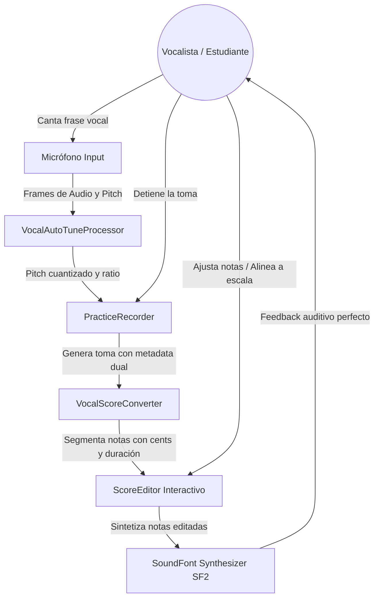
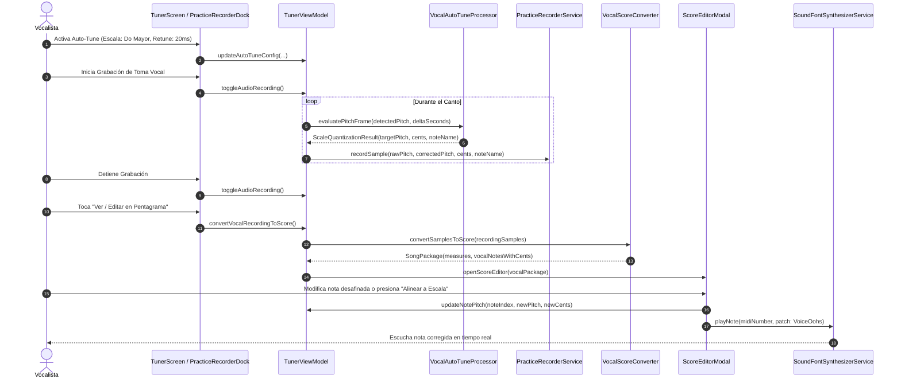

# Caso de Uso 60: Suite Vocal con Auto-Tune en Tiempo Real, Grabación Multitrack y Edición Microtonal en Pentagrama

## 1. Descripción
La Suite Vocal integra en un único flujo de trabajo asistido el procesamiento de corrección de tono en tiempo real (**Vocal Auto-Tune**), la captura de audio en la grabadora multipista (**Practice Recorder**), la visualización y edición microtonal en partitura interactiva (**Score Editor**) y la reproducción tímbrica de referencia (**SoundFont Synthesizer**). El vocalista graba su interpretación, visualiza las notas cantadas junto a sus desviaciones en cents sobre el pentagrama, corrige imperfecciones manualmente o mediante cuantización a escala con 1 tap, y reproduce la toma afinada con el timbre vocal o instrumental SoundFont.

---

## 2. Diagrama de Casos de Uso (Mermaid)

---

## 3. Diagrama de Secuencia (Mermaid)

---

## 4. Precondiciones, Flujo Principal y Alternativo

### Precondiciones
1. El micrófono está configurado y activo.
2. La escala musical y la tonalidad están configuradas en el Auto-Tune o en la partitura activa.

### Flujo Principal
1. El usuario activa la monitorización con Auto-Tune e inicia la grabación de una toma.
2. Cada muestra grabada almacena la frecuencia detectada, la frecuencia cuantizada por el Auto-Tune y el desvío en cents.
3. Al finalizar la grabación, el usuario selecciona "Ver / Editar en Pentagrama".
4. El sistema convierte la secuencia de muestras vocales en notas musicales articuladas en compases según el compás y tempo activos.
5. Cada nota muestra visualmente su altura y el error en cents original.
6. El usuario puede mover notas verticalmente, aplicar afinación a la escala o reproducir la toma con el sintetizador SoundFont.

### Flujos Alternativos y Excepciones
- **FA-1 (Toma sin sonido sonoro):** Si la grabación contiene únicamente ruido o silencio, el conversor emite un compás con silencio de redonda (`RestNote`) e informa al usuario.
- **FA-2 (Auto-Tune Desactivado):** Si el Auto-Tune estaba inactivo durante la grabación, las muestras registran la frecuencia bruta y el conversor calcula la cuantización en diferido a partir de la escala seleccionada en el editor.
