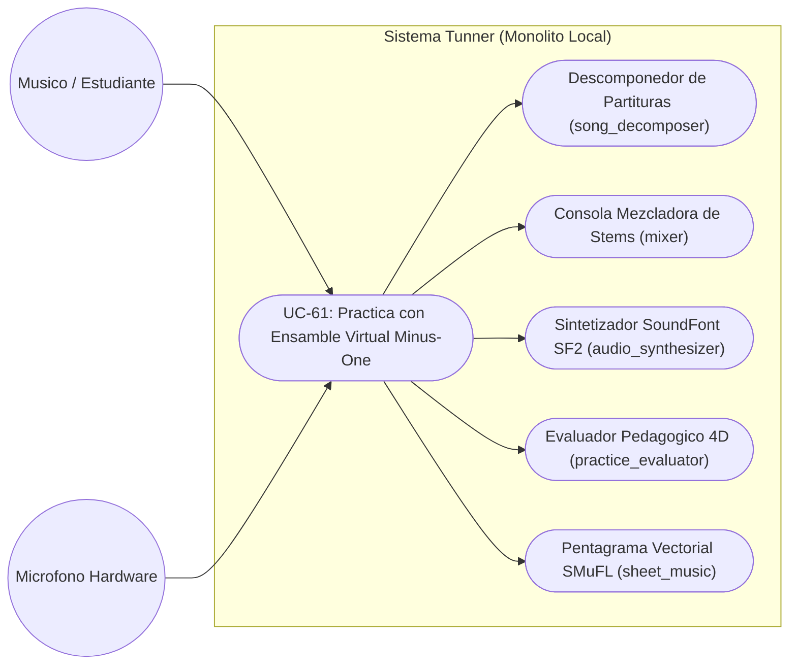
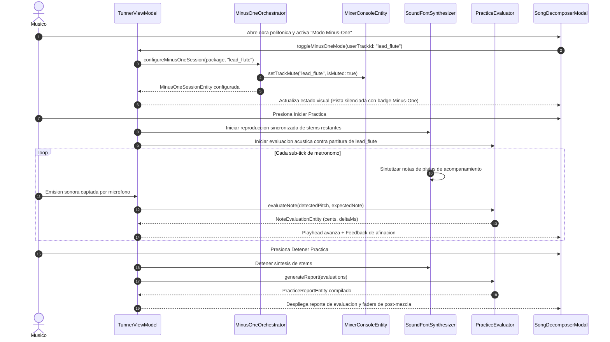

# Especificacion de Caso de Uso: Ensamble Virtual Minus-One y Descomposicion de Partituras

## Metadatos del Caso de Uso

- **ID del Caso de Uso:** `UC-61-SCORE-DECOMPOSER-MINUS-ONE-VIRTUAL-ENSEMBLE`
- **Nombre Canónico:** Descomponer partituras polifónicas, silenciar la pista de estudio en modo Minus-One y evaluar la interpretación en vivo con acompañamiento sintetizado
- **Fase Asociada:** Fase 2 (Suites Sinérgicas Multi-Herramienta)
- **Actor Principal:** Músico / Estudiante de Conservatorio
- **Actores Secundarios:** Micrófono (Captura PCM), Sintetizador SoundFont SF2, Mezclador de Stems, Evaluador Pedagógico 4D
- **Estado:** Approved

---

## 1. Descripcion Breve y Proposito

Permite al músico cargar una obra polifónica multitrack desde la biblioteca o importador, seleccionar la pista instrumental que desea estudiar, silenciarla automáticamente en la consola de mezcla (modo Minus-One) mientras el sintetizador ejecuta el acompañamiento de las voces restantes con sonido instrumental realista, captar la ejecución acústica en vivo con el micrófono y evaluar la entonación y el ritmo en tiempo real sobre la partitura de referencia.

---

## 2. Diagrama de Caso de Uso (Mermaid)

---

## 3. Precondiciones y Postcondiciones

### 3.1 Precondiciones
1. Existe al menos una obra polifónica cargada en el sistema con dos o más pistas (o una pista melódica y metrónomo).
2. El micrófono del dispositivo está habilitado y calibrado.
3. El motor de síntesis SoundFont SF2 se encuentra inicializado en memoria local.

### 3.2 Postcondiciones
1. La pista seleccionada por el estudiante queda silenciada en el mezclador (`isMuted: true`).
2. Los stems de acompañamiento se reproducen en sincronía con el playhead visual sobre el pentagrama.
3. Se genera un reporte pedagógico analítico con la precisión de cents, desviación de tiempo (rushing/dragging) y puntaje global.
4. El balance de la mezcla final (toma acústica del usuario + acompañamiento) queda disponible para escucha inmediata.

---

## 4. Diagrama de Flujo y Secuencia (Mermaid)

---

## 5. Flujo Principal de Ejecucion

1. El usuario navega al `SongDecomposerModal` desde el menú de canciones o el catálogo TTC.
2. Selecciona una obra de repertorio (ej: Invención a dos voces de Bach o ensamble camerístico).
3. El sistema identifica las pistas constitutivas (ej: Voz 1: Melodía, Voz 2: Acompañamiento, Metrónomo).
4. El usuario activa el interruptor "Modo Minus-One" y confirma su pista de instrumento.
5. El sistema silencia automáticamente dicha pista en la consola de mezcla (`isMuted: true`).
6. El usuario pulsa "Iniciar Práctica Minus-One".
7. El reloj de metrónomo arranca; las pistas de acompañamiento son sintetizadas en tiempo real mediante SoundFont SF2.
8. El usuario ejecuta su instrumento frente al micrófono.
9. El estimador MPM detecta la fundamental y el evaluador compara en tiempo real entonación ($\text{cents}$) y timing ($\text{ms}$).
10. El usuario finaliza la sesión; el sistema despliega el reporte de grado (S, A, B, C, D) y permite escuchar la mezcla con faders interactivos.

---

## 6. Flujos Alternativos y Excepciones

### 6.1 FA-01: El Usuario desea escuchar su voz atenuada como guía (Guide Track)
- En lugar de silenciar al $100\%$ la pista de referencia, el usuario ajusta el fader a volumen bajo (ej: $15\%$). El sistema marca el canal como pista guía y continúa evaluando la toma del micrófono.

### 6.2 FA-02: Instrumento Transpositor Activo
- Si el usuario tiene seleccionado un instrumento transpositor (ej. Trompeta en Si bemol), el orquestador Minus-One aplica el desplazamiento de semitonos correspondiente antes de enviar la nota esperada al motor de evaluación.

### 6.3 FE-01: Ruido Ambiental o Silencio Continuo
- Si el micrófono no detecta señal por encima de la puerta de ruido, el evaluador clasifica los compases como silencios del usuario sin interrumpir la reproducción del acompañamiento.
