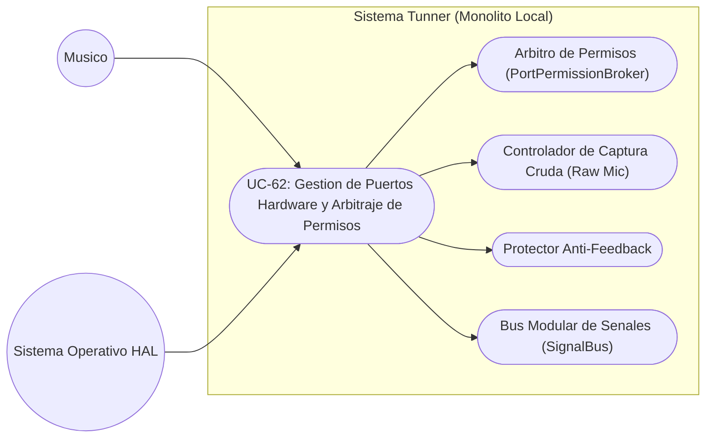
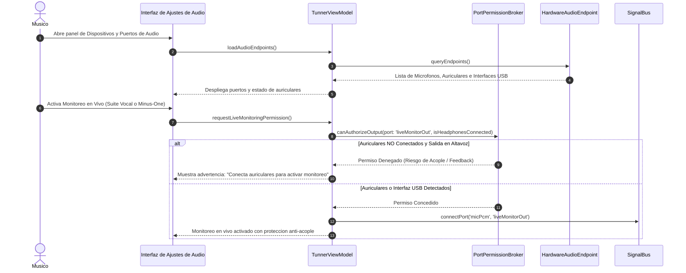

# Especificacion de Caso de Uso: Puertos de Hardware, Permisos y Arbitraje de Senales

## Metadatos del Caso de Uso

- **ID del Caso de Uso:** `UC-62-HARDWARE-IO-PORTS-AND-PERMISSION-BROKER`
- **Nombre Canónico:** Administrar permisos de puertos físicos de audio/MIDI, activar captura de micrófono sin procesar y arbitrar la emisión de señales para prevención de acoples
- **Fase Asociada:** Fase 2 (Infraestructura de Audio y Hardware)
- **Actor Principal:** Músico / Estudiante de Conservatorio
- **Actores Secundarios:** Sistema Operativo (Audio HAL), Controlador de Micrófono, Mezclador Maestro, PortPermissionBroker
- **Estado:** Approved

---

## 1. Descripcion Breve y Proposito

Permite a Tunner descubrir, configurar y gobernar los puertos de entrada y salida físicos del dispositivo (micrófonos integrados, interfaces de audio USB, salidas de auriculares, puertos MIDI), asegurando que la captura de audio se realice en modo crudo sin degradación de filtros telefónicos y que la reproducción en tiempo real esté protegida contra retroalimentación acústica destructiva (acoples).

---

## 2. Diagrama de Caso de Uso (Mermaid)

---

## 3. Precondiciones y Postcondiciones

### 3.1 Precondiciones
1. El usuario ha concedido el permiso de micrófono en el sistema operativo.
2. El motor de audio de Tunner se encuentra en estado inicializado.

### 3.2 Postcondiciones
1. El flujo de micrófono ingresa a Tunner en formato PCM crudo sin compresión ni ecualización telefónica.
2. Los puertos de emisión hacia altavoces integrados permanecen bloqueados para retornos de monitoreo en vivo salvo que se detecten auriculares.
3. El `PortPermissionBroker` mantiene la consistencia de permisos de lectura y escritura entre todos los módulos activos del rack.

---

## 4. Diagrama de Flujo y Secuencia (Mermaid)

---

## 5. Flujo Principal de Ejecucion

1. El sistema inicia la captura acústica solicitando al sistema operativo el modo no procesado (`AudioSource.UNPROCESSED`).
2. El controlador de hardware consulta los transductores de entrada y salida disponibles.
3. El `PortPermissionBroker` evalúa qué módulos del rack solicitan acceso a los puertos `audioPcm`, `pitchEvents` y `masterDacOut`.
4. El broker autoriza la lectura compartida del flujo de micrófono hacia el afinador MPM, el espectrograma y el grabador.
5. El usuario solicita activar una función de retorno sonoro en tiempo real.
6. El broker verifica la presencia de auriculares conectados.
7. Al verificarse una salida no acoplada, se habilita la emisión a través del mezclador maestro con limitador a $0\text{ dBFS}$.

---

## 6. Flujos Alternativos y Excepciones

### 6.1 FA-01: Desconexion en Caliente de Auriculares
- Si el usuario desconecta los auriculares durante una sesión de monitoreo en vivo o reproducción Minus-One, el `PortPermissionBroker` silencia de inmediato el canal de retorno para evitar un acople instantáneo.

### 6.2 FA-02: Calibracion de Ruido Ambiental
- Cuando el usuario ejecuta la calibración de piso de ruido en el laboratorio acústico, el broker conmuta a modo silencioso exclusivo, pausando la emisión de todos los demás módulos hasta concluir la medición.
