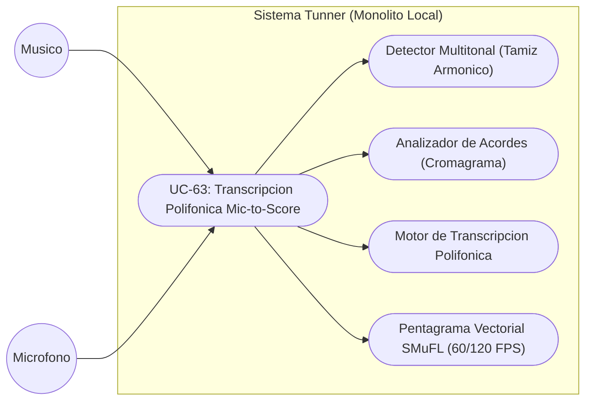
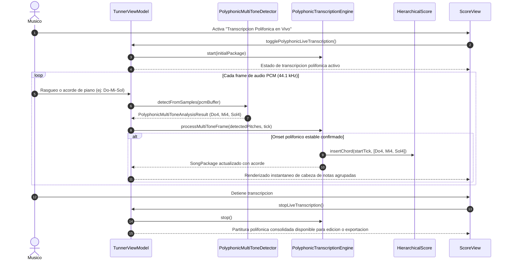

# Especificacion de Caso de Uso: Transcripcion Polifonica Mic-to-Score en Tiempo Real

## Metadatos del Caso de Uso

- **ID del Caso de Uso:** `UC-63-POLYPHONIC-MIC-TO-SCORE-TRANSCRIPTION`
- **Nombre Canónico:** Transcribir acordes y armonías polifónicas desde el micrófono directamente a la partitura vectorial SMuFL en tiempo real
- **Fase Asociada:** Fase 2 (Suites Sinérgicas Multi-Herramienta)
- **Actor Principal:** Músico (Guitarrista, Pianista o Arreglador)
- **Actores Secundarios:** Micrófono Hardware, Detector Multitonal, Cuantizador Rítmico, Lienzo SMuFL
- **Estado:** Approved

---

## 1. Descripcion Breve y Proposito

Permite a los músicos que interpretan instrumentos armónicos o polifónicos (guitarra clásica o eléctrica, piano, teclados, arpa o ensambles de cámara) tocar acordes y melodías polifónicas frente al micrófono y ver cómo el sistema separa espectralmente las notas simultáneas, las cuantiza a la cuadrícula temporal y las renderiza en tiempo real como acordes armónicos sobre el pentagrama vectorial.

---

## 2. Diagrama de Caso de Uso (Mermaid)

---

## 3. Precondiciones y Postcondiciones

### 3.1 Precondiciones
1. El micrófono está configurado en modo crudo (`AudioSource.UNPROCESSED`).
2. Se ha seleccionado un instrumento polifónico (guitarra, piano o teclado) o se ha activado el modo polifónico en el analizador.
3. El motor de partituras dispone de un paquete de canción inicializado para transcripción.

### 3.2 Postcondiciones
1. Las notas de los acordes detectados se plasman en el pentagrama compartiendo exactamente el mismo `startTick`.
2. Si el acorde coincide con una estructura tonal estándar (e.g. Do Mayor, Sol 7), se vincula el símbolo de acorde a la medida.
3. La medida del compás (`MeasureEntity`) mantiene su validez métrica íntegra.

---

## 4. Diagrama de Flujo y Secuencia (Mermaid)

---

## 5. Flujo Principal de Ejecucion

1. El usuario abre la vista de partitura o el editor y activa el interruptor "Transcripción Polifónica".
2. El sistema inicializa el `PolyphonicTranscriptionEngine` sobre un pentagrama en blanco o la partitura activa.
3. El músico ejecuta un acorde (ejemplo: acorde de Mi menor en guitarra acústica: Mi2, Si2, Mi3, Sol3, Si3, Mi4).
4. El `PolyphonicMultiToneDetector` descompone el espectro en armónicos fundamentales y extrae la lista de notas simultáneas.
5. El motor de transcripción polifónica verifica la estabilidad del onset durante 2 frames consecutivos.
6. El motor cuantiza la duración del acorde (semicorchea, corchea, negra, etc.) según el tiempo sostenido.
7. Las notas se insertan en la estructura del compás con el mismo `startTick`.
8. El lienzo vectorial SMuFL renderiza el acorde completo con plica unificada a 60/120 FPS.
9. Al finalizar, la obra puede ser editada con el patrón Memento (Deshacer/Rehacer) o exportada a MusicXML / MIDI.

---

## 6. Flujos Alternativos y Excepciones

### 6.1 FA-01: Arpegio Lento en lugar de Acorde en Bloque
- Si las notas del arpegio se tocan con un intervalo $> 40\text{ ms}$, el motor las cuantiza como notas individuales sucesivas en sub-ticks contiguos.

### 6.2 FA-02: Acorde con Nota de Paso Desafinada
- Si una de las notas presenta una desviación microtonal excesiva ($> 35\text{ cents}$), el motor asigna la alteración accidental más próxima (sostenido/bemol) preservando la armonía base.
