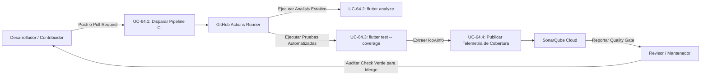
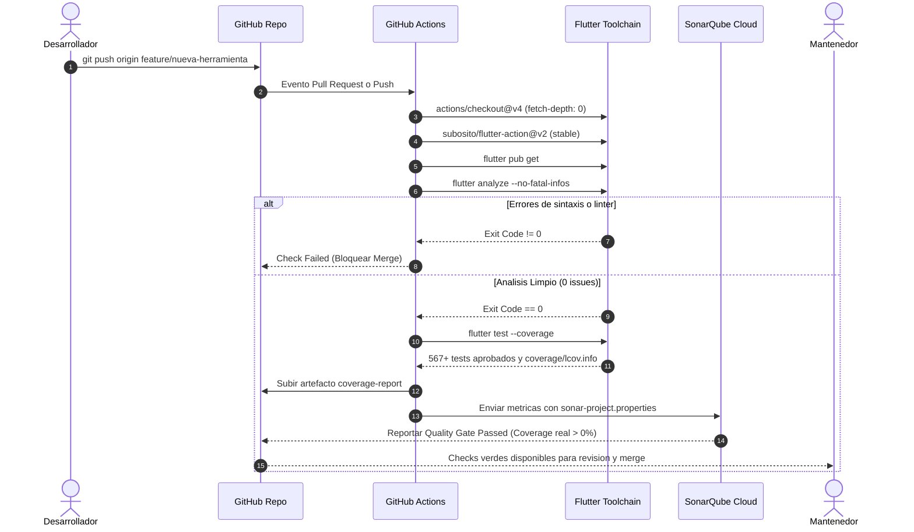

# Caso de Uso 64: Pipeline Automatizado de Integracion Continua y Evaluacion de Calidad en GitHub

## 1. Identificación y Metadatos

- **ID del Caso de Uso:** `UC-64`
- **Nombre:** Verificación Automatizada de Calidad de Código, Pruebas Unitarias y Cobertura mediante GitHub Actions
- **Fase del Proyecto:** Global / Infraestructura y Calidad
- **Prioridad:** Alta (Crítica para Integración en Equipo)
- **Actores Principales:** Desarrollador Contribuidor, Revisor de Código, Sistema GitHub Actions Runner, SonarQube Cloud
- **Documento de Arquitectura Relacionado:** [DOC-ARCH-2026-064](../01_product_vision/doc_ci_cd_github_actions_pipeline.md)

---

## 2. Diagrama de Caso de Uso

---

## 3. Diagrama de Flujo / Secuencia

---

## 4. Descripción del Escenario

### 4.1 Precondiciones
1. El repositorio en GitHub cuenta con las ramas base `main` y `develop`.
2. Las pruebas unitarias locales y el análisis estático se encuentran aprobados.
3. Se encuentra definido el archivo `.github/workflows/ci.yml`.

### 4.2 Flujo Principal (Camino Feliz)
1. El colaborador abre un Pull Request hacia `main`.
2. GitHub Actions detecta el evento y provisiona un runner `ubuntu-latest`.
3. El runner descarga el repositorio con su historial completo para auditoría de líneas y autoría.
4. Se inicializa el SDK de Flutter en canal `stable` utilizando caché.
5. Se descargan las dependencias del proyecto (`flutter pub get`).
6. Se evalúa el código con `flutter analyze`: no se detectan fallos ni advertencias.
7. Se ejecutan todas las pruebas con bandera `--coverage`, generando `coverage/lcov.info`.
8. Se publica el artefacto de cobertura y se envían los datos a SonarQube Cloud.
9. SonarQube Cloud y GitHub muestran todos los checks en estado verde.
10. El mantenedor aprueba y ejecuta el merge con total certeza de integridad.

### 4.3 Flujos Alternativos y de Error
- **FA-01: Fallo de Linter:** Si `flutter analyze` reporta advertencias o errores, el pipeline finaliza con código de error, impidiendo el merge y alertando al desarrollador en la vista del PR.
- **FA-02: Regresión en Pruebas:** Si cualquiera de las 567 pruebas falla, el runner se detiene y lista el stacktrace exacto del fallo en la pestaña de Actions.
- **FA-03: Token de SonarQube no disponible:** Si el secreto `SONAR_TOKEN` no está configurado (por ejemplo, en forks externos), el pipeline de Flutter aprueba de todas maneras la suite y la cobertura sin bloquear el PR de la comunidad.
