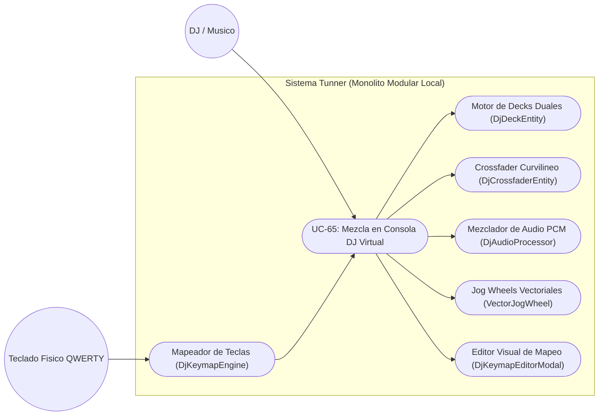
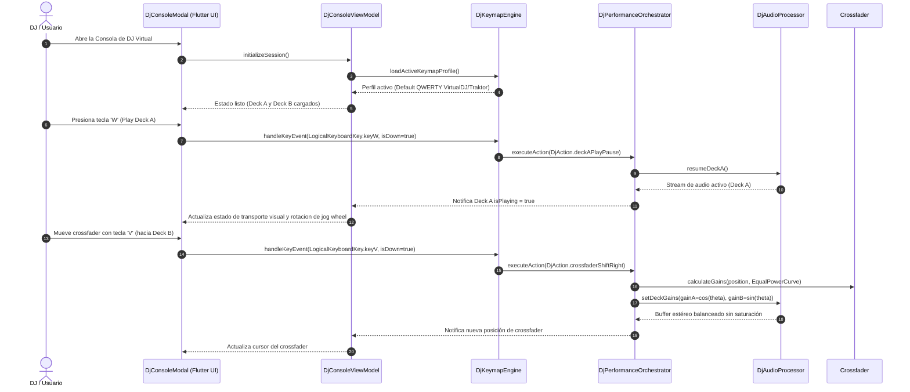

# Especificación de Caso de Uso: Consola de DJ Virtual con Mapeo Universal de Teclado QWERTY / MIDI

## Metadatos del Caso de Uso

- **ID del Caso de Uso:** `UC-65-VIRTUAL-DJ-CONSOLE-AND-KEYBOARD-MAPPING`
- **Nombre Canónico:** Ejecución de mezclas y transiciones DJ de doble deck mediante teclado físico QWERTY personalizado sin requerir hardware externo
- **Fase Asociada:** Fase 3 (Herramientas Creativas Avanzadas) & Fase 4 (Hardware & Periféricos)
- **Actor Principal:** DJ / Productor / Estudiante de Mezcla
- **Actores Secundarios:** Motor de Audio Estéreo (PCM Mixer), Teclado Físico del Sistema Operativo, Mapeador de Eventos QWERTY, Persistencia Local JSON
- **Estado:** Approved

---

## 1. Descripción Breve y Propósito

Permite al usuario operar una consola virtual de DJ de dos reproductores (Deck A y Deck B) equipada con controles profesionales de transporte (Play, Pause, Cue, Sync), modulación de pitch ($\pm 8\%, \pm 16\%, \pm 50\%$), ecualización de 3 bandas con aislamiento por corte total (-24 dB / Kill), crossfader con tres perfiles de transición acústica (Potencia Constante, Lineal y Fast Cut) y cuatro bancos de Hot Cues por deck, controlando la totalidad de los parámetros desde el teclado de su ordenador mediante atajos personalizables de latencia ultra baja sin depender de hardware físico dedicado.

---

## 2. Diagrama de Caso de Uso (Mermaid)

---

## 3. Diagrama de Secuencia Detallado (Mermaid)

---

## 4. Precondiciones y Postcondiciones

### 4.1 Precondiciones
1. El usuario tiene la aplicación Tunner en ejecución.
2. Existen pistas de audio o stems disponibles para cargar en los decks (o se proporcionan pistas de demostración sintéticas integradas).
3. El teclado del ordenador está habilitado y envía eventos de pulsación (`KeyEvent`).

### 4.2 Postcondiciones
1. La consola procesa y mezcla los streams de audio estéreo con latencia imperceptible ($\le 8\text{ ms}$).
2. Cualquier personalización en las asignaciones de teclado queda persistida localmente en formato JSON y se restaura automáticamente en sesiones futuras.
3. El audio resultante se emite por la salida de audio predeterminada del dispositivo con control estricto de pico dinámico para evitar clipping.

---

## 5. Flujo Principal de Ejecución (Paso a Paso)

1. El usuario abre la herramienta "Consola de DJ Virtual" desde el rack modular o el menú de herramientas.
2. La interfaz presenta Deck A a la izquierda, Deck B a la derecha, el módulo central con ecualizadores, ganancias de ganancia (Trim), potenciómetros de filtro y el crossfader horizontal inferior.
3. El usuario pulsa la tecla asignada a Play/Pause en Deck A (`W`), iniciando la reproducción.
4. El usuario ajusta el pitch de Deck A mediante las teclas de tempo nudge (`A` para desacelerar, `S` para acelerar).
5. El usuario pulsa la tecla de Hot Cue 1 (`1`) para marcar el punto de entrada de la pista en el tiempo deseado.
6. El usuario carga y pre-escucha Deck B, presiona la tecla de Sync (`O`) para alinear automáticamente el BPM de Deck B al BPM de Deck A.
7. El usuario inicia Deck B en el momento oportuno (`I`) y desplaza el crossfader hacia la derecha utilizando las teclas de mapeo (`V` o arrastre de ratón) con la curva de Potencia Constante seleccionada.
8. La mezcla se ejecuta fluidamente, combinando las frecuencias de ambos temas sin caída de volumen.

---

## 6. Flujos Alternativos y Excepciones

### 6.1 Flujo Alternativo 1: Personalización de Mapeo de Teclas
- El usuario hace clic en el botón "Configuración de Teclado" en la cabecera de la consola.
- Se despliega el `DjKeymapEditorModal`.
- El usuario selecciona una acción de la lista (ej. `Deck A Kill Low EQ`) y presiona la nueva tecla física deseada (ej. `Z`).
- El mapeador detecta la tecla, comprueba que no entre en colisión con otra acción (o alerta al usuario para sobreescribir) y guarda el nuevo perfil con nombre personalizado.

### 6.2 Flujo Alternativo 2: Conexión de Controlador MIDI Físico
- Si el usuario conecta un dispositivo MIDI USB, el sistema traduce los mensajes MIDI Control Change (CC) y Note On/Off a las mismas acciones canónicas de `DjAction`, permitiendo la coexistencia simultánea de teclado QWERTY y hardware MIDI.

### 6.3 Excepciones y Condiciones de Borde
- **Ausencia de archivo cargado:** Si el usuario pulsa Play o Hot Cue en un deck sin pista, la interfaz muestra un aviso visual sin interrumpir la reproducción del deck opuesto.
- **Cambio de foco de ventana:** Si la aplicación pierde el foco del sistema operativo, el mapeador ignora eventos espurios y mantiene la reproducción estable del audio sin colapsos.