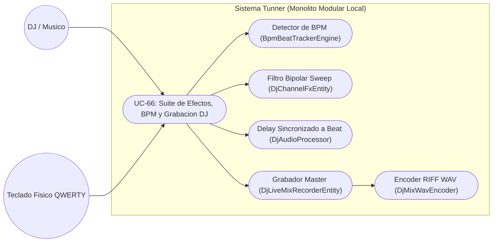
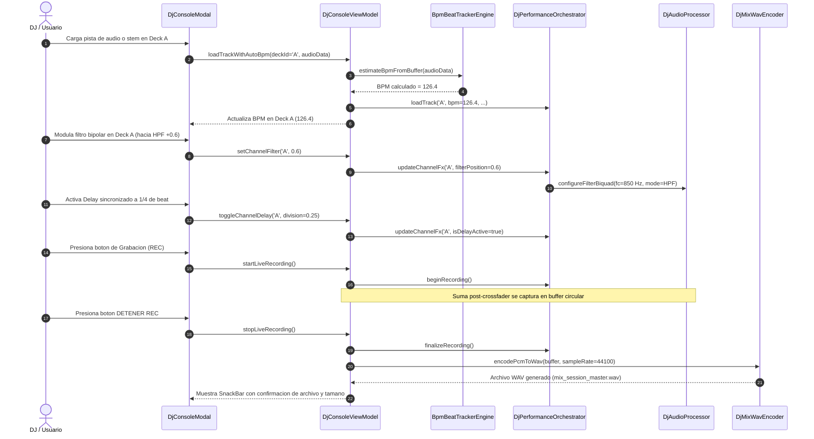

# Especificación de Caso de Uso: Suite de Efectos en Vivo, Detección Automática de BPM y Grabador Master de Mezcla DJ

## Metadatos del Caso de Uso

- **ID del Caso de Uso:** `UC-66-DJ-PERFORMANCE-FX-BEAT-TRACKING-AND-MIX-RECORDER`
- **Nombre Canónico:** Aplicación de filtros bipolares y retardos sincronizados, cálculo algorítmico de BPM y grabación de mezcla maestra en tiempo real
- **Fase Asociada:** Fase 3 (Herramientas Creativas Avanzadas) & Fase 4 (Estudio de Producción)
- **Actor Principal:** DJ / Productor Musical / Estudiante de Mezcla
- **Actores Secundarios:** Motor de Efectos DSP (`DjAudioProcessor`), Estimador de BPM (`BpmBeatTrackerEngine`), Codificador RIFF WAV (`DjMixWavEncoder`), Teclado QWERTY
- **Estado:** Approved

---

## 1. Descripción Breve y Propósito

Permite al usuario enriquecer su sesión de mezcla en la Consola DJ Virtual mediante el uso de filtros de barrido continuo (Low-Pass y High-Pass) en cada deck, unidades de retardo cuantizadas al compás musical ($1/2, 1/4, 1/8, 1/16$), detección automática del tempo (BPM) al importar pistas o stems de audio, y la grabación en tiempo real de la interpretación maestra para su exportación como archivo WAV de alta fidelidad sin saturación digital.

---

## 2. Diagrama de Caso de Uso (Mermaid)

---

## 3. Diagrama de Secuencia Detallado (Mermaid)

---

## 4. Precondiciones y Postcondiciones

### 4.1 Precondiciones
1. La aplicación Tunner se encuentra en ejecución y el usuario ha desplegado la Consola de DJ Virtual.
2. Existen pistas de audio, stems del sintetizador o demostraciones sintéticas disponibles para reproducir.

### 4.2 Postcondiciones
1. La señal procesada en cada deck aplica el filtrado bipolar y los ecos cuantizados sin producir discontinuidades de fase ni chasquidos (*pops/clicks*).
2. El tempo detectado de cada pista se refleja inmediatamente en el motor de sincronización (Sync).
3. La sesión de mezcla grabada se almacena en memoria o disco en formato WAV de 16 bits sin pérdida, respetando el límite dinámico de $0\text{ dBFS}$.

---

## 5. Flujo Principal de Ejecución (Paso a Paso)

1. El usuario abre la Consola de DJ Virtual y presiona el botón "Cargar Pista / Stem".
2. Selecciona un archivo o stem; el motor `BpmBeatTrackerEngine` calcula de inmediato el tempo y actualiza el BPM del deck.
3. El usuario inicia la reproducción con la tecla `W` o el botón Play.
4. Para realizar una transición hacia el Deck B, el usuario gira la perilla de Filtro del Deck A hacia la derecha ($+0.7$), activando el filtro paso-altos y retirando los graves.
5. El usuario enciende el efecto Delay sincronizado a $1/4$ en el Deck A para generar una cola rítmica espacial.
6. El usuario introduce el Deck B con el crossfader centrado.
7. Al iniciar la mezcla, el usuario presiona el botón "REC" en la cabecera de la consola; un cronómetro de grabación comienza a correr.
8. Una vez finalizada la transición, el usuario presiona "DETENER REC"; el codificador compila el archivo WAV maestro y notifica el éxito de la exportación.

---

## 6. Flujos Alternativos y Excepciones

### 6.1 Flujo Alternativo 1: Atajos de Teclado para Control de Efectos
- El usuario utiliza atajos físicos configurados:
  - `F`: Filtro a la izquierda (corte Low-Pass).
  - `G`: Filtro a la derecha (corte High-Pass).
  - `H`: Filtro al centro (Reset a Bypass).
  - `R`: Conmutar Grabación Maestro (REC On/Off).

### 6.2 Excepciones y Condiciones de Borde
- **Búfer de audio con señal demasiado corta para detección de BPM:** Si el archivo tiene una duración menor a 1 segundo, el detector recurre al tempo nominal estándar de 120.0 BPM como valor por defecto seguro.
- **Saturación en realimentación de Delay:** El factor de realimentación (*feedback*) se encuentra estrictamente limitado a $0.8$ para impedir oscilación incontrolada (*runaway feedback*).