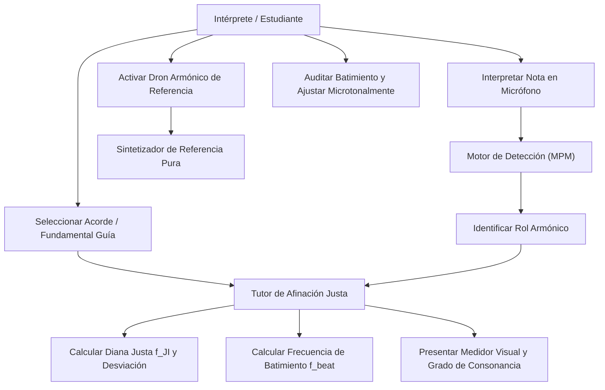
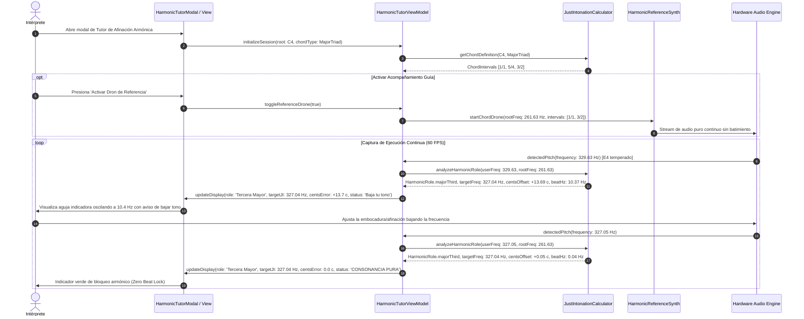

# Caso de Uso 67: Tutor de Entonación Armónica Adaptativa y Afinación Justa Dinámica

Documento canónico que formaliza el caso de uso y flujo de interacción del tutor de afinación armónica pura en **Tunner**.

---

## Metadatos del Caso de Uso

- **ID del Caso de Uso:** `UC-67`
- **Título:** Tutor de Afinación Justa Dinámica y Cancelación de Batimientos Acústicos
- **Fase Asociada:** Fase 2 (Suites Sinergéticas y Multitarea Profesional)
- **Actor Principal:** Intérprete / Estudiante de Canto o Instrumento de Afinación Continua (Cuerdas frotadas, Vientos)
- **Actores Secundarios:** Motor de Detección de Tono (MPM), Sintetizador de Drones Armónicos Puros
- **Documento de Visión Relacionado:** [DOC-ARCH-2026-067](../01_product_vision/doc_dynamic_just_intonation_tutor.md)
- **ADR Relacionado:** [ADR 0061](../04_adrs/0061_dynamic_just_intonation_and_harmonic_tuning_tutor.md)
- **Plan de Implementación:** [PLAN 65](../05_implementation_plans/65_plan_dynamic_just_intonation_tutor.md)

---

## 1. Diagrama de Casos de Uso (Mermaid)

---

## 2. Diagrama de Secuencia Detallado (Mermaid)

---

## 3. Precondiciones y Postcondiciones

### 3.1 Precondiciones
1. El motor de audio y micrófono se encuentra inicializado y con permisos concedidos en el sistema operativo.
2. La frecuencia base de concierto está calibrada (por defecto $A_4 = 440.0\text{ Hz}$).
3. Se ha seleccionado una fundamental de referencia (por defecto $C_4 = 261.63\text{ Hz}$) y una modalidad armónica (Tríada Mayor, Menor, Tríada Aumentada, Séptima Dominante o Cuarta Suspendida).

### 3.2 Postcondiciones
1. El usuario visualiza su desviación microtonal exacta respecto a la afinación justa y la tasa de batimiento acústico instantánea.
2. El sistema actualiza de forma determinista la métrica de consonancia y estabilidad armónica.
3. Al cerrar el tutor, cualquier oscilador de referencia activo se detiene liberando recursos sin ruidos espurios ni bloqueos de Isolate.

---

## 4. Flujo Principal y Flujos Alternativos

### 4.1 Flujo Principal (Happy Path)
1. El usuario abre el modal del Tutor de Afinación Justa desde el menú de herramientas o atajo de teclado.
2. Selecciona la fundamental del ensamble (ej. $C_4$) y la cualidad del acorde (ej. Tríada Mayor).
3. Activa opcionalmente el generador de tono de referencia armónico.
4. El usuario emite un tono vocal o instrumental continuo (ej. $E_4$).
5. El sistema detecta que el tono ejecutado corresponde a la Tercera Mayor ($5/4$).
6. Muestra la diana $327.04\text{ Hz}$ (frente a los $329.63\text{ Hz}$ de 12-TET) y una desviación inicial de $+13.7\text{ cents}$.
7. El usuario relaja el tono microtonalmente hasta situarse en $\pm 3.0\text{ cents}$ de la diana justa.
8. La interfaz visualiza el estado "Consonancia Pura (Lock)" y la tasa de batimiento desciende por debajo de $0.5\text{ Hz}$.

### 4.2 Flujos Alternativos y Casos de Borde
- **FA-01: La nota ejecutada no pertenece al acorde activo:** El sistema indica el intervalo cromático exacto respecto a la fundamental (ej. Segunda Menor Justa $16/15$ o Tritono $7/5$) y calcula la diana pura de dicho intervalo para entrenamiento modal.
- **FA-02: Señal de audio débil o por debajo del umbral de ruido:** El tutor silencia las agujas de batimiento y entra en modo de espera pasiva sin recalcular de forma espuria.
- **FA-03: Salto de octava:** Si el usuario canta o ejecuta una octava arriba ($E_5$) o abajo ($E_3$), el motor normaliza matemáticamente la comparación conservando el rol armónico y escalando la diana a la octava correcta ($2^k$).
