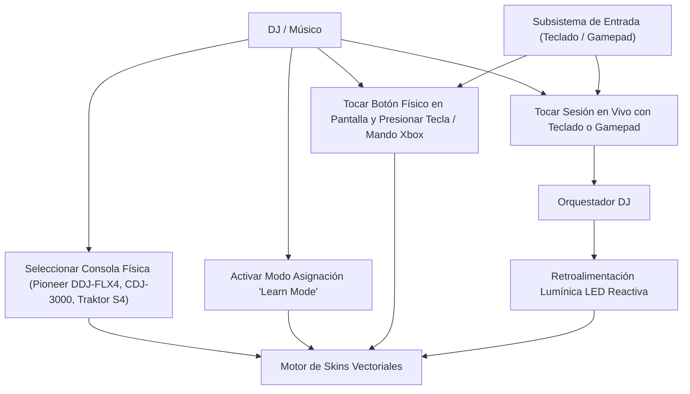
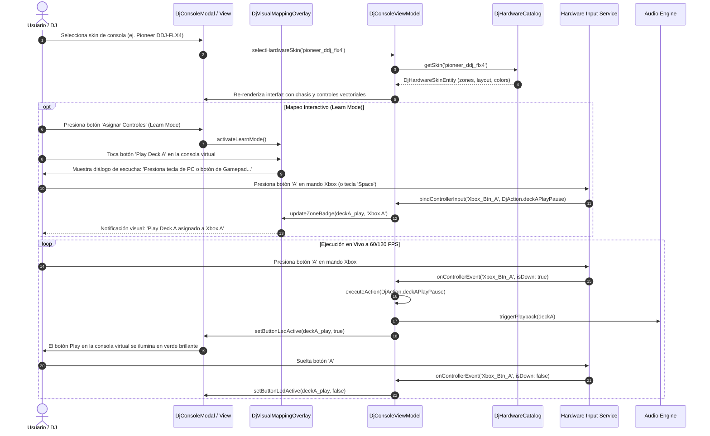

# Caso de Uso 68: Emulador Visual de Consolas DJ Reales y Mapeo Universal de Gamepad / Teclado

Documento canónico que define el caso de uso y el flujo de interacción para la visualización de consolas de hardware industrial y asignación universal de mandos de juego y teclado en **Tunner**.

---

## Metadatos del Caso de Uso

- **ID del Caso de Uso:** `UC-68`
- **Título:** Emulador de Consolas Físicas Reales y Mapeo Universal de Controles (Teclado PC & Mandos Xbox / PlayStation)
- **Fase Asociada:** Fase 3 (Herramientas Creativas Avanzadas) & Fase 4 (Estudio de Producción)
- **Actor Principal:** DJ / Productor Musical / Estudiante sin equipamiento físico
- **Actores Secundarios:** Subsistema de Hardware Input (HardwareKeyboard, Gamepad Events), Motor de Renderizado Vectorial 60 FPS
- **Documento de Visión Relacionado:** [DOC-ARCH-2026-068](../01_product_vision/doc_dj_hardware_skins_and_gamepad_mapping.md)
- **ADR Relacionado:** [ADR 0062](../04_adrs/0062_dj_hardware_skins_and_universal_gamepad_mapping.md)
- **Plan de Implementación:** [PLAN 66](../05_implementation_plans/66_plan_dj_hardware_skins_and_gamepad_mapping.md)

---

## 1. Diagrama de Casos de Uso (Mermaid)

---

## 2. Diagrama de Secuencia Detallado (Mermaid)

---

## 3. Precondiciones y Postcondiciones

### 3.1 Precondiciones
1. La Consola DJ Virtual está abierta en pantalla.
2. Los periféricos de entrada (teclado de computadora y/o control de videojuegos USB/Bluetooth) están conectados y reconocidos por el sistema operativo.
3. Se ha seleccionado un skin de consola física de la biblioteca.

### 3.2 Postcondiciones
1. Cada zona interactiva de la consola virtual responde de forma acústica y visual al periférico asignado.
2. Las asignaciones de teclas y botones de gamepad se persisten atómicamente en almacenamiento local (`.json`).
3. La interfaz vectorial se adapta con precisión geométrica a la relación de aspecto de la pantalla sin deformaciones.

---

## 4. Flujo Principal y Flujos Alternativos

### 4.1 Flujo Principal (Happy Path)
1. El usuario abre la Consola DJ Virtual y selecciona la consola **Pioneer DDJ-FLX4**.
2. La interfaz se transforma en el chasis físico de dos canales con jog wheels vectoriales y 8 performance pads por deck.
3. El usuario conecta un mando de Xbox o utiliza el teclado de su computadora con el preset ergonómico predeterminado.
4. Al presionar `Key W` o `Xbox Botón A`, el botón Play del Deck A se ilumina físicamente en pantalla y la pista comienza a reproducirse con latencia $< 8\text{ ms}$.
5. Al mover el gatillo analógico derecho (`RT`), el filtro bipolar de Deck A se desplaza suavemente eliminando frecuencias graves (modo HPF) o agudas (modo LPF).
6. Al presionar los botones `A`, `B`, `X`, `Y` o los números `1..4`, los Hot Cues saltan a las posiciones temporales marcadas.

### 4.2 Flujos Alternativos
- **FA-01: Reasignación personalizada en vivo (Learn Mode):**  
  El usuario hace clic en el botón físico de la consola virtual, presiona la tecla o botón deseado y la asignación se actualiza al instante con badge visible.
- **FA-02: Cambio de skin de consola:**  
  El usuario cambia de **Pioneer DDJ-FLX4** a **Pioneer CDJ-3000 Club Standard** o **Traktor Kontrol S4 MK3**. Las asignaciones funcionales se mantienen intactas adaptándose a la nueva disposición física de controles.
- **FA-03: Restablecimiento de fábrica:**  
  El usuario puede presionar "Restablecer Preset de Fábrica" para volver al mapa óptimo predeterminado recomendado por Tunner.
