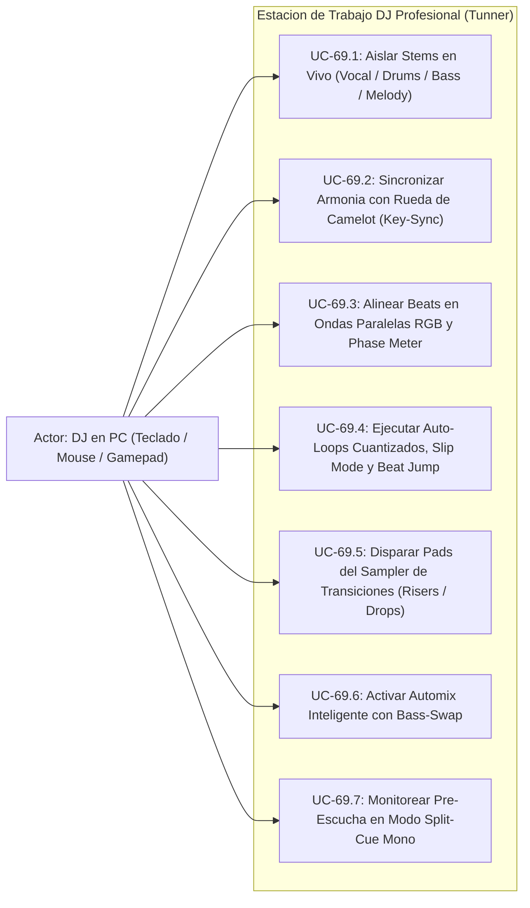
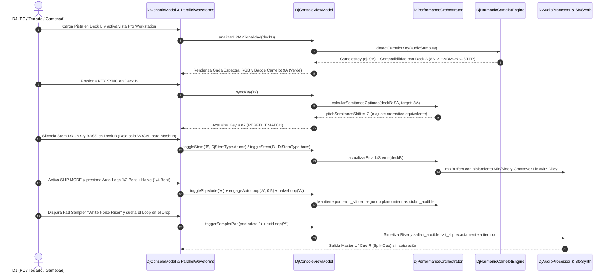

# Caso de Uso UC-69: Estación de Trabajo DJ Profesional Autónoma en PC (4-Stems, Mezcla Armónica Camelot, Ondas Paralelas RGB, Auto-Loops, Sampler y Split-Cue)

---

## 1. Identificación del Caso de Uso

- **ID:** `UC-69`
- **Nombre:** `Ejecución de Sesión Profesional de DJ en PC sin Hardware Externo (Standalone Pro DJ Workstation)`
- **Actores Principales:** `DJ / Productor Musical / Estudiante de Mezcla en PC`
- **Actores Secundarios:** `DjPerformanceOrchestrator`, `DjAudioProcessor`, `DjHarmonicCamelotEngine`, `DjTransitionSfxSynthesizer`, `DjGamepadInputService`
- **Fase:** `Fase 2`
- **Prioridad:** `Crítica (Core Differentiator)`
- **Documento Técnico Relacionado:** `[DOC-DJ-2026-069](../01_product_vision/doc_standalone_pro_dj_workstation_architecture.md)`

---

## 2. Diagrama de Casos de Uso (Mermaid)

---

## 3. Diagrama de Flujo y Secuencia (Mermaid)

---

## 4. Especificación de Condiciones y Flujos

### 4.1 Precondiciones
1. El módulo `DjConsoleModal` está inicializado en memoria local sin requerir conexión a internet.
2. El motor `DjPerformanceOrchestrator` dispone de al menos dos canales virtuales (`Deck A` y `Deck B`) y el banco de `Sampler` de 8 pads.

### 4.2 Postcondiciones
1. Las transformaciones de *Stems*, *Key-Shift*, *Auto-Loop*, *Slip Mode*, *Sampler* y *Automix* se reflejan instantáneamente tanto en el flujo de audio mezclado (y en la grabación WAV en vivo) como en el renderizador de ondas paralelas RGB y en los LEDs del skin de hardware.
2. Ninguna operación bloquea el hilo de interfaz gráfica (manteniendo $60/120\text{ FPS}$).

### 4.3 Flujo Principal (Escenario de Éxito Completo)
1. **Inspección Visual Espectral y Armónica:** El DJ observa en la parte superior del modal el **Visualizador de Ondas Espectrales Paralelas RGB**, donde el `Deck A` reproduce una pista a $124.0\text{ BPM}$ en tonalidad `8A` ($A\text{ minor}$) y el `Deck B` tiene preparada una pista a $128.0\text{ BPM}$ en `9A` ($E\text{ minor}$).
2. **Pre-Escucha en PC (*Split-Cue*):** El DJ activa el botón `PFL CUE` en el `Deck B` y habilita `SPLIT-CUE` para escuchar el `Deck B` por el canal derecho (audífonos) mientras el `Deck A` suena limpio por el canal izquierdo (altavoz principal).
3. **Sincronización de Tempo y Armonía:** El DJ presiona `SYNC` y `KEY SYNC` en el `Deck B`. El sistema iguala el tempo a $124.0\text{ BPM}$ con *Key-Lock* activo y alinea la clave armónica con el `Deck A`, mostrando el indicador `PERFECT HARMONIC MATCH`.
4. **Mezcla Creativa por Stems (Mashup en Vivo):** El DJ desactiva los botones de stem `DRUMS` y `BASS` en el `Deck B`, dejando únicamente activo el stem `VOCAL`. Mueve el crossfader al centro: la voz del `Deck B` flota limpiamente sobre la base instrumental del `Deck A`.
5. **Build-up con Auto-Loop, Slip Mode y Sampler:** El DJ activa `SLIP`, engancha un bucle cuantizado de `1 Beat` en el `Deck A`, lo reduce a `1/2` y `1/4` de beat usando el botón `1/2x`, y dispara el pad `RISER` del Sampler.
6. **Resolución en el Drop:** Al terminar la subida, el DJ desactiva el bucle y activa el stem `BASS` y `DRUMS` del `Deck B` mientras dispara el pad `SUB DROP`. Gracias al `Slip Mode`, la canción retoma exactamente en el primer tiempo del compás del drop.

### 4.4 Flujos Alternativos y de Error
- **FA-01 (Transición Asistida por Automix con Bass-Swap):** Si el DJ presiona el botón `AUTOMIX (A -> B)`, el motor inicia una transición temporizada; al llegar al $50\%$ del recorrido del crossfader, intercambia suavemente la ganancia de bajos (`gainLow`) entre `Deck A` y `Deck B` para evitar sobrepeso de sub-graves.
- **FA-02 (Interrupción Manual del Automix):** Si durante el *Automix* el usuario arrastra manualmente el crossfader o presiona una tecla de corte rápido, el motor desactiva el piloto automático de forma transparente.
- **FE-01 (Límite de División de Bucle):** Si el DJ intenta dividir un bucle más allá de $1/32$ de beat, el sistema mantiene el piso en $1/32$ e ignora divisiones adicionales para prevenir artefactos acústicos.
