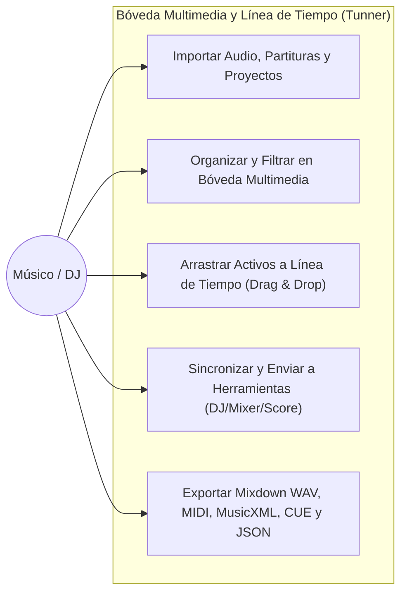
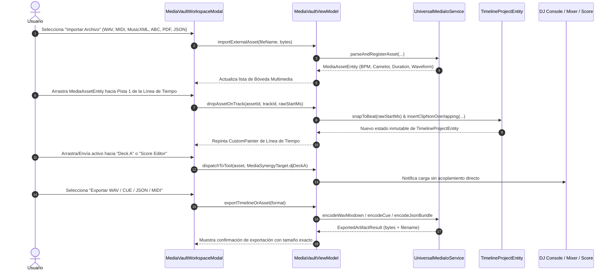

# Caso de Uso 70: Bóveda Multimedia, Línea de Tiempo Drag & Drop e Importación/Exportación Universal

## 1. Información General
- **ID:** `UC-70`
- **Actor Principal:** Músico / Productor / DJ
- **Actores Secundarios:** Motores internos de Tunner (`DJ Console`, `Universal Importer`, `Song Library`, `Mixer`, `Practice Recorder`)
- **Prioridad:** Alta
- **Documento Técnico Asociado:** [DOC-MEDIA-2026-070](../01_product_vision/doc_multimedia_vault_and_universal_io_sync.md)

---

## 2. Diagrama de Casos de Uso

---

## 3. Diagrama de Secuencia / Flujo Detallado

---

## 4. Precondiciones
- La aplicación Tunner se encuentra inicializada en modo offline.
- El usuario abre la ventana **Media Vault & Timeline** desde la barra superior de la aplicación o desde la Consola DJ.

## 5. Flujo Principal
1. El usuario importa uno o varios archivos locales (`WAV`, `MIDI`, `MusicXML`, `MXL`, `ABC`, `PDF` o `.tunner.json`) o explora los activos generados por otras herramientas.
2. El sistema analiza automáticamente el tipo de activo, calcula duración/BPM/tonalidad cuando aplica y lo almacena en la **Bóveda Multimedia**.
3. El usuario filtra por categoría (`Audio`, `Stems`, `Partituras`, `MIDI`, `Grabaciones`, `Presets DJ`) o compatibilidad armónica.
4. El usuario arrastra un activo desde la Bóveda hacia cualquier pista de la **Línea de Tiempo Multi-Pista** (`Drag & Drop`).
5. Si `Snap to Beatgrid` está activo, el clip se cuantiza automáticamente al beat más cercano sin solaparse destructivamente con otros clips.
6. El usuario puede previsualizar la línea de tiempo con el playhead animado, mover clips, silenciar/aislar pistas (`Mute`/`Solo`) o arrastrar un activo hacia las zonas rápidas de herramientas (`Deck A`, `Deck B`, `Sampler`, `Mixer`, `Score Editor`).
7. Finalmente, el usuario exporta el resultado como mezcla `.wav` PCM, hoja de marcas `.cue`, paquete `.tunner.json` o partitura/secuencia (`MIDI`, `MusicXML`, `ABC`, `PDF`).

## 6. Flujos Alternativos y de Error
- **A1 (Formato no soportado o archivo dañado):** `UniversalMediaIoService` retorna un error controlado; la UI muestra un aviso claro sin alterar los clips ni la bóveda existente.
- **A2 (Exportación de línea de tiempo vacía):** Si no hay clips cargados al solicitar un mixdown WAV/CUE, el sistema informa al usuario que debe arrastrar al menos un clip primero.
- **A3 (Colisión al soltar clip):** El motor de dominio desplaza automáticamente el inicio del nuevo clip al final del clip ocupado más cercano en esa pista.

## 7. Postcondiciones
- Todos los activos quedan indexados en memoria/almacenamiento local con trazabilidad de metadatos.
- Los archivos exportados cumplen estrictamente con sus especificaciones estándar (RIFF/WAV, SMF MIDI, MusicXML, CUE, JSON).
