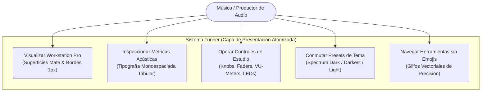
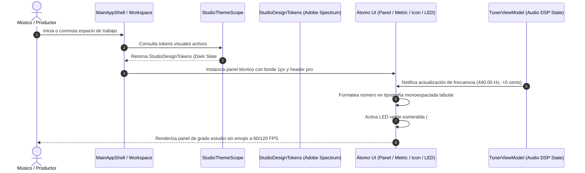

# Caso de Uso 71: Sistema de Diseño Atomizado de Estudio y Transformación Pro-Workstation

## 1. Identificación y Metadatos

- **ID del Caso de Uso:** `UC-071`
- **Nombre:** `Interacción con el Sistema de Diseño Atomizado y Estación de Trabajo Pro-Studio`
- **Actores:** Músico Profesional, Ingeniero de Sonido, Estudiante de Conservatorio.
- **Módulo Asociado:** `lib/core/design_system/`, `lib/features/navigation/`, `lib/features/modular_rack/`.
- **Precondiciones:** La aplicación inicia o el usuario navega a través de los workspaces de Tunner.
- **Postcondiciones:** Toda la interfaz renderiza componentes atómicos de precisión con estética Adobe Spectrum (superficies mate, bordes hairline de 1px, cero emojis, métricas monoespaciadas y controles de nivel industrial).

---

## 2. Diagrama de Casos de Uso (Mermaid)

---

## 3. Diagrama de Secuencia y Flujo de Renderizado (Mermaid)

---

## 4. Flujo Principal (Basic Flow)

1. El usuario interactúa con la aplicación en cualquiera de sus modos (Afinador, Rack Modular, Consola DJ, Bóveda Multimedia).
2. El sistema resuelve el árbol de temas a través de `StudioThemeScope` sin realizar lecturas repetitivas ni recalcular estilos en tiempo de ejecución.
3. Los paneles se dibujan utilizando `StudioPanel`, con fondos mates escalonados (`#141414` a `#2D2D30`) y bordes hairline de `1.0 px`.
4. Cada icono de instrumento o herramienta se representa mediante `StudioIcon`, utilizando glifos vectoriales lineales de 16-18px con semántica unificada.
5. Las lecturas en vivo (Hz, cents, BPM, dB) se procesan con `StudioMetricDisplay`, asegurando que el cambio continuo de valores no genere desbordamientos (*text reflow*) ni saltos en el diseño.
6. El usuario percibe una interfaz limpia, sobria, sin distracciones visuales ni saturación de elementos.

---

## 5. Flujos Alternativos y Casos Borde

### 5.1 Conmutación Dinámica de Preset Visual (Dark a Light o Darkest)
- **Condición:** El usuario cambia de entorno de iluminación (estudio oscuro a exterior con luz diurna).
- **Acción:** `StudioThemeController.setPreset(StudioDesignTokens.adobeSpectrumLight)`.
- **Resultado:** Todos los átomos se redibujan de forma inmediata con contraste de luz diurna, sin que los procesos de captura de audio o síntesis se detengan.

### 5.2 Instrumento o Módulo sin Glifo Específico
- **Condición:** Se carga un instrumento experimental o microtonal no contemplado en el catálogo canónico.
- **Acción:** `StudioIcon` aplica el glifo genérico de audio acústico (`StudioGlyphType.genericAudioTool`) garantizando coherencia visual y evitando que aparezcan emojis o iconos rotos.
