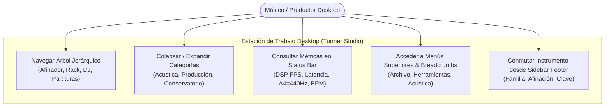
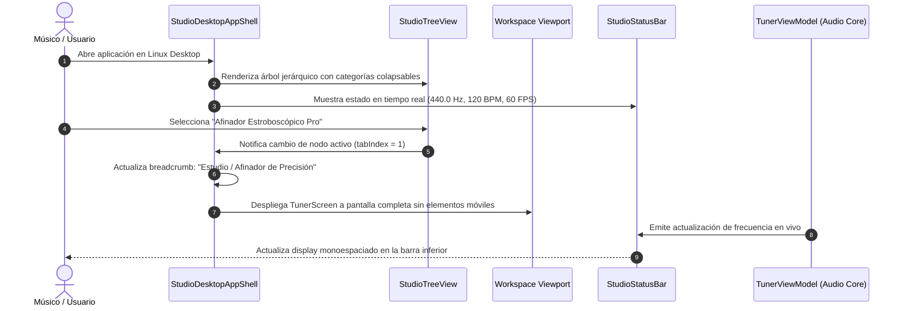

# Caso de Uso 72: Navegación Jerárquica en Estación de Trabajo Desktop (IDE / Studio Style)

## 1. Identificación y Metadatos

- **ID del Caso de Uso:** `UC-072`
- **Nombre:** `Navegación y Operación en Estación de Trabajo de Escritorio con Árbol Jerárquico`
- **Actores:** Músico Profesional, Ingeniero de Sonido, Productor de Audio.
- **Módulo Asociado:** `lib/core/design_system/organisms/studio_desktop_app_shell.dart`, `lib/features/navigation/presentation/main_app_shell.dart`.
- **Precondiciones:** La aplicación Tunner se ejecuta en un entorno de escritorio con pantalla completa o ventana maximizada.
- **Postcondiciones:** El usuario opera la suite a través de una barra lateral izquierda con árbol jerárquico de navegación (estilo Antigravity / IDE), barra de menú superior unificada con breadcrumbs y barra de estado inferior continua.

---

## 2. Diagrama de Casos de Uso (Mermaid)

---

## 3. Diagrama de Secuencia (Mermaid)

---

## 4. Flujo Principal

1. La aplicación detecta un ancho de pantalla de escritorio ($\ge 800\text{ px}$) o entorno desktop y monta `StudioDesktopAppShell`.
2. A la izquierda se presenta la **Barra Lateral Jerárquica** dividida en secciones claras:
   - **General:** Inicio / Dashboard, Buscador Global (`Cmd+K`).
   - **Acústica & Afinación:** Afinador Estroboscópico, Espectrograma FFT, Calibración de Micrófono.
   - **Conservatorio & Práctica:** Tutor Interactivo, Entrenador Auditivo a Ciegas, Analizador de Acordes.
   - **Estudio & Producción:** Rack Modular Multitarea, Consola DJ Profesional, Bóveda Multimedia & Timeline.
   - **Composición & Partituras:** Pentagrama en Vivo, Transcripción Mic-to-Score, Biblioteca de Repertorio.
3. El usuario hace clic en cualquier nodo del árbol; el nodo se resalta con un fondo sutil tipo píldora activa y el viewport central conmuta al módulo seleccionado al instante.
4. En el pie de la barra lateral, una tarjeta técnica compacta muestra el instrumento activo con acceso directo para cambiarlo.
5. La barra de estado inferior provee telemetría continua del motor DSP.

---

## 5. Flujos Alternativos

### 5.1 Colapso / Ocultamiento de la Barra Lateral
- **Condición:** El usuario desea maximizar el área de trabajo del pentagrama o la consola DJ.
- **Acción:** Presionar el botón de colapso de sidebar o atajo `Cmd+B`.
- **Resultado:** La barra lateral se contrae a una tira de iconos compactos (48 px) o se oculta, otorgando el 100% del ancho al área de trabajo.
