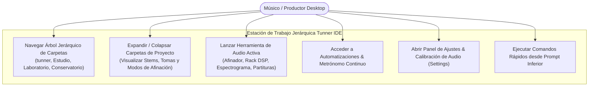
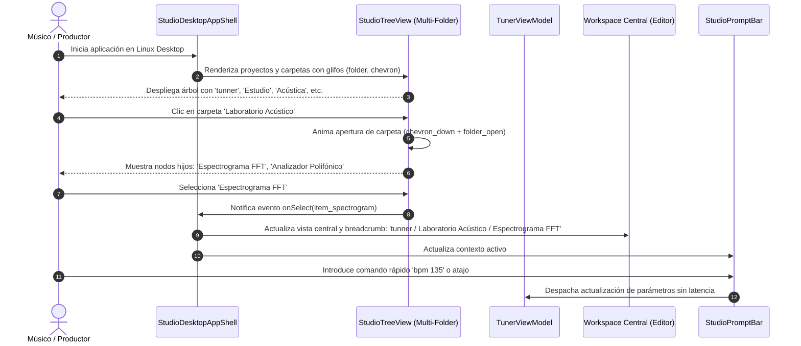

# Caso de Uso 73: Espacio de Trabajo Jerárquico Desktop Estilo Antigravity / Adobe Audition

## 1. Identificación y Metadatos

- **ID del Caso de Uso:** `UC-073`
- **Nombre:** `Operación y Navegación Jerárquica de Proyectos y Módulos de Audio en Entorno de Escritorio Profesional`
- **Actores:** Músico Profesional, Diseñador de Sonido, Docente de Conservatorio.
- **Módulo Asociado:** `lib/core/design_system/organisms/studio_desktop_app_shell.dart`, `lib/core/design_system/molecules/studio_tree_view.dart`, `lib/features/navigation/presentation/main_app_shell.dart`.
- **Precondiciones:** La aplicación se ejecuta en una resolución de pantalla de escritorio (`>= 720px`).
- **Postcondiciones:** La interfaz presenta un sidebar de carpetas y proyectos jerárquicos multinivel idéntico a Antigravity IDE, con selector de ajustes, breadcrumbs interactivos y barra de comandos acústicos.

---

## 2. Diagrama de Casos de Uso (Mermaid)

---

## 3. Diagrama de Flujo y Secuencia (Mermaid)

---

## 4. Descripción del Flujo de Interacción

### 4.1 Flujo Principal (Navegación Jerárquica)
1. El usuario visualiza la barra lateral izquierda organizada por niveles:
   - **Nivel Superior de Utilidades:** Enlaces a `Automatizaciones` y `Personalizaciones / Plugins DSP`.
   - **Cabecera de Proyectos:** Etiqueta `Projects` con botones de filtrado y creación de nuevas sesiones.
   - **Árbol de Proyectos:** Carpetas temáticas expandibles que contienen sesiones y submódulos de audio.
2. Al hacer clic sobre cualquier carpeta (ej. `tunner`, `Estudio & Grabación`, `Laboratorio Acústico`), esta se abre mostrando sus módulos hijos con sangría elegante y glifos técnicos.
3. El elemento activo se destaca con un contenedor de fondo pulido, dot indicador de actividad y badge de estado.
4. El área central actualiza instantáneamente el breadcrumb superior y el canvas de trabajo correspondiente.
5. En la parte inferior de la barra lateral, el usuario cuenta con el acceso a `Ajustes` (`Settings`) y el control rápido del instrumento seleccionado.

### 4.2 Flujos Alternativos y Excepciones
- **A1: Búsqueda o Filtrado Rápido:** El usuario presiona `Ctrl+K` o el icono de búsqueda en la barra superior para saltar directamente a cualquier herramienta sin desplegar manualmente las carpetas.
- **A2: Pantalla Reducida:** Si el usuario redimensiona la ventana a un ancho inferior a 720 px, la interfaz se adapta fluidamente a la vista compacta sin perder el estado de la sesión activa.
