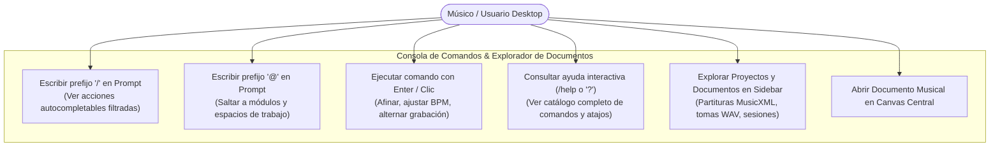
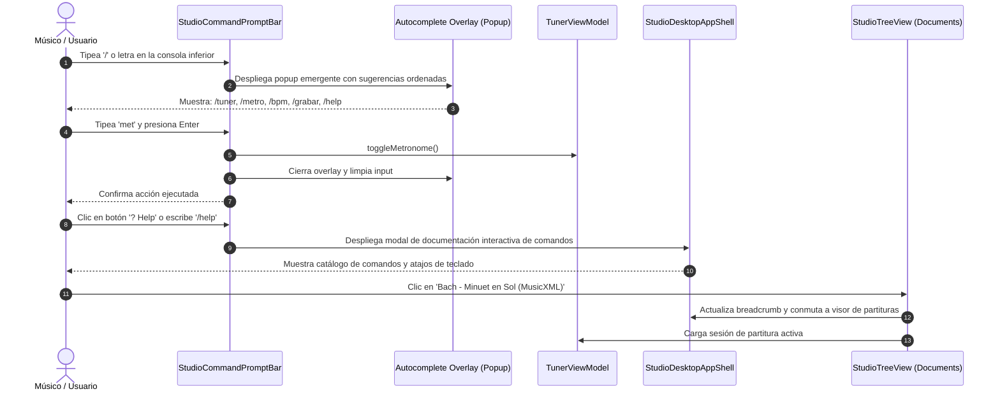

# Caso de Uso 74: Autocompletado Interactivo de Comandos y Gestión de Documentos en Árbol de Proyectos

## 1. Identificación y Metadatos

- **ID del Caso de Uso:** `UC-074`
- **Nombre:** `Ejecución de Acciones por Autocompletado de Comandos (/ y @) y Navegación de Documentos y Proyectos Musicales`
- **Actores:** Músico Profesional, Docente de Música, Productor Musical.
- **Módulo Asociado:** `lib/core/design_system/molecules/studio_command_prompt_bar.dart`, `lib/core/design_system/organisms/studio_desktop_app_shell.dart`, `lib/features/navigation/presentation/main_app_shell.dart`.
- **Precondiciones:** La estación de trabajo de escritorio está abierta y el motor de audio está inicializado.
- **Postcondiciones:** El usuario puede tipear `/` o `@` en la consola para ver sugerencias interactivas autocompletables, ejecutar acciones con Enter/clic, abrir la ayuda completa con `/help` o `?`, y navegar proyectos, tomas y partituras completas en el árbol lateral.

---

## 2. Diagrama de Casos de Uso (Mermaid)

---

## 3. Diagrama de Flujo y Secuencia (Mermaid)

---

## 4. Matriz de Comandos del Sistema

| Comando | Disparador | Acción Ejecutada | Atajo Directo |
| :--- | :--- | :--- | :--- |
| `/afinar` o `/tuner` | `/` | Abre Afinador Estroboscópico de Precisión (±0.1c) | `A` o `2` |
| `/metro` | `/` | Alterna metrónomo acústico (Start / Stop) | `Espacio` o `M` |
| `/bpm <valor>` | `/` | Establece el tempo exacto (ej. `/bpm 120`) | `[` / `]` |
| `/calibrar <hz>` | `/` | Ajusta tono de referencia A4 (ej. `/calibrar 442`) | `Alt+↑` / `Alt+↓` |
| `/grabar` o `/rec` | `/` | Alterna grabación de práctica WAV | `R` |
| `/espectrograma` | `/` | Abre Espectrograma FFT en tiempo real | N/A |
| `/dron` | `/` | Abre Dron Armónico y afinación por temperamentos | N/A |
| `/acordes` | `/` | Abre Analizador Polifónico de Acordes | `Shift+C` |
| `/oido` | `/` | Abre Entrenador Auditivo a Ciegas | `Shift+E` |
| `/partituras` | `/` | Abre Biblioteca y Visor MusicXML | `S` o `5` |
| `/rack` | `/` | Abre Rack Modular de Estudio y Pedales DSP | `4` |
| `/instrumento` | `/` | Abre selector de instrumento y transposición | `Ctrl+I` |
| `/silencio` o `/mute` | `/` | Panic Mute (detiene audio y metrónomo de inmediato) | `0` |
| `/help` o `/ayuda` | `/` | Despliega catálogo interactivo de comandos y atajos | `?` |
| `@tunner` | `@` | Navega a la suite de afinación principal | N/A |
| `@estudio` | `@` | Navega al Rack Modular de Estudio | N/A |
| `@conservatorio` | `@` | Navega al Tutor de Lecciones y Compás | N/A |
| `@partituras` | `@` | Navega a la Biblioteca de Canciones | N/A |
| `@laboratorio` | `@` | Navega al Laboratorio Acústico FFT | N/A |
