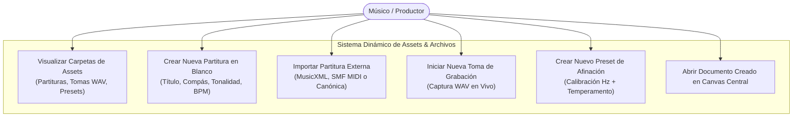
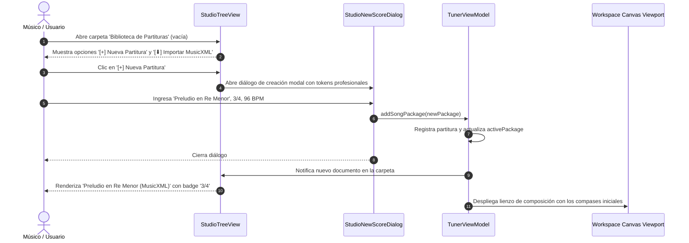

# Caso de Uso 75: Gestión Dinámica de Assets, Creación de Documentos e Importación Profesional

## 1. Identificación y Metadatos

- **ID del Caso de Uso:** `UC-075`
- **Nombre:** `Creación de Nuevos Documentos (Partituras, Tomas, Presets) e Importación de Archivos en Carpetas de Assets Dinámicas`
- **Actores:** Músico Profesional, Compositor, Productor de Audio.
- **Módulo Asociado:** `lib/core/design_system/molecules/studio_tree_view.dart`, `lib/features/navigation/presentation/main_app_shell.dart`, `lib/features/song_library/presentation/studio_assets_modals.dart`.
- **Precondiciones:** El usuario opera en la estación de trabajo desktop Tunner.
- **Postcondiciones:** Las carpetas de assets reflejan fielmente los documentos reales del usuario; si están vacías muestran acciones de creación e importación; al crear o importar un asset este se incorpora en vivo al árbol y se carga en el canvas central.

---

## 2. Diagrama de Casos de Uso (Mermaid)

---

## 3. Diagrama de Secuencia (Mermaid)

---

## 4. Flujo Principal de Operación

1. El usuario expande cualquiera de las carpetas de assets en la barra lateral:
   - **Partituras & Notación**: Si no hay obras creadas, muestra `[+] Crear Nueva Partitura en Blanco...` y `[⬇] Importar MusicXML / MIDI...`.
   - **Tomas & Grabaciones**: Muestra `[+] Iniciar Nueva Toma WAV...`.
   - **Presets de Afinación**: Muestra `[+] Nuevo Preset de Calibración...`.
2. Al pulsar `Crear`:
   - Se abre un modal de diálogo estético con fondo mate, bordes hairline de 1px y tipografía técnica.
   - El usuario define los parámetros (nombre, compás, tonalidad, Hz de referencia).
   - Al confirmar, el nuevo documento es instanciado en el dominio y añadido a la lista reactiva.
3. Al pulsar `Importar`:
   - El usuario puede seleccionar un archivo local o cargar obras de muestra del repertorio canónico.
   - El motor decodifica el MusicXML / MIDI en memoria y genera la entidad `SongPackage`.
4. El nuevo elemento se añade inmediatamente a la carpeta y el canvas central se actualiza con el documento cargado.
