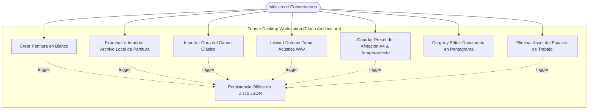
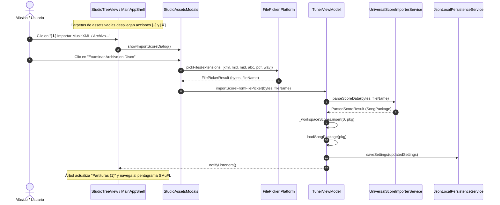

# Caso de Uso 76: Arquitectura Limpia End-to-End para Assets de Espacio de Trabajo (Partituras, Presets y Tomas de Audio)

## Metadatos del Caso de Uso

- **ID del Caso de Uso:** `UC-76`
- **Nombre:** Gestión Funcional End-to-End de Partituras, Presets y Tomas en el Árbol de Trabajo
- **Fase del Proyecto:** Fase 2 (Afinación, Notación y Estructura Monolítica Modular)
- **Actores:** Músico de Estudio / Estudiante de Conservatorio (Actor Principal), Sistema Tunner (Sistema)
- **Estado:** Especificado y Aprobado

---

## 1. Descripción Breve

Permite al usuario gestionar de forma 100% funcional y reactiva sus documentos de trabajo dentro del panel lateral de navegación jerárquica de Tunner. Las carpetas de assets (`Partituras del Proyecto`, `Tomas de Audio & WAV` y `Presets de Afinación`) inician vacías por defecto, y permiten crear nuevas partituras en blanco con compás y tempo personalizados, importar partituras reales desde el sistema de archivos local (`.musicxml`, `.mxl`, `.mid`, `.midi`, `.abc`, `.pdf`, `.wav`) mediante el selector nativo de archivos del sistema operativo, registrar tomas de audio acústicas en vivo y guardar calibraciones históricas como presets de afinación en una entidad pura de dominio (`TuningPresetEntity`), persistiendo todos los cambios de forma no volátil en disco local.

---

## 2. Diagrama de Casos de Uso (Mermaid)

---

## 3. Diagrama de Secuencia y Flujo de Datos (Mermaid)

---

## 4. Precondiciones
1. La aplicación Tunner está iniciada en modo local 100% offline.
2. Los repositorios de persistencia local se encuentran inicializados en el directorio de documentos de la aplicación.
3. El árbol de trabajo refleja el estado actual del `TunerViewModel`.

---

## 5. Postcondiciones
1. Cualquier partitura creada o importada pasa a formar parte de `workspaceScores`, mostrándose de inmediato en el árbol y cargándose en el editor de partituras de la pestaña 4.
2. Cualquier preset de afinación guardado se almacena como `TuningPresetEntity` en `tuningPresets` con su frecuencia exacta en Hz y temperamento, reflejándose en el árbol.
3. El estado consolidado se persiste asíncronamente en el archivo JSON local de la aplicación, manteniéndose disponible ante reinicios del sistema.

---

## 6. Flujo Principal

### 6.1 Creación de Nueva Partitura
1. El usuario hace clic en el botón `+` de la cabecera de la carpeta `Partituras & Notación` o en el elemento de acción `[+] Nueva Partitura en Blanco...`.
2. El sistema despliega el diálogo atómico `StudioNewScoreDialog`.
3. El usuario ingresa el título, selecciona el compás ($4/4$, $3/4$, etc.) y el tempo BPM, y confirma con `Crear Partitura`.
4. El diálogo delega la llamada a `viewModel.createWorkspaceScore(...)`.
5. El ViewModel construye la estructura inmutable de compases en silencio `HierarchicalScore`, empaqueta el `SongPackage`, lo agrega a `_workspaceScores`, lo selecciona como obra activa, notifica a los escuchas y dispara la auto-persistencia en disco.
6. La aplicación navega a la pestaña de notación musical, desplegando el lienzo con los compases iniciales generados.

### 6.2 Importación de Archivo Local de Partitura
1. El usuario hace clic en `[⬇] Importar MusicXML / Catálogo...`.
2. El diálogo `StudioImportScoreDialog` ofrece la opción de examinar el disco o seleccionar del canon clásico.
3. El usuario pulsa `Examinar Archivo Local (FilePicker)`.
4. El plugin `FilePicker` abre el explorador nativo filtrando formatos soportados (`.musicxml`, `.xml`, `.mxl`, `.mid`, `.midi`, `.abc`, `.pdf`, `.wav`).
5. El usuario selecciona un archivo válido.
6. El ViewModel recibe los bytes binarios y el nombre de archivo, invocando a `UniversalScoreImporterService`.
7. El servicio parsea el archivo en una jerarquía tipográfica `HierarchicalScore` con pistas de audio o stems asociadas.
8. La partitura se incorpora al espacio de trabajo del usuario y queda lista para ensayo y reproducción.

### 6.3 Registro de Toma Acústica WAV
1. El usuario pulsa `[+] Iniciar Nueva Toma WAV...` o el atajo global de teclado `R`.
2. `PracticeRecorderService` inicializa la captura de micrófono en formato universal WAV a 44.1 kHz / 16-bit PCM.
3. El árbol lateral refleja el estado de grabación activo con una insignia `REC` en rojo brillante.
4. Al pulsar detener, la toma se consolida en una entidad `PracticeRecordingEntity` con duración y forma de onda calculada, agregándose a `viewModel.recordingHistory`.
5. La toma queda disponible para reproducción inmediata y análisis espectral.

### 6.4 Guardado de Preset de Calibración A4
1. El usuario pulsa `[+] Guardar Calibración A4 Actual...`.
2. El sistema despliega `StudioNewTuningPresetDialog` prellenando la frecuencia de referencia actual (e.g. $442.0\text{ Hz}$) y el temperamento activo.
3. El usuario ingresa un nombre identificador (e.g. "Sinfónica de Viena A442") y pulsa `Guardar Preset`.
4. El ViewModel crea una entidad `TuningPresetEntity`, la inserta en `_tuningPresets`, actualiza el almacenamiento offline y notifica a la interfaz gráfica.
5. El nuevo preset aparece bajo la carpeta `Presets de Afinación`.

---

## 7. Flujos Alternativos y Excepciones

- **FA-01: Cancelación de selección de archivo en FilePicker:** Si el usuario cierra el explorador de archivos sin seleccionar ningún archivo, el diálogo permanece abierto y no se produce ninguna mutación de estado.
- **FA-02: Formato de archivo de partitura no reconocido:** Si se intenta importar un archivo corrupto o no soportado, el ViewModel captura la excepción `FormatException`, la registra en el log técnico del sistema y muestra un mensaje de advertencia visual al usuario sin abortar la aplicación.
- **FA-03: Permiso de micrófono denegado:** Si el sistema operativo no concede permisos de captura de audio, `PracticeRecorderService` reporta el error limpiamente, desactiva la bandera de grabación y notifica a la interfaz.
