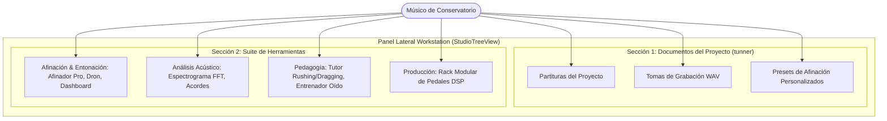
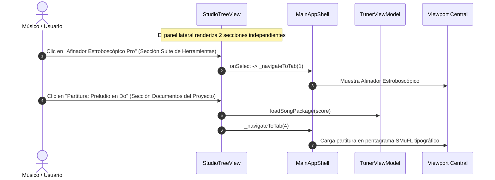

# Caso de Uso 77: Separación Estética y Arquitectónica del Panel Lateral: Documentos vs. Suite de Herramientas

## Metadatos del Caso de Uso

- **ID del Caso de Uso:** `UC-77`
- **Nombre:** Separación Dual en el Explorador Lateral: Documentos del Proyecto y Suite de Herramientas de Estudio
- **Fase del Proyecto:** Fase 2 (Afinación, Notación y Estructura Monolítica Modular)
- **Actores:** Músico de Estudio / Estudiante de Conservatorio (Actor Principal), Sistema Tunner (Sistema)
- **Estado:** Especificado y Aprobado

---

## 1. Descripción Breve

Proporciona una interfaz lateral calculada, intuitiva y de nivel profesional separando estrictamente la jerarquía del explorador en dos dominios visuales y funcionales independientes:
1. **Documentos del Proyecto:** Carpeta raíz de proyectos que contiene únicamente archivos de usuario (partituras compuestas/importadas, tomas de audio WAV grabadas y presets de afinación).
2. **Suite de Herramientas:** Catálogo técnico clasificado por disciplina (Afinación & Entonación, Análisis Acústico & Laboratorio, Pedagogía & Conservatorio, Producción & Enrutamiento) que permite al usuario invocar y conmutar cualquier analizador o procesador sin contaminar el árbol de archivos.

---

## 2. Diagrama de Casos de Uso (Mermaid)

---

## 3. Diagrama de Secuencia y Flujo de Navegación (Mermaid)

---

## 4. Precondiciones
1. La aplicación Tunner está ejecutándose en modo escritorio o tablet.
2. El ViewModel suministra de forma reactiva las listas `workspaceScores`, `recordingHistory` y `customTuningPresets`.

---

## 5. Postcondiciones
1. La sección `Documentos del Proyecto` permanece 100% limpia de utilidades o plugins de sistema.
2. Cada herramienta técnica se encuentra catalogada bajo su carpeta temática en la `Suite de Herramientas`.
3. La navegación y selección de items es instantánea, sin jank ni reconstrucciones innecesarias.

---

## 6. Flujo Principal
1. El usuario visualiza en la barra lateral dos secciones principales claramente demarcadas por sus cabeceras:
   - `DOCUMENTOS DEL PROYECTO (tunner)`
   - `SUITE DE HERRAMIENTAS`
2. Si el usuario desea crear o abrir una partitura o toma, interactúa con la sección de documentos.
3. Si el usuario desea realizar un análisis acústico, afinar con precisión o practicar oído, interactúa con la sección de herramientas.
4. Al hacer clic en un elemento de herramientas, la aplicación conmuta la pestaña activa o abre el diálogo modal correspondiente.
