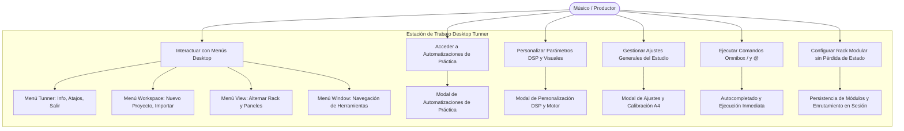
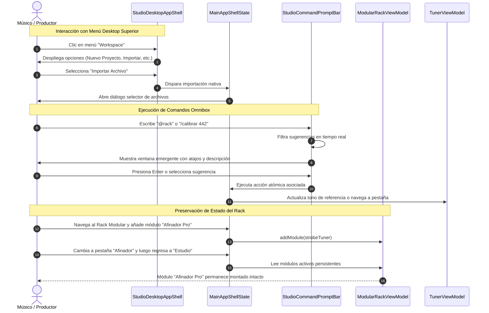

# Caso de Uso 78: Erradicación Integral de Mocks, Persistencia de Estado de Rack y Menús Desktop Profesionales

## Metadatos
- **ID:** `UC-WORKSTATION-78`
- **Nombre:** Erradicación Integral de Mocks, Persistencia de Estado de Rack y Menús Desktop Profesionales
- **Fase:** Fase 3 (Estación de Trabajo Desktop & Arquitectura Modular)
- **Actores:** Músico Profesional, Productor de Audio, Estudiante de Conservatorio
- **Estado:** Aprobado

---

## 1. Descripción
Este caso de uso describe la interacción fluida y profesional del usuario con la estación de trabajo desktop de **Tunner**. Resuelve de manera integral la presencia de funciones incompletas o simuladas en los menús de la cabecera superior, las opciones de utilidades del sistema (`Automations`, `Customizations`, `Settings`), la barra omnibox interactiva de comandos (`StudioCommandPromptBar`) y la preservación de estado continuo del rack modular de efectos e instrumentos (`ModularRackViewModel`).

---

## 2. Diagrama de Casos de Uso (Mermaid)

---

## 3. Diagrama de Secuencia (Mermaid)

---

## 4. Flujo Principal de Trabajo

1. **Acceso a Menús Superiores:**
   - El usuario hace clic en `Tunner`, `Workspace`, `View` o `Window` en la barra superior.
   - La aplicación despliega inmediatamente un menú emergente nativo con opciones claras, atajos de teclado y acciones directas.
   - El usuario selecciona la acción deseada (ej. crear partitura, importar audio, alternar rack) y la aplicación responde de inmediato.
2. **Uso de Herramientas de Barra Lateral:**
   - Al pulsar `Automations`, se despliega un panel de rutinas automatizadas (calentamiento técnico, rampa de BPM de metrónomo, auto-grabación).
   - Al pulsar `Customizations`, se abre el diálogo de personalización técnica (motor DSP Tartini/YIN/MPM, tasa de refresco 60/120 FPS, resolución de centésimas).
   - Al pulsar `Settings`, se abre el diálogo de configuración acústica (frecuencia A4, temperamento histórico, clave de afinación).
3. **Consola Omnibox y Autocompletado:**
   - El usuario escribe en la barra inferior. Al tipear `/` ve comandos de transporte y afinación (`/afinar`, `/metro`, `/bpm`, `/calibrar`, `/grabar`, `/help`).
   - Al tipear `@` visualiza herramientas y módulos disponibles para conmutar directamente (`@afinador`, `@metronomo`, `@partitura`, `@grabador`, `@rack`, `@espectrograma`, `@acordes`).
   - El autocompletado navega con teclas de flecha y se selecciona con `Tab` o `Enter`.
4. **Persistencia del Rack Modular:**
   - El usuario agrega módulos y ajusta diales en la vista modular.
   - Al navegar a cualquier otra sección (Biblioteca, Afinador, Ejercicios) y volver, toda la disposición modular se encuentra preservada.

---

## 5. Flujos Alternativos y Excepciones

- **A1. Comando no reconocido:**
  - Si el usuario tipea un comando inválido y presiona Enter, la barra notifica amablemente que el comando no existe y sugiere escribir `/help`.
- **A2. Cancelación de menús:**
  - Si el usuario hace clic fuera del menú o presiona Escape, el menú contextual o la ventana emergente de sugerencias se cierra limpiamente sin dejar residuos visuales.

---

## 6. Precondiciones y Postcondiciones

- **Precondición:** La aplicación debe estar inicializada en modo escritorio o responsive.
- **Postcondición:** Todas las interacciones de cabecera, utilidades y comandos producen respuestas funcionales reales; el estado de trabajo del rack no se reinicia durante la sesión.
