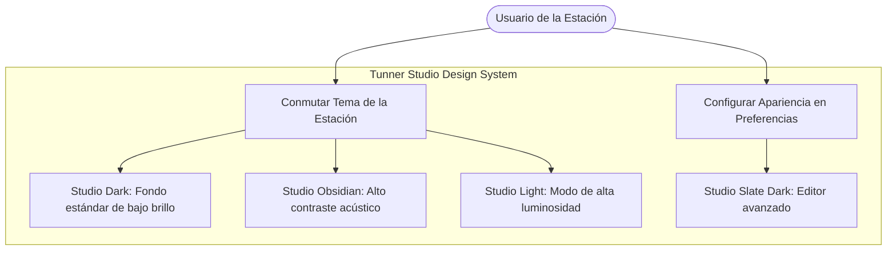
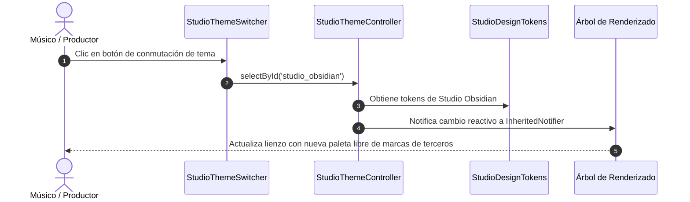

# Caso de Uso 79: Neutralización de Marcas Propietarias y Adopción de Tunner Studio Design System

## Metadatos
- **ID:** `UC-BRANDING-79`
- **Nombre:** Neutralización de Marcas Propietarias y Adopción de Tunner Studio Design System
- **Fase:** Fase 3 (Estación de Trabajo Desktop & Arquitectura Visual Limpia)
- **Actores:** Músico, Desarrollador, Diseñador de Sistema
- **Estado:** Aprobado

---

## 1. Descripción
Este caso de uso formaliza el renombramiento de todos los temas visuales, selectores de paleta y tokens de diseño para erradicar cualquier referencia a marcas comerciales ajenas (como Adobe o sus productos), adoptando una identidad de marca 100% propia y original denominada **Tunner Studio Design System**, con variantes de paleta: `Studio Dark`, `Studio Obsidian`, `Studio Slate Dark` y `Studio Light`.

---

## 2. Diagrama de Casos de Uso (Mermaid)

---

## 3. Diagrama de Secuencia (Mermaid)

---

## 4. Flujo Principal

1. El usuario visualiza en la esquina superior derecha del shell de escritorio la insignia de tema activo (ej. `Studio Dark`).
2. Al pulsar el botón, la aplicación cicla o abre el selector de temas propios de la suite.
3. Todas las etiquetas mostradas al usuario corresponden a nombres genéricos y técnicos de **Tunner Studio** (`Studio Dark`, `Studio Obsidian`, `Studio Light`), garantizando cumplimiento de propiedad intelectual y ausencia de marcas registradas ajenas.

---

## 5. Precondiciones y Postcondiciones

- **Precondición:** La aplicación ejecuta el sistema de temas atómico `StudioThemeScope`.
- **Postcondición:** Cero ocurrencias de nombres de marcas comerciales ajenas en la interfaz gráfica y en las definiciones de tokens del código fuente.
