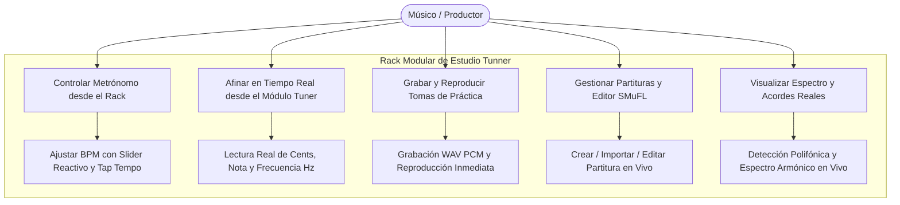
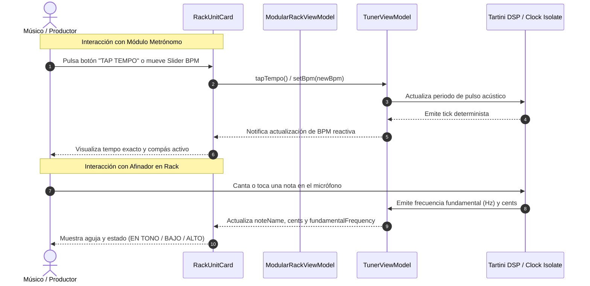

# Caso de Uso 80: Enlace Real de DSP y Erradicación Total de Mocks en el Rack Modular

## Metadatos
- **ID:** `UC-RACK-80`
- **Nombre:** Enlace Real de DSP y Erradicación Total de Mocks en el Rack Modular
- **Fase:** Fase 3 (Estación de Trabajo Desktop & Arquitectura Modular)
- **Actores:** Músico, Productor, Ingeniero de Audio
- **Estado:** Aprobado

---

## 1. Descripción
Este caso de uso describe la experiencia de interacción completa y auténtica dentro del Rack Modular de Estudio (`ModularStudioRackView`). Elimina de manera concluyente cualquier comportamiento simulado, número mágico o controlador vacío, vinculando cada tarjeta de unidad de módulo (`RackUnitCard`) directamente a los servicios de audio, reloj determinista, analizador armónico y grabador de práctica de `TunerViewModel`.

---

## 2. Diagrama de Casos de Uso (Mermaid)

---

## 3. Diagrama de Secuencia (Mermaid)

---

## 4. Flujo Principal de Trabajo

1. **Afinación en Rack:**
   - El módulo `strobeTuner` lee de forma continua la frecuencia capturada por el micrófono.
   - Si no hay señal audible, muestra `Esperando audio...` y `(SILENCIO)`.
   - Al tocar un instrumento, muestra la nota exacta, la frecuencia en Hz calculada por el motor DSP y la desviación en centésimas de semitono con retroalimentación cromática.
2. **Control Rítmico en Rack:**
   - El módulo `metronome` refleja el tempo global del proyecto.
   - El usuario puede modificar el BPM arrastrando el deslizador, pulsar "TAP TEMPO" o iniciar/detener el reloj auditivo.
3. **Captura y Reproducción en Rack:**
   - El módulo `practiceRecorder` permite iniciar una toma de audio WAV con un solo clic.
   - Si existen tomas previas, permite escucharlas al instante o acceder al reproductor multipista.
4. **Notación y Partitura en Rack:**
   - El módulo `scoreNotation` muestra los datos de la partitura en curso o botones directos para importar archivos MusicXML/MIDI o crear una partitura nueva.

---

## 5. Precondiciones y Postcondiciones

- **Precondición:** El usuario navega a la pestaña de Estudio / Rack Modular.
- **Postcondición:** Cero elementos inertes en los módulos del rack; todas las acciones disparan procesos reales en los motores de audio locales.
