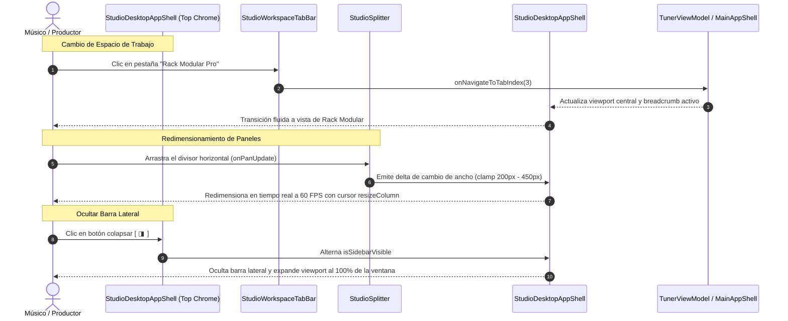

# Caso de Uso 81: Sistema de Ventanas Acoplables/Ajustables, Selector de Espacios DAW y Menú de Alta Gama

## Metadatos
- **ID:** `UC-DESK-81`
- **Nombre:** Sistema de Ventanas Acoplables/Ajustables, Selector de Espacios DAW y Menú de Alta Gama
- **Fase:** Fase 3 (Estación de Trabajo Desktop & Arquitectura Modular)
- **Actores:** Músico, Productor, Diseñador de Sonido, Estudiante de Conservatorio
- **Estado:** Aprobado

---

## 1. Descripción
Este caso de uso dota a la estación de trabajo de Tunner de un entorno ergonómico de ventanas y paneles ajustables con la precisión estética de software comercial de alta gama (DAW / IDE):
- Permite al usuario ajustar interactivamente el ancho de los paneles (Barra Lateral y Viewports de Audio) arrastrando divisores hairline con cursor dedicado (`resizeColumn`).
- Provee una barra de pestañas de espacios de trabajo (`Aprender & Afinar`, `Rack Modular Pro`, `Notación & Partitura`, `Consola DJ & Mezcla`) para conmutar flujos de trabajo sin fricción.
- Ofrece controles de distribución de layout en la barra superior (Ocultar/Mostrar Barra Lateral, Modo Dual Split y Maximizar Vista).
- Refina la barra de menú superior con apariencia de software premium de licencia, atajos de teclado tabulares alineados a la derecha y telemetría de rendimiento en tiempo real.

---

## 2. Diagrama de Casos de Uso (Mermaid)

```mermaid
flowchart TD
    User([Músico / Productor]) --> M1[Ajustar Ancho de Paneles Arrastrando Divisor]
    User --> M2[Conmutar Espacio de Trabajo con Pestañas DAW]
    User --> M3[Alternar Vista Dual Dividida Rack + Viewport]
    User --> M4[Colapsar o Expandir Barra Lateral con Botón Rápido]
    User --> M5[Acceder a Menús de Alta Gama con Atajos Alineados]

    subgraph Estación de Trabajo Desktop Tunner
        M1 --> A1[StudioSplitter: Modificar proporciones de layout dinámicamente]
        M2 --> A2[StudioWorkspaceTabBar: Cambiar contexto entre Afinación, Rack, Partitura y DJ]
        M3 --> A3[Dual Split Mode: Renderizar Rack Modular junto al Editor o Afinador]
        M4 --> A4[Sidebar Toggle [ ◨ ]: Maximizar área de trabajo útil]
        M5 --> A5[High-End Menu Chrome: Menús estilizados con atajos Ctrl+N/O/S/P]
    end
```

---

## 3. Diagrama de Secuencia (Mermaid)



---

## 4. Precondiciones y Postcondiciones

- **Precondiciones:**
  - La aplicación Tunner está ejecutándose en un entorno de escritorio (Linux, macOS o Windows).
  - La resolución de la pantalla permite una disposición modular (ancho $\ge$ 900 px para escritorio estándar).
- **Postcondiciones:**
  - Los paneles se adaptan dinámicamente al tamaño deseado por el usuario sin desbordamientos (*overflow*).
  - La barra lateral puede ocultarse completamente para sesiones de grabación o práctica enfocada.
  - La barra de menú presenta jerarquía visual, espaciado uniforme y atajos claros.

---

## 5. Flujos de Trabajo

### 5.1 Flujo Principal: Ajuste Dinámico de Ventanas
1. El usuario sitúa el puntero sobre el divisor vertical entre la barra lateral y el canvas central.
2. El cursor se transforma en `SystemMouseCursors.resizeColumn`.
3. El usuario arrastra hacia la izquierda o derecha: el ancho se actualiza de manera reactiva respetando los límites de seguridad mínimos y máximos.
4. Al soltar el cursor, el nuevo tamaño queda memorizado para la sesión activa.

### 5.2 Flujo Alternativo 1: Vista Dual Dividida (Split View)
1. El usuario activa el modo de vista dividida en el menú `View -> Vista Dual Dividida (Ctrl+Shift+D)`.
2. La pantalla central se divide en dos columnas ajustables: a la izquierda se ubica el Rack Modular y a la derecha el Editor de Partituras o la Consola de DJ.
3. El usuario puede monitorear señales del rack mientras edita música o mezcla stems.

### 5.3 Flujo Alternativo 2: Modo Enfocado (Full Screen Canvas)
1. El usuario pulsa el icono `[ ◨ ]` en la barra superior o presiona `Ctrl+B`.
2. La barra lateral izquierda se oculta con una transición limpia de 0 px.
3. El área de trabajo ocupa el 100% del ancho horizontal disponible.
