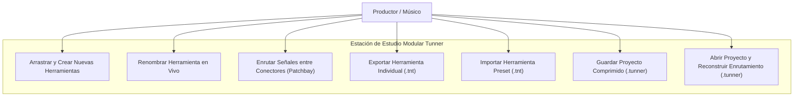
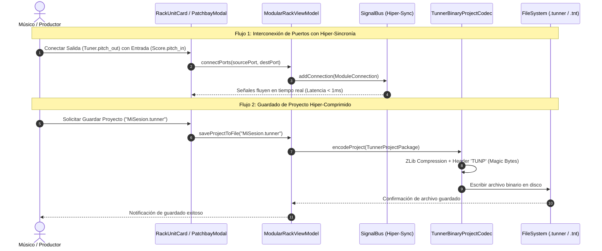

# Caso de Uso 82: Sistema Modular de Herramientas, Conectores Hiper-Sincronizados y Formato de Proyecto Propietario Hiper-Comprimido (.tunner / .tnt)

---

## 1. Descripción
Permitir a los músicos y productores configurar su espacio de trabajo de manera ágil e intuitiva mediante la creación y arrastre de herramientas modulares, interconexión de puertos de entrada/salida (Audio, Pitch, Reloj, Notas) con hiper-sincronización instantánea en el `SignalBus`, personalización de nombres por herramienta y persistencia integral en un formato de archivo propietario de alta compresión binaria (`.tunner` para proyectos completos y `.tnt` para herramientas individuales).

---

## 2. Diagrama de Casos de Uso (Mermaid)

---

## 3. Diagrama de Secuencia y Flujo de Señales (Mermaid)

---

## 4. Precondiciones, Postcondiciones y Flujos

### 4.1 Precondiciones
- La aplicación se encuentra en ejecución en escritorio o móvil con el `ModularRackViewModel` instanciado.

### 4.2 Postcondiciones
- Los módulos conectados comparten datos a través del `SignalBus` con sincronización garantizada.
- Los archivos `.tunner` y `.tnt` son almacenados en el disco local con compresión sin pérdidas de alta eficiencia.

### 4.3 Flujo Principal (Guardar y Cargar Proyecto)
1. El usuario nombra sus herramientas (ej. "Afinador Mic 1", "Sintetizador Lead").
2. El usuario establece conexiones entre salidas y entradas mediante el modal de patchbay.
3. El usuario pulsa Guardar Proyecto.
4. El sistema empaqueta metadatos, herramientas, estados y el grafo de conexiones en `TunnerProjectPackage`.
5. El códec binario agrega la firma `TUNP`, versión `1`, comprime los bytes usando deflate y escribe el archivo `.tunner`.
6. Al cargar el archivo, el códec valida la firma binaria, descomprime el contenido, restaura los módulos, sus nombres y reconstituye automáticamente las conexiones en el `SignalBus`.

### 4.4 Flujos Alternativos y Manejo de Errores
- **Archivo corrupto o firma inválida:** Si el archivo no comienza con los bytes mágicos `0x54, 0x55, 0x4E, 0x50`, el sistema rechaza la carga informando al usuario sin alterar el estado actual de la sesión.
- **Conexión incompatible:** Si el usuario intenta conectar un puerto de tipo incompatible (ej: un reloj temporal a una entrada de audio PCM), el sistema bloquea la conexión informando la incompatibilidad de señal.
