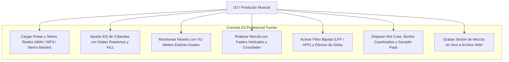
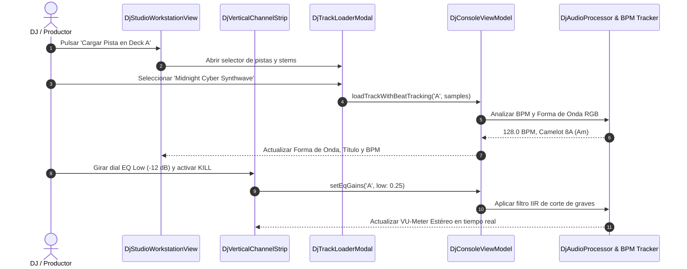

# Caso de Uso 83: Estación de Trabajo DJ Profesional, Mezclador de Grado Club y Carga Real de Audio/Stems

---

## 1. Descripción
Proporcionar una consola DJ de grado profesional inspirada en los estándares de hardware de club (Pioneer DJM, Allen & Heath Xone, Traktor Pro), erradicando sliders horizontales genéricos y reemplazándolos por tiras de canal verticales con ecualizadores rotatorios Isolator de 3 bandas (-26dB a +6dB y switches KILL), medidores VU-Meter duales estéreo, faders de canal de precisión, crossfader con curva variable, carga real de pistas/stems de audio, y visualización tanto en modal como en espacio de trabajo nativo a pantalla completa (`F4`).

---

## 2. Diagrama de Casos de Uso (Mermaid)

---

## 3. Diagrama de Flujo y Secuencia (Mermaid)

---

## 4. Precondiciones y Postcondiciones

### 4.1 Precondiciones
- La estación Tunner está en ejecución en escritorio o móvil.
- El usuario navega al espacio de trabajo de la Consola DJ (`F4` o selector de pestañas) o abre el modal.

### 4.2 Postcondiciones
- Cada canal de audio se controla mediante faders y diales verticales con respuesta táctil y numérica.
- Las pistas cargadas corresponden a audio real procesado por el motor de audio DSP.
- La grabación de mezcla genera un archivo `.wav` descargable o guardable en el almacenamiento local.
