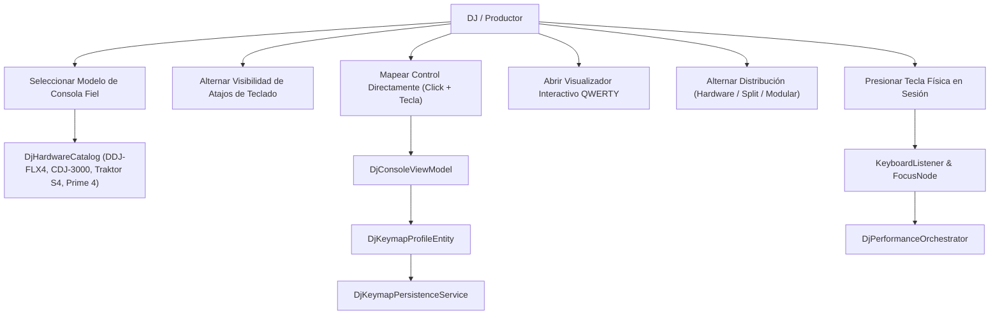
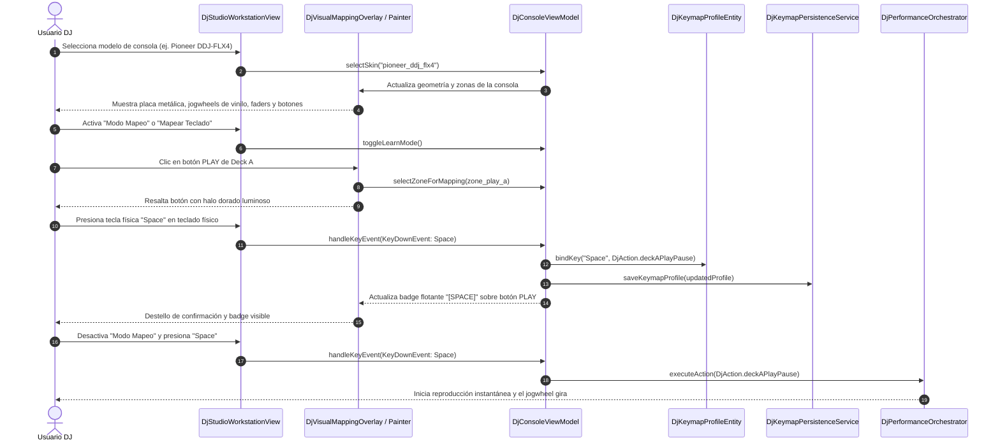

# Caso de Uso 84: Visualización Fiel de Modelos de Consolas Hardware y Mapeo Interactivo de Teclado QWERTY

## 1. Identificación y Descripción del Caso de Uso

- **ID del Caso de Uso:** `UC-084-DJ-HARDWARE-KEYMAPPER`
- **Nombre:** Selección y Operación de Modelos de Consolas DJ Fieles con Mapeo Interactivo de Teclado Físico
- **Fase de la Arquitectura:** Fase 2 - Instrumentos Virtuales, Síntesis y Mezcla
- **Actor Principal:** DJ / Productor / Estudiante Musical
- **Objetivo:** Permitir al usuario seleccionar y operar modelos fidedignos de consolas de hardware DJ reconocidas (Pioneer DDJ-FLX4, Pioneer CDJ-3000 + DJM-900NXS2, Traktor Kontrol S4 MK3, Denon DJ Prime 4+, Numark Mixtrack Pro FX) renderizadas vectorialmente con acabados industriales de placa metálica, e interactuar con ellas mediante pulsaciones directas de teclado físico configurables tecla por tecla (Click en control $\rightarrow$ Presionar tecla $\rightarrow$ Asignación instantánea) o mediante un visualizador interactivo QWERTY con presets estándar.

---

## 2. Diagrama de Casos de Uso (Mermaid)

---

## 3. Diagrama de Secuencia Detallado (Mermaid)

---

## 4. Precondiciones y Postcondiciones

### 4.1 Precondiciones
1. La aplicación Tunner debe estar en ejecución con el subsistema de audio y la estación de trabajo DJ cargados.
2. El teclado físico del dispositivo debe estar disponible y reconocido por el sistema operativo.

### 4.2 Postcondiciones
1. La consola seleccionada se visualiza con sus proporciones de aspecto físicas exactas y elementos vectoriales industriales interactivos.
2. Cada tecla física presionada desencadena la acción de mezcla correspondiente en menos de 10 milisegundos.
3. Las asociaciones de teclas configuradas por el usuario se guardan de forma persistente en las preferencias locales.

---

## 5. Flujos de Trabajo

### 5.1 Flujo Principal (Mapeo Directo y Reproducción)
1. El usuario accede a la estación `Consola DJ` (`F4` o pestaña superior).
2. Selecciona el modelo de hardware deseado desde el selector desplegable (ej. Pioneer DDJ-FLX4).
3. Activa la opción `Modo Mapeo`.
4. Hace clic sobre cualquier control interactivo de la consola (ej. CUE de Deck B, Fader de Pitch o Hot Cue 1).
5. El sistema resalta el control seleccionado con un anillo luminoso y solicita la pulsación de una tecla física.
6. El usuario pulsa la tecla deseada en su teclado (ej. `U` o `1`).
7. El sistema registra la tecla, persiste el cambio y coloca la insignia `[U]` sobre el control.
8. El usuario desactiva el modo de mapeo e interactúa con el teclado: al pulsar la tecla `U`, el control ejecuta la acción con feedback visual inmediato.

### 5.2 Flujo Alternativo A (Selección de Perfiles Preestablecidos)
1. El usuario abre el modal de Visualización de Teclado QWERTY.
2. En el menú de perfiles selecciona un estándar de la industria (ej. `VirtualDJ Standard`, `Traktor Pro Standard` o `Serato DJ Standard`).
3. El sistema actualiza inmediatamente todas las teclas y las distribuye sobre el mapa de controles de la consola.
4. El visualizador ilumina las teclas del teclado en colores según la función (Cian para Deck A, Ámbar para Deck B, Esmeralda para Mezclador, Púrpura para Efectos).

### 5.3 Flujo Alternativo B (Alternancia de Vista de Trabajo)
1. El usuario selecciona `Modo Split-Screen` para visualizar las formas de onda espectrales RGB en la parte superior y la consola de hardware fidedigna en la mitad inferior.
2. El usuario selecciona `Modo Hardware Fiel` para maximizar la consola a pantalla completa, operándola como un instrumento físico de estudio.
