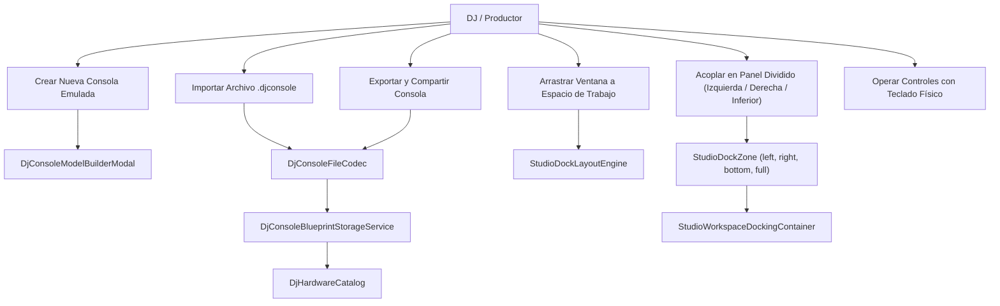
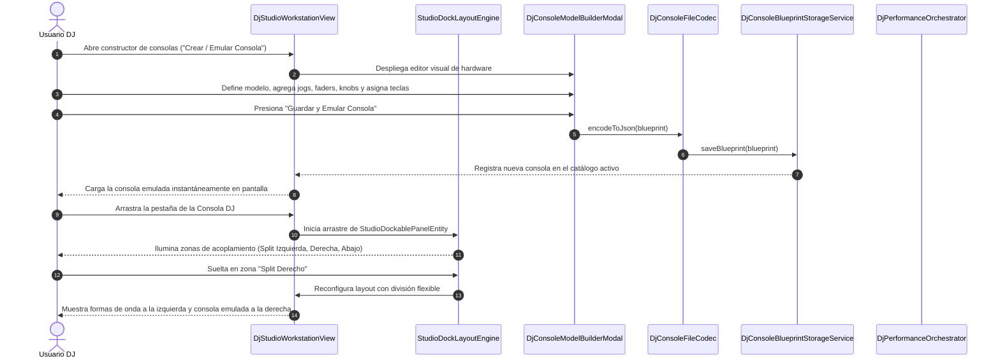

# Caso de Uso 85: Emulador Universal de Consolas por Archivo y Sistema Docking de Ventanas Multi-Panel para Espacios de Trabajo

## 1. Identificación y Descripción del Caso de Uso

- **ID del Caso de Uso:** `UC-085-EMULATOR-DOCKING-SUITE`
- **Nombre:** Emulación de Consolas Físicas por Archivo Abierto y Gestión de Ventanas Divididas tipo DAW en Espacios de Trabajo
- **Fase de la Arquitectura:** Fase 2 - Instrumentos Virtuales, Mezcla y Entorno de Trabajo DAW
- **Actor Principal:** DJ / Productor Musical / Usuario Creativo
- **Objetivo:** 
  1. Permitir que cualquier usuario emule cualquier consola física en su computadora mediante archivos abiertos de definición (`.djconsole`), programando sus botones y atajos de teclado sin necesidad de comprar hardware físico costoso.
  2. Permitir arrastrar cualquier consola o herramienta hacia zonas de acoplamiento divididas (izquierda, derecha, inferior o maximizada) dentro de los espacios de trabajo como en un DAW profesional.

---

## 2. Diagrama de Casos de Uso (Mermaid)

---

## 3. Diagrama de Secuencia Detallado (Mermaid)

---

## 4. Precondiciones y Postcondiciones

### 4.1 Precondiciones
1. La aplicación Tunner debe estar en ejecución con el motor de audio inicializado.
2. La pantalla debe contar con un espacio de visualización de escritorio o tablet.

### 4.2 Postcondiciones
1. La consola personalizada se guarda en formato JSON legible y canónico en el almacenamiento local.
2. Los paneles de herramientas pueden reorganizarse fluidamente mediante arrastrar y soltar sin reiniciar el motor de audio ni perder el estado de reproducción.

---

## 5. Flujos de Trabajo

### 5.1 Flujo Principal: Emulación y Creación de Consola Personalizada
1. El usuario hace clic en `Emular Nueva Consola` en la barra superior.
2. Ingresa el nombre del modelo (ej. `Numark Party Mix Live`), fabricante y dimensiones.
3. Agrega componentes físicos: rueda jog, fader de pitch, botones de Play/Cue, faders de canal y ecualizadores.
4. Vincula cada control a una tecla de teclado físico con un solo toque.
5. Guarda el modelo: el sistema genera el archivo de definición `.djconsole` y lo añade a la biblioteca local.
6. La consola entra en servicio de inmediato, respondiendo al teclado con latencia inferior a 10 ms.

### 5.2 Flujo Alternativo A: Acoplamiento de Ventana a Panel Dividido
1. El usuario toma la barra de título de la Consola DJ con el cursor del ratón.
2. Arrastra la ventana hacia el borde derecho de la pantalla de trabajo.
3. La zona de acoplamiento derecha se resalta con un borde cian translúcido (`Drop Target`).
4. Al soltar el ratón, el espacio de trabajo se divide en dos columnas con un divisor ajustable.
5. El usuario puede redimensionar la proporción de las dos columnas arrastrando el divisor central.
