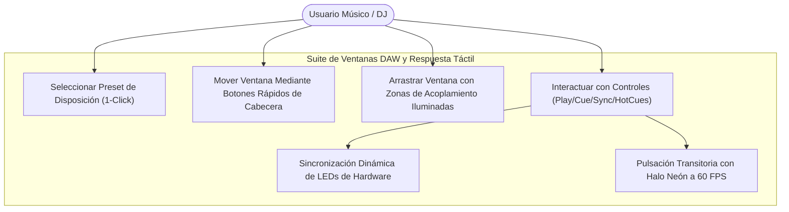
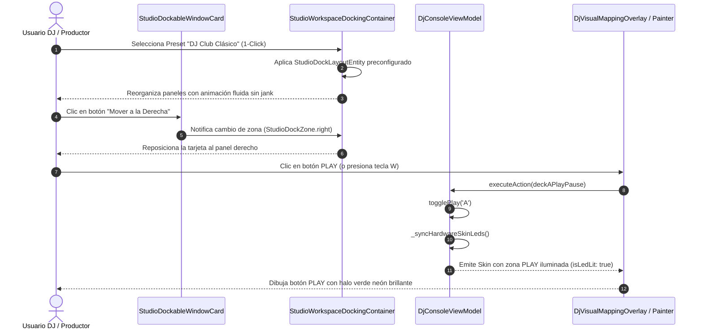

# Caso de Uso 86: Suite de Respuesta Táctil Ultra-Reactiva y Sistema Avanzado de Acoplamiento de Ventanas DAW

Este documento formaliza los requisitos funcionales, diagramas y especificaciones de ingeniería para la retroalimentación visual táctil inmediata de controles y la experiencia de ventanas DAW rápida y fluida.

---

## 1. Metadatos del Caso de Uso

- **ID del Caso de Uso:** `UC-86-TACTILE-FEEDBACK-ADVANCED-DAW-DOCKING`
- **Nombre:** Retroalimentación Táctil Ultra-Reactiva y Acoplamiento Avanzado de Ventanas DAW
- **Actor Principal:** Usuario Músico / Productor / DJ Profesional
- **Fase:** Fase 2 (Instrumentación, Consola DJ y Estaciones de Trabajo)
- **Componentes Afectados:**
  - `lib/features/dj_console/view_model/dj_console_view_model.dart`
  - `lib/features/dj_console/domain/dj_hardware_skin_entity.dart`
  - `lib/features/dj_console/presentation/dj_visual_mapping_overlay.dart`
  - `lib/features/dj_console/presentation/dj_hardware_console_painter.dart`
  - `lib/core/docking/presentation/studio_workspace_docking_container.dart`
  - `lib/core/docking/presentation/studio_dockable_window_card.dart`
- **ADR Relacionado:** [ADR 0076](../04_adrs/0076_ultra_responsive_tactile_feedback_and_advanced_daw_window_docking_suite.md)

---

## 2. Descripción General

El usuario necesita una estación de trabajo que responda de forma evidente e inmediata ante cada pulsación, clic o atajo de teclado:
1. **Retroalimentación de Estado Táctil:** Los botones de transporte (PLAY, CUE, SYNC), almohadillas Hot Cue, controles de silenciamiento y perillas deben encender sus respectivos LEDs luminosos en la consola física y en los paneles modulares cuando el estado esté activo.
2. **Pulsación Transitoria (Haptic Feedback Visual):** Al presionar cualquier control físico o virtual, la interfaz debe mostrar un pulso transitorio de halo o iluminación que certifique la recepción de la orden en menos de 10 ms.
3. **Disposición Intuitiva 1-Click (Workspace Layout Presets):** La disposición de ventanas debe ofrecer presets inmediatos ("DJ Club Clásico", "Consola Fiel", "Estudio 4-Stems", "Monitor Espectral", "Dividido 3 Paneles") y botones directos de anclaje rápido en cada cabecera de ventana, evitando depender exclusivamente de arrastrar.

---

## 3. Diagramas Formales de Casos de Uso y Secuencia

### 3.1 Diagrama de Casos de Uso (Mermaid)

### 3.2 Diagrama de Flujo y Secuencia (Mermaid)

---

## 4. Precondiciones y Postcondiciones

### Precondiciones:
- El usuario ha abierto la estación de trabajo `DjStudioWorkstationView`.
- El motor de audio y la consola virtual se encuentran inicializados en memoria.

### Postcondiciones:
- Cada cambio de estado de reproducción, sincronización o hot cue se refleja en los LEDs de la consola y en los botones táctiles.
- El usuario puede conmutar la disposición de paneles mediante 1 solo clic en la barra de presets o mediante botones en cada cabecera.
- El renderizado se aísla por ventana mediante `RepaintBoundary` para mantener 60 FPS estables.

---

## 5. Flujos de Operación

### 5.1 Flujo Principal (Happy Path)
1. El usuario hace clic en el botón `PLAY` de Deck A.
2. `DjConsoleViewModel` conmuta el estado de reproducción y ejecuta `_syncHardwareSkinLeds()`.
3. El LED del botón `PLAY` se enciende en verde neón visible y el botón modular adopta color esmeralda vibrante.
4. El usuario desea organizar sus paneles y hace clic en el preset `Estudio 4-Stems`.
5. La vista redistribuye los paneles en pantalla con la consola arriba, stems en el centro y mezclador a la derecha.
6. El usuario hace clic en el icono `Maximizar` del panel de formas de onda; el panel se expande a pantalla completa.
7. Al hacer clic nuevamente en `Restaurar`, el panel regresa a su posición en la cuadrícula.

### 5.2 Flujos Alternativos y Excepciones
- **Arrastre hacia zona inválida:** Si el usuario arrastra una ventana fuera de las zonas definidas, la ventana regresa fluidamente a su zona original sin perder estado ni interrumpir la reproducción de audio.
- **Ventana única en zona:** Si una zona contiene una sola herramienta, se renderiza directamente la tarjeta sin barra de pestañas para maximizar el espacio útil.
