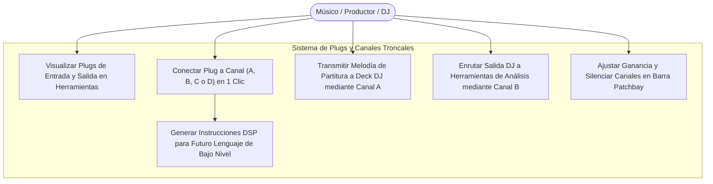
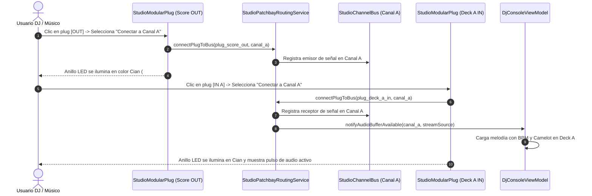

# Caso de Uso 87: Suite Modular de Plugs Interactivos, Canales de Parcheo (A, B, C, D) y Enrutamiento Inter-Herramientas

Este documento define la especificación canónica, diagramas de flujo y casos de uso para la interconexión tangible y atomizada de herramientas a través de plugs modulares y buses de canales troncales (Canal A, B, C, D) en **Tunner**.

---

## 1. Metadatos del Caso de Uso

- **ID del Caso de Uso:** `UC-87-MODULAR-PLUGS-CHANNELS-ROUTING`
- **Nombre:** Plugs Modulares Interactivos y Enrutamiento Inter-Herramientas mediante Canales A, B, C, D
- **Actor Principal:** Estudiante de Música / Productor Musical / DJ
- **Fase:** Fase 2 (Instrumentación, Consola DJ y Estaciones de Trabajo)
- **Componentes Afectados:**
  - `lib/core/channels/domain/studio_modular_plug.dart`
  - `lib/core/channels/domain/studio_channel_bus.dart`
  - `lib/core/channels/data/studio_patchbay_routing_service.dart`
  - `lib/core/channels/presentation/studio_modular_plug_widget.dart`
  - `lib/core/channels/presentation/studio_channel_patchbay_bar_widget.dart`
  - `lib/features/dj_console/presentation/dj_studio_workstation_view.dart`
- **ADR Relacionado:** [ADR 0077](../04_adrs/0077_universal_studio_channel_matrix_and_inter_tool_audio_routing_suite.md)

---

## 2. Descripción General

Para que el usuario experimente una verdadera sensación de estudio físico modular con interactividad intuitiva y respuesta inmediata:
1. **Plugs Modulares Virtuales:** Cada herramienta de la plataforma expone conectores Jack tipo hardware (plugs de Entrada `[IN]` y Salida `[OUT]`).
2. **Sistema Troncal de Canales (Canal A, B, C, D):** 
   - **Canal A (Cian #00E5FF):** Canal primario de melodías y partituras.
   - **Canal B (Ámbar #FFAB00):** Canal secundario de percusión y bases.
   - **Canal C (Esmeralda #10B981):** Canal de procesamiento vocal y micrófono.
   - **Canal D (Púrpura #8B5CF6):** Canal auxiliar de efectos y mezcla master.
3. **Conexión Tangible en 1 Clic:** Al pulsar sobre cualquier plug, un selector circular o menú emergente permite al usuario enchufar el conector a cualquiera de los canales o dejarlo desconectado.
4. **Sincronización Total de Melodías y Consola DJ:** Si el plug de salida de una partitura y el plug de entrada de Deck A están conectados al `Canal A`, la partitura sintetiza su señal y la inyecta de forma continua y reactiva en Deck A de la consola DJ.

---

## 3. Diagramas Formales de Casos de Uso y Secuencia

### 3.1 Diagrama de Casos de Uso (Mermaid)

### 3.2 Diagrama de Flujo y Secuencia (Mermaid)

---

## 4. Precondiciones y Postcondiciones

### Precondiciones:
- El usuario se encuentra en el entorno de trabajo con herramientas abiertas (p. ej. Consola DJ y Partituras).
- El servicio de parcheo `StudioPatchbayRoutingService` está inicializado en memoria local.

### Postcondiciones:
- Los plugs conectados reflejan visualmente el color característico del canal asignado.
- El flujo de señal de audio se transmite en tiempo real (<5ms de latencia) entre el emisor y los receptores.
- Los faders del canal troncal modulan uniformemente la señal distribuida.

---

## 5. Flujos de Operación

### 5.1 Flujo Principal (Happy Path)
1. El usuario visualiza el conector `[OUT]` en el visor de partituras y hace clic sobre él.
2. Selecciona `CANAL A` en el menú rápido. El conector se ilumina en cian brillante.
3. En la Consola DJ, hace clic en el conector `[IN]` de Deck A y selecciona `CANAL A`.
4. El servicio de parcheo detecta la ruta activa y transfiere la melodía al Deck A.
5. Deck A muestra la forma de onda espectral generada, el BPM y el título de la melodía.
6. El usuario presiona `PLAY` en Deck A para reproducir la partitura como si fuese un vinilo interactivo.

### 5.2 Flujos Alternativos y Excepciones
- **Desconexión Rápida:** Al hacer clic en un plug y elegir `Desconectar`, el aro LED pasa a color gris oscuro y el flujo de audio se corta de forma limpia sin clics sonoros ni excepciones de punto flotante.
- **Múltiples Receptores:** Si el usuario conecta tanto Deck A como el Afinador Estroboscópico a `CANAL A`, ambos reciben la señal simultáneamente en modo paralelo (multicast in-memory) con cero copia innecesaria de memoria.
