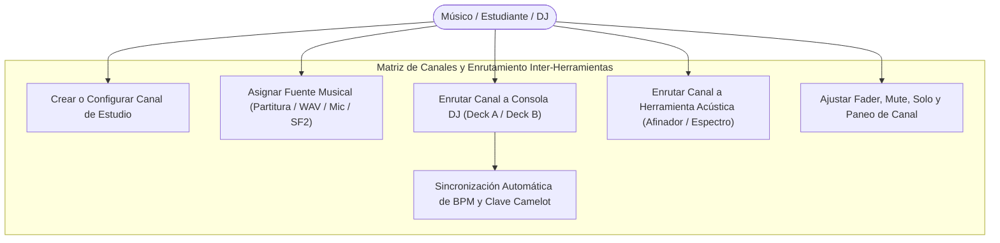
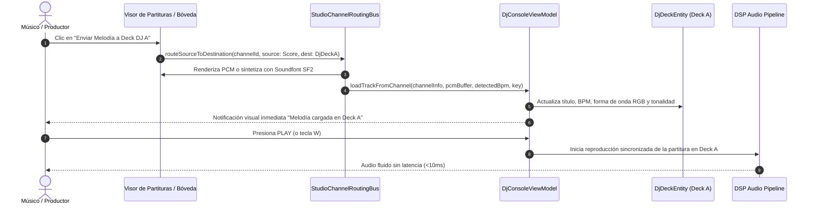

# Caso de Uso 87: Matriz Universal de Canales de Estudio y Enrutamiento Inter-Herramientas (Score-to-DJ-to-DSP)

Este documento define la especificación canónica, diagramas de flujo y casos de uso para la interconexión modular y atomizada de herramientas a través de canales de estudio en **Tunner**.

---

## 1. Metadatos del Caso de Uso

- **ID del Caso de Uso:** `UC-87-UNIVERSAL-STUDIO-CHANNEL-MATRIX-ROUTING`
- **Nombre:** Matriz Universal de Canales de Estudio y Enrutamiento Inter-Herramientas
- **Actor Principal:** Estudiante de Música / Productor Musical / DJ
- **Fase:** Fase 2 (Instrumentación, Consola DJ y Estaciones de Trabajo)
- **Componentes Afectados:**
  - `lib/core/channels/domain/studio_channel_entity.dart`
  - `lib/core/channels/data/studio_channel_routing_bus.dart`
  - `lib/core/channels/presentation/studio_channel_strip_widget.dart`
  - `lib/features/dj_console/presentation/dj_studio_workstation_view.dart`
  - `lib/features/dj_console/presentation/dj_console_view_model.dart`
  - `lib/features/score_editor/` (Interconexión de partituras a decks)
- **ADR Relacionado:** [ADR 0077](../04_adrs/0077_universal_studio_channel_matrix_and_inter_tool_audio_routing_suite.md)

---

## 2. Descripción General

En las estaciones de trabajo tradicionales (DAWs), conectar una partitura musical con un sintetizador, una consola de directo o herramientas de análisis acústico exige configurar manualmente complejas pistas de retorno, buses MIDI, puertos virtuales y ruteos matriciales abrumadores que confunden a estudiantes y ralentizan a profesionales.

El **Caso de Uso 87** resuelve este problema mediante un **Sistema de Canales de Estudio Basado en Ergonomía Cognitiva y Divulgación Progresiva**:
1. Cada fuente musical (una partitura MusicXML, un archivo WAV de la bóveda, un stem vocal, una señal de micrófono o un sintetizador Soundfont) reside en un **Canal de Estudio Nombrado y Coloreado**.
2. Cualquier canal puede ser **arrastrado o asignado directamente** a cualquier herramienta de destino:
   - Enviar una melodía de partitura a **Deck A** de la Consola DJ: el motor genera las muestras de audio y forma de onda en tiempo real, permitiendo hacer scratching, aplicar EQ de 3 bandas, filtrar frecuencias o sincronizar tempo BPM contra un beat comercial.
   - Enviar la salida del Deck DJ al **Afinador Estroboscópico** o **Espectrograma FFT**: permite visualizar la entonación y armónicos de una pista en tiempo real.
3. El usuario interactúa a través de conmutadores intuitivos y visuales en lugar de tablas complejas de enrutamiento.

---

## 3. Diagramas Formales de Casos de Uso y Secuencia

### 3.1 Diagrama de Casos de Uso (Mermaid)

### 3.2 Diagrama de Secuencia y Flujo de Señal (Mermaid)

---

## 4. Precondiciones y Postcondiciones

### Precondiciones:
- El proyecto contiene al menos una partitura, stem o archivo de audio disponible en la sesión local.
- La aplicación se encuentra en ejecución offline sin requerir servicios externos.

### Postcondiciones:
- El canal queda enlazado de forma reactiva al receptor seleccionado.
- La consola DJ puede manipular la partitura como si fuese un disco de vinilo o archivo WAV nativo.
- El rendimiento del sistema se mantiene a 60/120 FPS sin bloqueos de memoria ni picos de CPU.

---

## 5. Flujos de Operación

### 5.1 Flujo Principal (Happy Path)
1. El usuario abre una partitura o melodía en el espacio de trabajo.
2. En la cabecera de la herramienta o menú contextual, selecciona `"Enrutar a Canal -> Deck A"`.
3. El bus `StudioChannelRoutingBus` procesa las notas musicales, calcula su tempo nativo (p. ej. 120 BPM) y su centro tonal.
4. Deck A de la Consola DJ se actualiza automáticamente con la onda espectral de la melodía y el título correspondiente.
5. El usuario puede accionar el jog wheel para hacer scratch sobre la melodía o pulsar el botón `SYNC` para emparejarla con una base rítmica cargada en Deck B.
6. El fader de volumen del canal modula la ganancia sin distorsión ni saltos audibles.

### 5.2 Flujos Alternativos y Excepciones
- **Desconexión de Canal:** Si el usuario desconecta el canal de Deck A, el deck retiene el último estado seguro o se limpia sin interrumpir la reproducción en Deck B.
- **Formato Desconocido o Corrupto:** Si la fuente de audio o partitura presenta anomalías, el sistema notifica el error de forma no invasiva mediante un `SnackBar` y mantiene la ruta anterior sin colapsar el motor.
