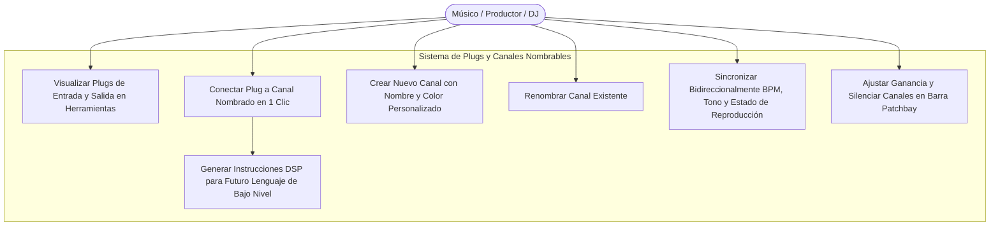
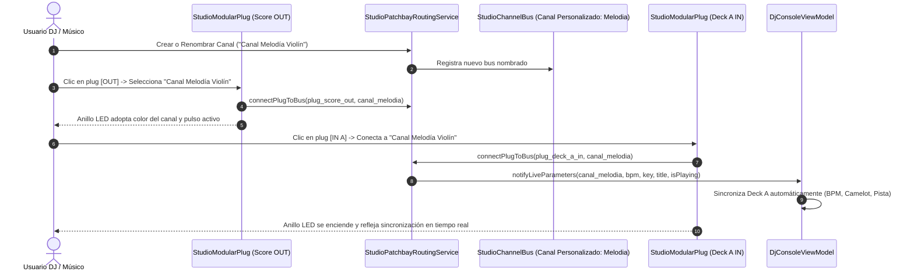

# Caso de Uso 87: Suite Modular de Plugs Interactivos, Canales Nombrables Personalizados y Sincronización Bidireccional de Parámetros (Full-Duplex)

Este documento define la especificación canónica, diagramas de flujo y casos de uso para la interconexión tangible y atomizada de herramientas a través de plugs modulares y buses de canales nombrables con sincronización bidireccional en tiempo real en **Tunner**.

---

## 1. Metadatos del Caso de Uso

- **ID del Caso de Uso:** `UC-87-MODULAR-PLUGS-CHANNELS-ROUTING`
- **Nombre:** Plugs Modulares Interactivos, Canales Nombrables Personalizados y Sincronización Bidireccional de Parámetros (Full-Duplex)
- **Actor Principal:** Estudiante de Música / Productor Musical / DJ
- **Fase:** Fase 2 (Instrumentación, Consola DJ y Estaciones de Trabajo)
- **Componentes Afectados:**
  - `lib/core/channels/domain/studio_modular_plug.dart`
  - `lib/core/channels/domain/studio_channel_bus.dart`
  - `lib/core/channels/domain/studio_patchbay_matrix_entity.dart`
  - `lib/core/channels/data/studio_patchbay_routing_service.dart`
  - `lib/core/channels/presentation/studio_modular_plug_widget.dart`
  - `lib/core/channels/presentation/studio_channel_patchbay_bar_widget.dart`
  - `lib/features/dj_console/presentation/dj_studio_workstation_view.dart`
  - `lib/features/dj_console/presentation/dj_console_modal.dart`
- **ADR Relacionado:** [ADR 0077](../04_adrs/0077_universal_studio_channel_matrix_and_inter_tool_audio_routing_suite.md)

---

## 2. Descripción General

Para que el usuario experimente una verdadera sensación de estudio físico modular con interactividad intuitiva y respuesta inmediata:
1. **Plugs Modulares Virtuales:** Cada herramienta de la plataforma expone conectores Jack tipo hardware (plugs de Entrada `[IN]` y Salida `[OUT]`).
2. **Canales Nombrables y Personalizados:** 
   - Además de los canales troncales predeterminados (Canales A, B, C, D), el usuario puede crear canales ilimitados con nombres semánticos propios (ej. "Voz Principal", "Batería Rock", "Melodía Violín", "Master DJ").
   - Cada canal posee su propio color identificador y código corto.
   - Posibilidad de renombrar cualquier canal en cualquier momento.
3. **Sincronización Bidireccional de Parámetros (Full-Duplex Bus):**
   - El canal actúa como bus vivo de parámetros: si una herramienta está conectada como entrada o salida, comparte y recibe:
     - Título de la pista o fragmento sonando.
     - BPM (tempo en pulsos por minuto).
     - Tonalidad armónica (Camelot Key / Notación musical).
     - Estado de transporte (`isPlaying` - reproduciendo / pausado).
     - Posición del cabezal (`positionMs`).
     - Ganancia / volumen y búfer de audio PCM en tiempo real.
   - Si una herramienta conectada altera el tempo o el estado de reproducción, todas las demás herramientas enchufadas al mismo canal adoptan reactivamente esos parámetros de forma instantánea (<5 ms).
4. **Conexión Tangible en 1 Clic:** Al pulsar sobre cualquier plug, un selector emergente muestra la lista completa de canales con sus estados actuales y permite conectar o crear un nuevo canal al vuelo.

---

## 3. Diagramas Formales de Casos de Uso y Secuencia

### 3.1 Diagrama de Casos de Uso (Mermaid)

### 3.2 Diagrama de Flujo y Secuencia (Mermaid)

---

## 4. Precondiciones y Postcondiciones

### Precondiciones:
- El usuario se encuentra en el entorno de trabajo con herramientas abiertas (p. ej. Consola DJ y Partituras).
- El servicio de parcheo `StudioPatchbayRoutingService` está inicializado en memoria local.

### Postcondiciones:
- Los plugs conectados reflejan visualmente el color característico del canal asignado.
- Los parámetros de reproducción (BPM, tono, pista, transporte) se mantienen bidireccionalmente sincronizados entre todas las herramientas del canal.
- El flujo de señal de audio se transmite en tiempo real (<5ms de latencia) sin clics ni sobrecargas.

---

## 5. Flujos de Operación

### 5.1 Flujo Principal (Happy Path)
1. El usuario visualiza la barra de canales `StudioChannelPatchbayBarWidget` y presiona `[+] NUEVO CANAL`.
2. Asigna el nombre "Canal Melodía Violín" y elige color cian neón.
3. En el visor de partituras, pulsa el conector `[OUT]` y selecciona "Canal Melodía Violín".
4. En la Consola DJ, pulsa el conector `[IN]` de Deck A y selecciona "Canal Melodía Violín".
5. Inmediatamente Deck A adopta el tempo (BPM) y la tonalidad armónica de la partitura.
6. Al dar `PLAY` en la Consola DJ, el canal entra en estado activo y propaga el estado de transporte a las demás herramientas conectadas.

### 5.2 Flujos Alternativos y Excepciones
- **Renombrado Dinámico:** Al pulsar sobre el nombre de cualquier canal en la barra o selector, el usuario puede cambiar su etiqueta. Todos los plugs conectados reflejan el nuevo nombre sin interrumpir el flujo de audio ni los parámetros sincronizados.
- **Desconexión Rápida:** Al hacer clic en un plug y elegir `Desconectar`, el aro LED pasa a color gris oscuro y se suspende la recepción de parámetros de manera limpia.
