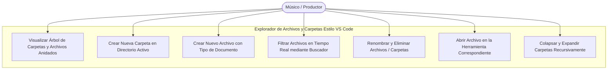
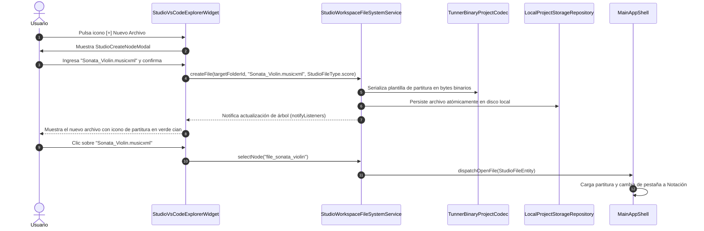

# Caso de Uso 88: Explorador Jerárquico de Archivos y Carpetas Estilo VS Code con Lectura y Escritura Atómica

Este documento define la especificación canónica, diagramas formales y flujos operativos para el **Explorador Jerárquico de Archivos y Carpetas de Tunner**, permitiendo operaciones atómicas de lectura, escritura, creación, navegación recursiva y filtrado en tiempo real en la estación de trabajo de escritorio.

---

## 1. Metadatos del Caso de Uso

- **ID del Caso de Uso:** `UC-88-VSCODE-FILE-SYSTEM-EXPLORER`
- **Nombre:** Explorador Jerárquico de Archivos y Carpetas Estilo VS Code con Lectura y Escritura Atómica
- **Actor Principal:** Usuario Músico / Productor / Ingeniero de Audio
- **Fase:** Fase 2 (Almacenamiento Binario y Estaciones de Trabajo)
- **Componentes Afectados:**
  - `lib/core/file_system/domain/studio_file_type.dart`
  - `lib/core/file_system/domain/studio_file_system_node.dart`
  - `lib/core/file_system/domain/studio_file_system_repository.dart`
  - `lib/core/file_system/data/studio_workspace_file_system_service.dart`
  - `lib/core/file_system/presentation/studio_file_tree_tile.dart`
  - `lib/core/file_system/presentation/studio_folder_tree_tile.dart`
  - `lib/core/file_system/presentation/studio_explorer_action_header.dart`
  - `lib/core/file_system/presentation/studio_vscode_explorer_widget.dart`
  - `lib/core/file_system/presentation/studio_file_system_modals.dart`
  - `lib/features/navigation/presentation/main_app_shell.dart`
- **ADR Relacionado:** [ADR 0078](../04_adrs/0078_vscode_style_atomized_file_system_and_project_explorer_suite.md)

---

## 2. Descripción General

El usuario necesita gestionar sus proyectos, partituras, tomas de audio y configuraciones con la misma familiaridad, velocidad y ergonomía que ofrece Visual Studio Code:
1. **Árbol de Directorios Recursivo e Ilimitado:** Carpetas que contienen subcarpetas y archivos con sangrías proporcionales, flechas indicadoras de apertura/cierre y estado de memoria de colapso.
2. **Acciones Rápidas en la Cabecera:**
   - Botón `[+] Nuevo Archivo` para crear archivos con extensiones reconocidas (`.tunner`, `.musicxml`, `.wav`, `.tpreset`, `.tnt`, `.djblueprint`).
   - Botón `[+] Nueva Carpeta` para organizar sesiones por instrumento, acto o versión.
   - Botón `[⟳ Refrescar]` para reindexar la estructura.
   - Botón `[↕ Colapsar Todo]` para contraer todas las carpetas a nivel raíz.
3. **Búsqueda y Filtrado Instantáneo:** Caja de texto con respuesta en tiempo real (<2ms) que filtra todo el árbol manteniendo la jerarquía de las carpetas que contienen coincidencias.
4. **Apertura Contextual Dinámica:** Al hacer clic en un archivo, la aplicación determina su tipo y abre la herramienta adecuada con el documento cargado:
   - Partituras $\rightarrow$ Abre el Espacio de Trabajo de Composición & Notación.
   - Tomas WAV $\rightarrow$ Enruta al reproductor o Deck DJ según esté conectado.
   - Presets de afinación $\rightarrow$ Aplica la calibración en el Afinador Pro.
   - Proyectos `.tunner` $\rightarrow$ Restaura la sesión completa (BPM, herramientas, canales).

---

## 3. Diagramas Formales de Casos de Uso y Secuencia

### 3.1 Diagrama de Casos de Uso (Mermaid)

### 3.2 Diagrama de Flujo y Secuencia (Mermaid)

---

## 4. Precondiciones y Postcondiciones

### Precondiciones:
- La aplicación se ejecuta en modo escritorio o tablet.
- El servicio de sistema de archivos `StudioWorkspaceFileSystemService` está inicializado.

### Postcondiciones:
- Los archivos creados se reflejan de inmediato en la jerarquía y persisten en disco local.
- Las operaciones de apertura contextúan la vista principal de la aplicación sin perder el estado de otras herramientas.

---

## 5. Flujos de Operación

### 5.1 Flujo Principal (Happy Path)
1. El usuario visualiza la barra lateral izquierda y observa el explorador de archivos con sus carpetas principales: "Partituras", "Grabaciones WAV", "Presets de Afinación".
2. Pulsa el botón `[+] Nueva Carpeta` en la barra de herramientas del explorador.
3. Ingresa "Bocetos Acto 2" y confirma. La carpeta aparece anidada.
4. Hace clic derecho o pulsa el menú de la nueva carpeta y selecciona `[+] Nuevo Archivo`.
5. Asigna el nombre "Tema_Principal.tunner" (Proyecto Maestro).
6. El archivo se genera, se marca como seleccionado y se serializa atómicamente en disco.
7. Al pulsar el archivo, el proyecto se abre cargando automáticamente todos los canales del estudio.

### 5.2 Flujos Alternativos y Excepciones
- **Búsqueda en Vivo:** Al escribir texto en la caja de búsqueda del explorador, los nodos que no coinciden se ocultan de forma inmediata en <2ms, expandiendo automáticamente las ramas ascendentes para revelar los archivos coincidentes. Al limpiar el texto, se restablece el estado de expansión previo.
- **Eliminación Segura:** Al seleccionar `Eliminar`, se despliega un diálogo de confirmación informando la cantidad de elementos que serán removidos si se trata de una carpeta con hijos.
