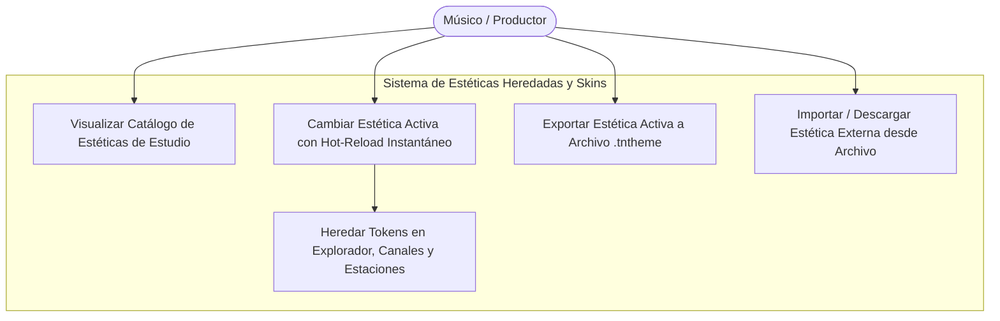
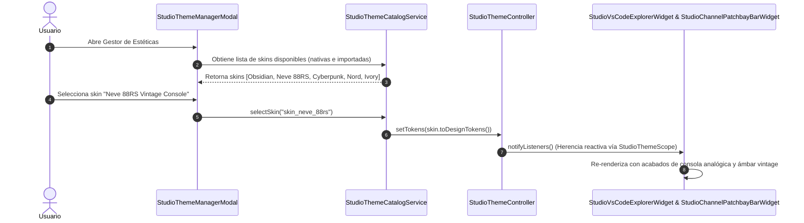

# Caso de Uso 89: Gestión de Skins Descargables y Herencia de Apariencia Total

Este documento define la especificación canónica, diagramas formales y flujos operativos para el **Sistema de Estéticas Heredadas y Catálogo de Skins Descargables (.tntheme)** en **Tunner**.

---

## 1. Metadatos del Caso de Uso

- **ID del Caso de Uso:** `UC-89-INHERITED-AESTHETICS-DOWNLOADABLE-SKINS`
- **Nombre:** Gestión de Skins Descargables y Herencia de Apariencia Total
- **Actor Principal:** Usuario Músico / Productor / Diseñador de Audio
- **Fase:** Fase 2 (Diseño de Sistemas, Skins y Estaciones de Trabajo)
- **Componentes Afectados:**
  - `lib/core/design_system/domain/studio_theme_skin_entity.dart`
  - `lib/core/design_system/data/studio_theme_catalog_service.dart`
  - `lib/core/design_system/studio_design_tokens.dart`
  - `lib/core/design_system/studio_theme_provider.dart`
  - `lib/core/design_system/molecules/studio_theme_manager_modal.dart`
  - `lib/core/file_system/presentation/*`
  - `lib/core/channels/presentation/*`
- **ADR Relacionado:** [ADR 0079](../04_adrs/0079_downloadable_themes_and_inherited_studio_aesthetic_suite.md)

---

## 2. Descripción General

Para que Tunner mantenga una estética de software de alta gama ("software caro de licencia") y sea al mismo tiempo ultra configurable:
1. **Herencia Total de Estilo:** Ninguna vista, widget o modal utiliza valores de color fijos o arbitrarios. Todos los elementos leen sus tonos desde el ámbito heredado `StudioThemeScope.tokensOf(context)`.
2. **Formato de Archivo `.tntheme`:** Las estéticas completas se empaquetan en archivos livianos y portables que contienen la matriz de diseño (superficies mate, líneas de separación finas de 1px, acentos de función, colores de texto y radios geométricos).
3. **Catálogo de Estéticas de Estudio:**
   - **Obsidian Pro DAW:** Ideal para sesiones nocturnas de mastering con alto contraste y enfoque extremo.
   - **Neve 88RS Vintage:** Calidez analógica inspirada en las consolas británicas legendarias de grabación.
   - **Tokyo Cyberpunk:** Estética futurista con degradados sutiles en violeta y cian brillante.
   - **Nord Electro:** Minimalismo industrial con toques de rojo crimson.
   - **Conservatory Ivory Paper:** Diseñado para lectura clara de partituras en conservatorios y luz de día.
4. **Importación y Exportación en 1 Clic:** El usuario puede exportar su configuración activa para compartirla con otros músicos, o cargar temas personalizados descargados.

---

## 3. Diagramas Formales de Casos de Uso y Secuencia

### 3.1 Diagrama de Casos de Uso (Mermaid)

### 3.2 Diagrama de Flujo y Secuencia (Mermaid)

---

## 4. Precondiciones y Postcondiciones

### Precondiciones:
- El entorno de la aplicación se encuentra renderizado con `StudioThemeScope`.
- El servicio `StudioThemeCatalogService` está inicializado.

### Postcondiciones:
- Todos los elementos visuales de la interfaz adoptan de forma simultánea e inmediata la nueva estética seleccionada.
- Las skins importadas se guardan en el almacenamiento local para mantenerse activas en sesiones futuras.

---

## 5. Flujos de Operación

### 5.1 Flujo Principal (Happy Path)
1. El usuario pulsa el selector de estética en la barra de herramientas.
2. Se despliega el modal `StudioThemeManagerModal` mostrando las tarjetas de las 5 estéticas de estudio.
3. El usuario pulsa sobre "Tokyo Cyberpunk Synthwave".
4. Toda la aplicación (explorador de archivos, barra de parcheo, botones y consolas) cambia de forma limpia e instantánea a la estética nocturna con tonos violeta y cian neón.

### 5.2 Flujos Alternativos y Excepciones
- **Importación de Skin Externa:** Al pulsar `Importar .tntheme`, el usuario selecciona un archivo de estética desde su sistema de archivos. El servicio valida la estructura JSON de los tokens; si es válida, la añade al catálogo y la activa de inmediato.
