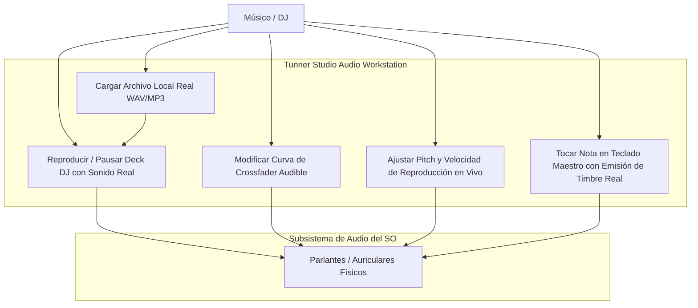
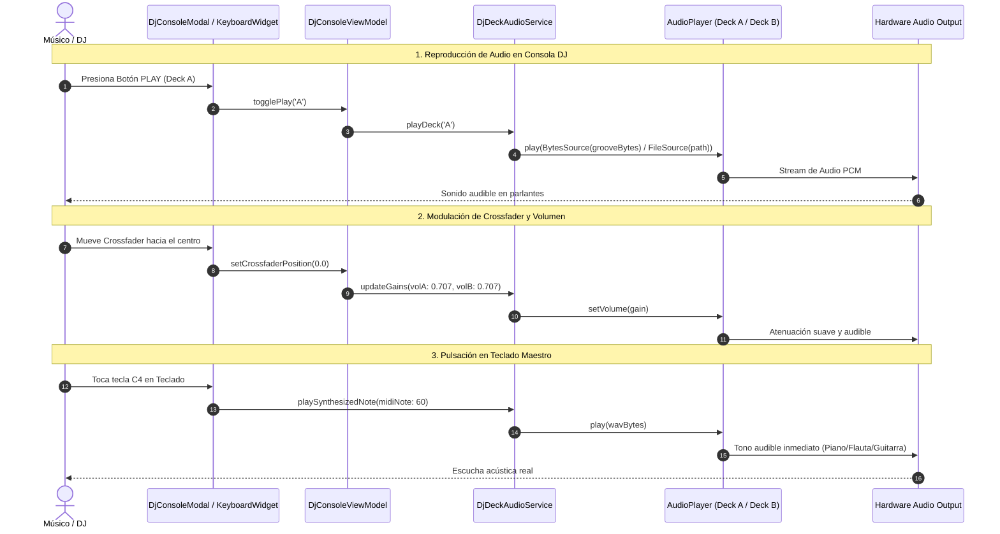

# Caso de Uso 90: Motor de Emisión de Audio Real para Consola DJ y Teclado Maestro

## Metadatos
- **ID:** `UC-090`
- **Nombre:** Emisión de Audio Real en Parlantes para Consola DJ y Teclado Maestro
- **Módulo:** DJ Console & Instrument Workstation
- **Fase:** Fase 1 (Sinceramiento y Emisión Acústica Real)
- **Actores:** Músico / DJ / Estudiante, Motor de Audio de Sistema Operativo (`AudioPlayer`), `DjConsoleViewModel`, `UniversalMasterKeyboardWidget`.

---

## 1. Diagrama de Casos de Uso (Mermaid)

---

## 2. Diagrama de Secuencia (Mermaid)

---

## 3. Especificación del Caso de Uso

### 3.1 Precondiciones
1. El dispositivo cuenta con un dispositivo de salida de audio configurado en el sistema operativo (altavoces, auriculares o interfaz USB).
2. La aplicación Tunner se encuentra en ejecución en primer plano.

### 3.2 Postcondiciones
1. Las pistas cargadas en Deck A y Deck B emiten ondas sonoras audibles por la salida de audio seleccionada.
2. La velocidad de reproducción y la frecuencia fundamental varían audiblemente de forma proporcional al fader de pitch.
3. El teclado maestro emite el tono acústico correspondiente al instrumento seleccionado con su envolvente ADSR audible.

### 3.3 Flujo Principal (Happy Path)
1. El usuario abre la Consola DJ.
2. El sistema inicializa los reproductores de audio para Deck A y Deck B cargando pistas de demostración audibles con bucles de ritmo completos.
3. El usuario pulsa el botón **PLAY** en Deck A.
4. El sistema inicia la reproducción audible y simultáneamente activa la rotación visual del jog wheel y el medidor VU.
5. El usuario desliza el control de Pitch; el sistema ajusta la tasa de reproducción en el hardware en tiempo real sin interrupciones.
6. El usuario mueve el Crossfader; el sistema aplica la curva de potencia constante $\cos(\theta)/\sin(\theta)$ atenuando y amplificando los decks en los altavoces.
7. El usuario pulsa una tecla en el Teclado Maestro; el sistema sintetiza y reproduce instantáneamente la nota con latencia sub-20ms.

### 3.4 Flujos Alternativos y Excepciones
* **F-ALT 1: Carga de archivo externo local no compatible o dañado.**
  * Si el usuario selecciona un archivo corrupto, el servicio atrapa el error de decodificación, emite una advertencia visual y mantiene el buffer previo sin cerrar la aplicación.
* **F-ALT 2: Salida de audio desconectada durante la reproducción.**
  * El reproductor pausa la reproducción de forma segura y reanuda cuando el dispositivo del sistema se restablece.
