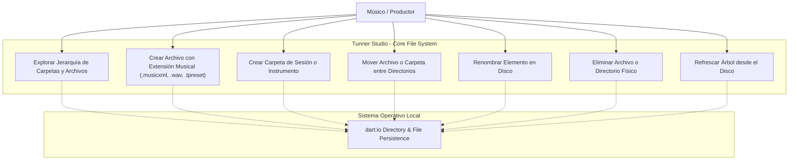
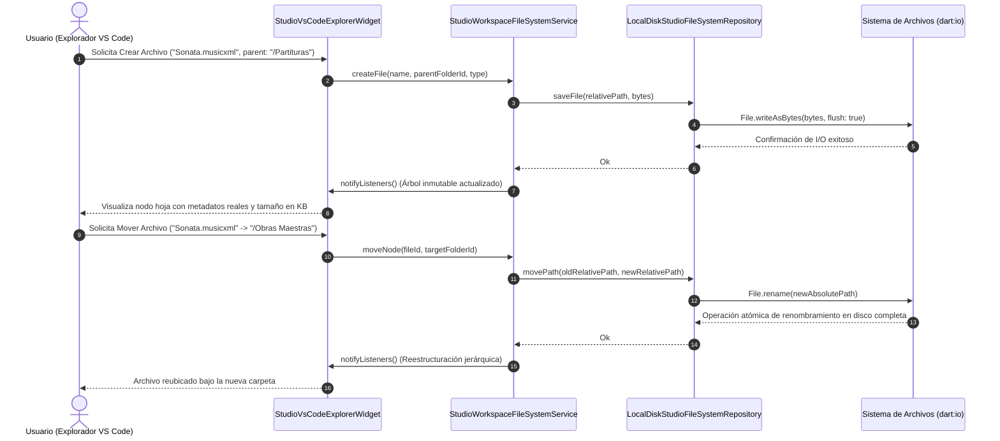

# Caso de Uso 91: Sistema de Archivo Real con Persistencia en Disco y Explorador VS Code

Documento de especificación formal del Caso de Uso 91 para la persistencia física en disco local (`dart:io`) y navegación interactiva jerárquica de archivos y carpetas del espacio de trabajo en Tunner Studio.

---

## Metadatos del Documento

- **ID del Caso de Uso:** `UC-91`
- **Título Oficial:** Persistencia Real de Sistema de Archivos en Disco y Explorador Jerárquico VS Code
- **Estado:** Aprobado
- **Fase Asociada:** Fase 2 (Sistema de Archivo Real)
- **Actores:** Productor Musical, Músico Educativo, Sistema de Archivos del SO (`dart:io`)

---

## 1. Resumen Ejecutivo

El presente caso de uso formaliza el desacoplamiento de la memoria volátil en el Explorador de Archivos de Tunner, garantizando que todos los proyectos, partituras MusicXML, capturas de audio WAV, presets de afinación y blueprints de consolas DJ sean leídos y escritos de forma persistente en el disco físico del usuario (`~/Documents/TunnerProjects` o directorio de aplicación local). Asimismo, se habilita la reubicación de elementos entre carpetas (movimiento físico de nodos) y la recarga inmediata del árbol tras modificaciones externas.

---

## 2. Diagramas de Casos de Uso y Secuencia

### 2.1 Diagrama de Casos de Uso (Mermaid)

### 2.2 Diagrama de Secuencia: Creación y Movimiento de Archivos en Disco (Mermaid)

---

## 3. Especificación Detallada del Flujo

### 3.1 Precondiciones
1. La aplicación Tunner se ejecuta en un entorno con permisos de lectura y escritura en almacenamiento local.
2. El directorio base del espacio de trabajo está inicializado o el repositorio cuenta con permisos para crear la carpeta raíz en disco.

### 3.2 Flujo Principal
1. **Inicialización y Carga:** Al arrancar el módulo de explorador, `StudioWorkspaceFileSystemService` invoca `loadRootWorkspace()` en el repositorio.
2. Si el directorio en disco no existe, se genera la estructura física canónica (`Partituras & Notación`, `Tomas de Audio & WAV`, `Presets de Afinación`, `Modelos Consola DJ`) sembrando las plantillas iniciales.
3. El usuario interactúa con la interfaz de árbol estilo VS Code (expandir/colapsar carpetas, filtrar por nombre).
4. El usuario crea, renombra, mueve o elimina un elemento.
5. El servicio actualiza el estado reactivo en memoria y ejecuta la operación física en disco correspondiente mediante `LocalDiskStudioFileSystemRepository`.
6. Si ocurre un cambio externo, el usuario presiona el botón "Refrescar" y el servicio vuelve a inspeccionar el disco físico, reconstruyendo el árbol fielmente.

### 3.3 Flujos Alternativos y Manejo de Errores
- **Fallo de permisos de E/S:** Si el directorio no cuenta con permisos de escritura, la operación de E/S captura la excepción `FileSystemException`, registra un log seguro y mantiene la integridad del árbol sin provocar cierres inesperados.
- **Conflicto de nombres:** Si un archivo con el mismo nombre ya existe en el destino, se añade un sufijo numérico determinista `_1` antes de la extensión.

### 3.4 Postcondiciones
- Todos los cambios estructurales y de contenido quedan escritos en almacenamiento no volátil.
- Reinicios posteriores de la aplicación cargan con fidelidad absoluta los archivos creados por el usuario.
