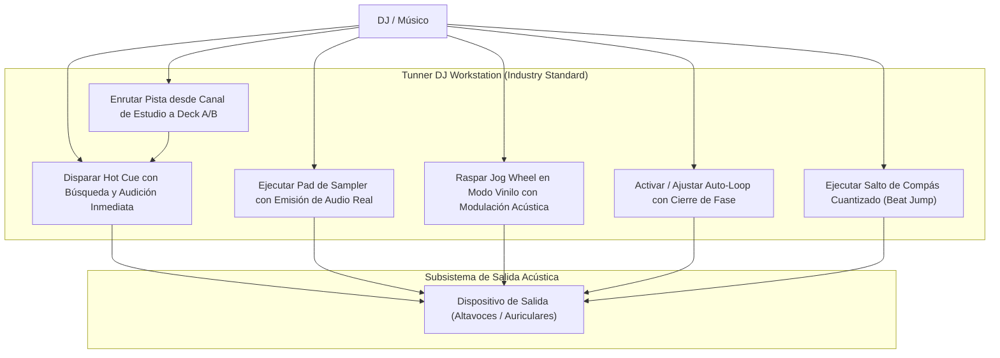
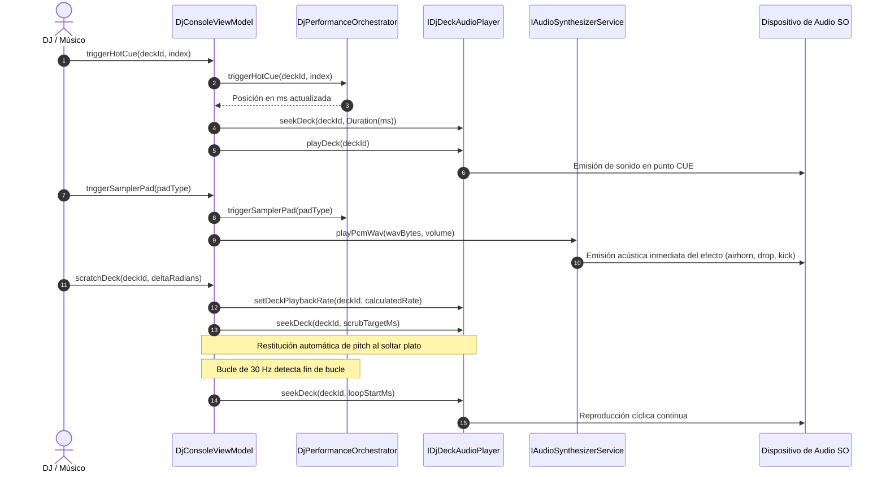

# Caso de Uso 92: Expansión de Consola DJ al Estándar de la Industria

## Metadatos
- **ID:** `UC-092`
- **Nombre:** Expansión del Motor de Rendimiento DJ al Estándar de la Industria
- **Módulo:** Consola DJ & Workstation de Audio
- **Fase:** Fase 1 (Sinceramiento y Emisión Acústica Real)
- **Actores:** DJ / Músico / Productor, `DjConsoleViewModel`, `IDjDeckAudioPlayer`, `IAudioSynthesizerService`, `UniversalStudioPatchbayService`.

---

## 1. Resumen Ejecutivo

Este caso de uso especifica la integración profunda de los controles táctiles e interactivos de la Consola DJ con el subsistema de audio físico del dispositivo. Establece la ejecución audible en tiempo real de Hot Cues, Sampler de 8 pads acústicos, modulación de velocidad por Jog Wheel en modo vinilo (scratching y audio scrubbing), ciclos de auto-loops continuos y salto de compás cuantizado (beat jump), así como la ingesta de señales acústicas directas desde la Matriz Universal de Canales del Estudio.

---

## 2. Diagrama de Casos de Uso (Mermaid)

---

## 3. Diagrama de Secuencia (Mermaid)

---

## 4. Fundamento Teórico y Matemático

### 4.1 Modulación de Velocidad por Jog Wheel (Scratch y Scrubbing)
El giro angular de la rueda de desplazamiento $\Delta \theta$ en un intervalo de tiempo $\Delta t$ produce una velocidad angular $\omega = \frac{\Delta \theta}{\Delta t}$.

La tasa de reproducción dinámica en modo vinilo se deriva como:
$$\text{rate}_{\text{vinyl}} = \left( \text{pitchMultiplier} + \omega \cdot K_{\text{scratch}} \right)_{\text{clamp}(0.2, 3.0)}$$
Donde $K_{\text{scratch}} \approx 0.15$ es la constante de calibración táctil. Si $\Delta \theta < 0$ y excede el umbral de aceleración, el reproductor ejecuta un rebobinado por scrubbing en milisegundos:
$$\Delta t_{\text{scrub}} = \Delta \theta \cdot K_{\text{scrub\_time}}$$

### 4.2 Salto de Compás Cuantizado (Beat Jump)
Para una pista con tempo efectivo $\text{BPM}_{\text{eff}}$, la duración de un compás de 4 pulsos (o cualquier número de beats $\beta$) en milisegundos es:
$$\Delta t_{\text{jump}} = \beta \cdot \left( \frac{60000}{\text{BPM}_{\text{eff}}} \right)$$
El salto sitúa el cabezal en:
$$t_{\text{target}} = \text{clamp}\left(t_{\text{current}} + \Delta t_{\text{jump}}, 0, t_{\text{duration}}\right)$$
Dicha posición se comunica inmediatamente al reproductor de hardware vía `seekDeck`.

---

## 5. Especificación Funcional

### 5.1 Precondiciones
1. La Consola DJ se encuentra instanciada en el árbol de widgets o en el ViewModel.
2. Los decks A y B poseen pistas cargadas (demostración o archivos locales del usuario).

### 5.2 Flujo Principal
1. **Hot Cues:**
   - Si el pad de Hot Cue no tiene marca guardada, se almacena la posición actual.
   - Si el pad ya contenía una posición guardada, el cabezal salta inmediatamente a dicho milisegundo y el reproductor de audio emite sonido sin retraso.
2. **Sampler de Rendimiento:**
   - Al pulsar cualquiera de los 8 pads, se genera el buffer de muestras sintetizadas y se invoca `playPcmWav`, produciendo sonido físico audible en la salida seleccionada.
3. **Control de Jog Wheel:**
   - Al arrastrar el Jog Wheel con el mouse o la rueda táctil, el ángulo se actualiza y la velocidad del reproductor se modula; al cesar la interacción, un temporizador restaura la velocidad original de la pista.
4. **Bucles y Beat Jump:**
   - La activación de Auto-Loop define `loopStartMs` y `loopEndMs`. Cada vez que el reloj de 30 Hz detecta que la posición ha alcanzado el límite, se ejecuta un salto de regreso a `loopStartMs`.

### 5.3 Postcondiciones
- El estado visual de los controles, formas de onda y LEDs físicos concuerda exactamente con la señal de audio escuchada por el usuario.

---

## 6. Criterios de Aceptación (Definition of Done)

- [ ] Cero emojis en documentación, código y salidas de terminal.
- [ ] Hot Cues buscan y suenan en tiempo real.
- [ ] 8 Sampler Pads emiten audio audible sin latencia perceptible.
- [ ] Jog Wheel modula la velocidad y permite scrubbing audible.
- [ ] Pruebas unitarias de integración superadas con 100% de éxito.
