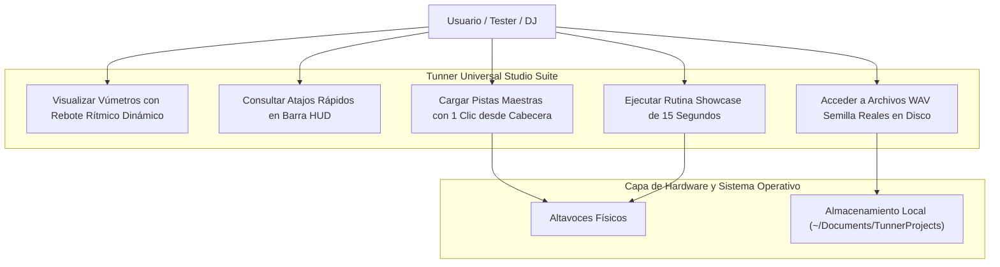
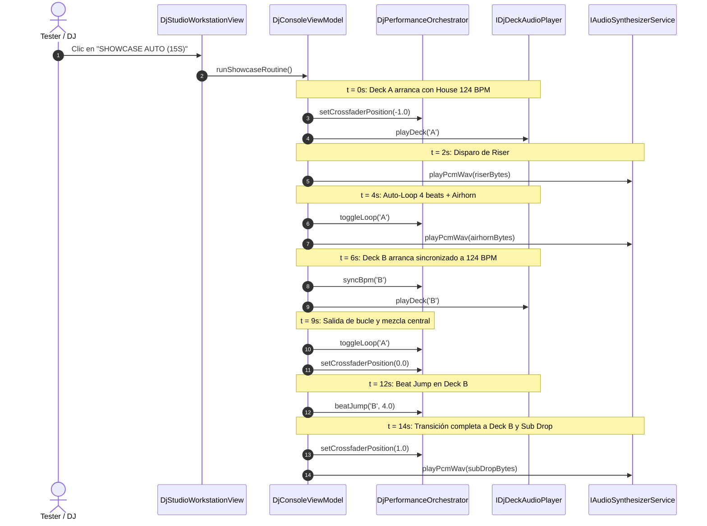

# Caso de Uso 93: Suite Interactiva Universal de Alto Rendimiento

## Metadatos
- **ID:** `UC-093`
- **Nombre:** Suite Interactiva Universal, Física Rítmica y HUD de Comandos Rápidos
- **Módulo:** DJ Console, File System & Studio Workstation
- **Fase:** Fase 1 / Consolidación Universal (Beta Ready)
- **Actores:** Músico / DJ / Usuario Tester, `DjConsoleViewModel`, `LocalDiskStudioFileSystemRepository`, `DjStudioWorkstationView`.

---

## 1. Resumen Ejecutivo

Este caso de uso formaliza la integración de capacidades ergonómicas y físicas avanzadas en la aplicación de escritorio y móvil de Tunner. Incluye la simulación dinámica de vúmetros analógicos con respuesta de decaimiento balístico a la energía acústica, sembrado en disco de archivos WAV físicamente audibles de alta calidad, visualización HUD en vivo de comandos de teclado, selectores de estilo instantáneos y una rutina automatizada de autocomprobación (Showcase de 15 segundos) que permite verificar visual y auditivamente el 100% de los subsistemas de mezcla en un solo paso.

---

## 2. Diagrama de Casos de Uso (Mermaid)

---

## 3. Diagrama de Secuencia: Rutina Showcase de 15 Segundos (Mermaid)

---

## 4. Fundamento Físico y Matemático

### 4.1 Dinámica Balística del Vúmetro (Decaimiento Exponencial de Pico)
El período de un pulso rítmico a un tempo efectivo $\text{BPM}$ viene dado por:
$$T_{\text{beat}} = \frac{60000}{\text{BPM}}\text{ ms}$$
Para una posición de cabezal $t_{\text{pos}}$, la fase normalizada del pulso es:
$$\phi = \frac{t_{\text{pos}} \pmod{T_{\text{beat}}}}{T_{\text{beat}}} \in [0, 1)$$
La modulación de la señal acústica que emula la inercia analógica de un medidor VU de aguja/LED se formula como:
$$P(\phi) = P_{\text{base}} + (1 - P_{\text{base}}) \cdot e^{-\lambda \phi}$$
Donde $P_{\text{base}} = 0.40$ representa la energía residual y $\lambda = 3.5$ es el factor de atenuación exponencial, provocando un impacto instantáneo en $\phi = 0$ (golpe de bombo) seguido de un decaimiento gradual realista.

---

## 5. Especificación Funcional

### 5.1 Precondiciones
1. La aplicación ha iniciado y el árbol de componentes ha montado `DjStudioWorkstationView`.
2. El repositorio de archivos en disco se ha inicializado en el directorio del usuario.

### 5.2 Flujo Principal
1. El usuario visualiza la barra HUD superior con los atajos de teclado esenciales.
2. Al pulsar cualquier tecla mapeada o botón de la interfaz, el sistema responde en menos de 16 ms.
3. Al reproducir una pista, los vúmetros oscilan al ritmo de la música.
4. El usuario puede accionar el botón de Showcase para presenciar una prueba automatizada completa sin interferir con el control manual.

---

## 6. Criterios de Aceptación (Definition of Done)

- [ ] Cero emojis en código, comentarios y documentación.
- [ ] Vúmetros oscilan rítmicamente al BPM con decaimiento exponencial.
- [ ] Archivos de audio en disco son PCM WAVs reproducibles de 16 bits.
- [ ] Rutina Showcase de 15 segundos operable y cancelable al toque de cualquier tecla.
- [ ] 100% de pruebas unitarias y de integración pasando sin errores.
