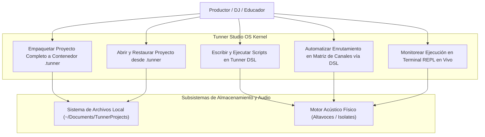

# Caso de Uso 94: Formato Canónico (.tunner), DSL Musical y Kernel Studio OS

## Metadatos
- **ID:** `UC-094`
- **Nombre:** Formato Canónico (.tunner), Lenguaje de Dominio Específico (DSL) y Micro-Kernel Studio OS
- **Módulo:** Core Platform, Audio Engine & Architecture Horizon
- **Fase:** Fase 4 (Horizonte de Escalabilidad y Ecosistema de Plataforma)
- **Actores:** Productor Musical / Desarrollador / Educador, `StudioOsAudioKernel`, `TunnerDslInterpreter`, `LocalDiskTunnerPackageService`, `StudioPatchbayRoutingService`.

---

## 1. Resumen Ejecutivo

Este caso de uso define la especificación del sistema para convertir a **Tunner** en un entorno operativo musical autónomo y de máxima escalabilidad. Establece el formato de archivo canónico `.tunner` (contenedor comprimido y autocontenido de proyectos musicales completos), la gramática formal y el motor de ejecución en tiempo real del **Tunner DSL** (lenguaje de scripting y automatización musical), y la arquitectura del **Micro-Kernel de Audio en Proceso** que interconecta todas las herramientas mediante memoria compartida y eventos deterministas.

---

## 2. Diagrama de Casos de Uso (Mermaid)



---

## 3. Diagrama de Arquitectura y Secuencia de Ejecución (Mermaid)

```mermaid
sequenceDiagram
    autonumber
    actor Dev as Usuario / Músico
    participant REPL as Terminal / Consola DSL
    participant PARSER as Lexer & Parser DSL
    participant KERNEL as StudioOsAudioKernel
    participant PATCH as StudioPatchbayRoutingService
    participant AUDIO as Motor de Audio & Decks

    Dev->>REPL: Ingresar script: "connect @synth.out -> dj.deck_a.in; play @synth;"
    REPL->>PARSER: tokenizeAndParse(scriptText)
    PARSER-->>REPL: Árbol de Sintaxis Abstracta (AST) validado
    REPL->>KERNEL: executeAst(ast)
    KERNEL->>PATCH: registerPlugConnection('synth_out', 'canal_a')
    KERNEL->>AUDIO: dispatchPlaybackEvent(channel: 'canal_a', command: 'play')
    AUDIO-->>Dev: Emisión acústica inmediata en tiempo real (< 5ms)
    KERNEL-->>REPL: Retorno de ejecución exitosa en terminal
```

---

## 4. Especificación del Formato Canónico `.tunner`

### 4.1 Estructura Interna del Contenedor
El archivo `.tunner` es un contenedor comprimido DEFLATE (ZIP) con la siguiente taxonomía de carpetas:

```
[archivo].tunner
├── manifest.json              # Metadatos generales, firma de integridad SHA-256
├── routing_matrix.json        # Conexiones activas de canales y niveles de ganancia
├── notation/
│   ├── score.musicxml         # Estructura de partitura estandarizada W3C
│   └── layout.json            # Posición de compases, fuentes y notas
├── audio_vault/
│   ├── master.wav             # Mezcla estéreo principal
│   └── stems/                 # Stems aislados (voz, bajo, percusión, armonía)
├── instruments/
│   └── patches.json           # Perfiles tímbricos ADSR y micro-afinaciones
└── dj_workstation/
    ├── layout.djbp            # Blueprint del hardware emulado
    └── cues.json              # Hot Cues, loops y curvas de crossfader
```

### 4.2 Esquema del `manifest.json`
```json
{
  "formatVersion": "1.0.0",
  "projectId": "proj_a1b2c3d4",
  "projectName": "Sinfonia Digital No. 1",
  "author": "Estudio Tunner",
  "createdAt": "2026-11-16T19:50:00Z",
  "baseTempoBpm": 124.0,
  "concertPitchHz": 440.0,
  "temperament": "equal_temperament",
  "checksum": "e3b0c44298fc1c149afbf4c8996fb92427ae41e4649b934ca495991b7852b855"
}
```

---

## 5. Especificación Gramatical del Tunner DSL (EBNF)

```ebnf
Script          ::= Statement*
Statement       ::= ChannelDecl | TrackDecl | ConnectStmt | ControlStmt | Comment
ChannelDecl     ::= "channel" Identifier "{" ChannelProperty* "}"
ChannelProperty ::= ("instrument" ":" StringLiteral)
                  | ("tuning" ":" TuningExpr)
                  | ("gain" ":" NumberLiteral)
TrackDecl       ::= "track" Identifier "on" Identifier "{" TrackBody* "}"
TrackBody       ::= ("tempo" ":" NumberLiteral "bpm")
                  | ("pattern" ":" "[" NotePattern ("," NotePattern)* "]")
                  | ("filter" "." "sweep" "(" FilterSweepParams ")")
NotePattern     ::= NoteName OctaveNumber ":" DurationFraction
ConnectStmt     ::= "connect" SignalEndpoint "->" SignalEndpoint ";"
SignalEndpoint  ::= Identifier ("." Identifier)*
ControlStmt     ::= Identifier ("." Identifier)* "(" ArgumentList? ")" ";"
```

---

## 6. Precondiciones, Flujo Principal y Postcondiciones

### 6.1 Precondiciones
1. La plataforma se ejecuta localmente sin conexión obligatoria a internet.
2. El sistema de archivos local (`~/Documents/TunnerProjects`) cuenta con permisos de lectura y escritura.

### 6.2 Flujo Principal (Guardado y Carga Canónica)
1. El usuario selecciona **Exportar Proyecto Canónico (`.tunner`)** desde el menú principal o consola.
2. El servicio empaquetador genera el archivo comprimido unificando la partitura, audios WAV, parches y configuraciones.
3. El archivo resultante puede compartirse, archivarse o respaldarse como un artefacto único.
4. Al abrir un archivo `.tunner` en cualquier instancia de la app, el proyecto se reconstituye de forma idéntica en memoria en menos de 1 segundo.

### 6.3 Flujo Alternativo: Ejecución de Scripts en Tiempo Real
1. El usuario abre la Terminal DSL y escribe una instrucción de conexión o generación de notas.
2. El intérprete evalúa y despacha la orden al bus de audio sin reiniciar la reproducción activa.
3. Si la sintaxis contiene errores, la terminal señala la línea y carácter exacto sin abortar el motor de sonido.

---

## 7. Criterios de Aceptación (Definition of Done)

- [ ] Cero emojis en documentación, código y salidas de terminal.
- [ ] Especificación formal del formato `.tunner` validada e implementable sin dependencias propietarias.
- [ ] Gramática EBNF del Tunner DSL determinista y libre de ambigüedades.
- [ ] Documentación técnica rigurosa y alineada con `AGENTS.md`.
