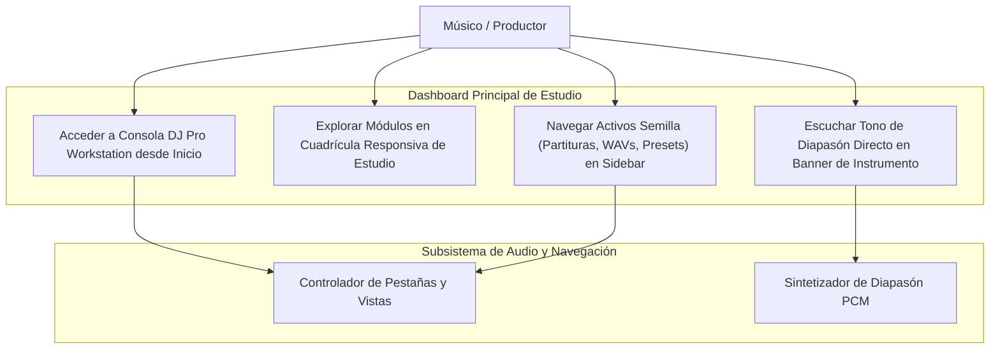
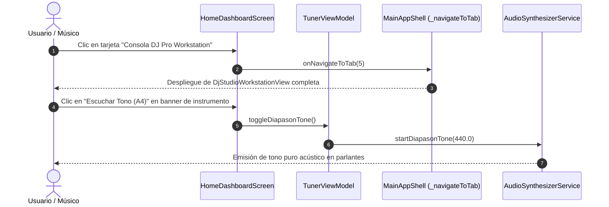

# Caso de Uso 95: Rediseño Pro del Dashboard de Inicio y Activos de Espacio de Trabajo

## Metadatos
- **ID:** `UC-095`
- **Nombre:** Rediseño Pro del Dashboard de Inicio, Incorporación de Consola DJ y Población de Activos
- **Módulo:** Navegación, Dashboard de Inicio y Árbol de Documentos del Proyecto
- **Fase:** Fase 1 / Consolidación de Experiencia y Estética de Estudio
- **Actores:** Músico / Productor / Usuario Tester, `TunerViewModel`, `HomeDashboardScreen`, `MainAppShell`.

---

## 1. Resumen Ejecutivo

Este caso de uso aborda la modernización de la superficie de bienvenida del software (`HomeDashboardScreen`) y la integridad visual del explorador de proyectos. Resuelve la ausencia de la Consola DJ Pro en la cuadrícula de inicio, transforma el diseño plano monocromático en una cuadrícula responsiva de 2 columnas de grado estudio profesional con gradientes sutiles y micro-métricas en vivo, y asegura que el árbol de documentos del proyecto en la barra lateral lateralice activos musicales predeterminados de alta fidelidad en lugar de carpetas vacías con conteos `(0)`.

---

## 2. Diagrama de Casos de Uso (Mermaid)

---

## 3. Diagrama de Secuencia (Mermaid)

---

## 4. Especificación Funcional

### 4.1 Requerimientos Funcionales
- **REQ-01 (Tarjeta DJ en Dashboard):** El dashboard debe incluir una tarjeta dedicada a la Consola DJ Pro con descripción de mezcla de 2 decks, jogwheels con scratch, 4-stems isolator y sampler de 8 pads, navegando directamente a la pestaña 5.
- **REQ-02 (Rejilla Responsiva de Escritorio):** Para anchos de pantalla $\ge 900\text{px}$, los módulos principales deben organizarse en una cuadrícula de dos columnas aprovechando el ancho disponible con proporciones armónicas de tarjeta de audio.
- **REQ-03 (Población de Activos de Proyecto):** `TunerViewModel` debe garantizar que `workspaceScores`, `recordingHistory` y `customTuningPresets` contengan elementos semilla válidos al inicio de la aplicación.

---

## 5. Criterios de Aceptación (Definition of Done)

- [ ] Cero emojis en código, comentarios y documentación técnica.
- [ ] La tarjeta de Consola DJ Pro se renderiza y navega a la pestaña de DJ.
- [ ] El árbol de proyectos muestra números positivos de elementos (`(3)`, `(2)`, `(2)`).
- [ ] La interfaz se adapta dinámicamente al tamaño de pantalla.
- [ ] Todas las pruebas automatizadas pasan al 100%.
