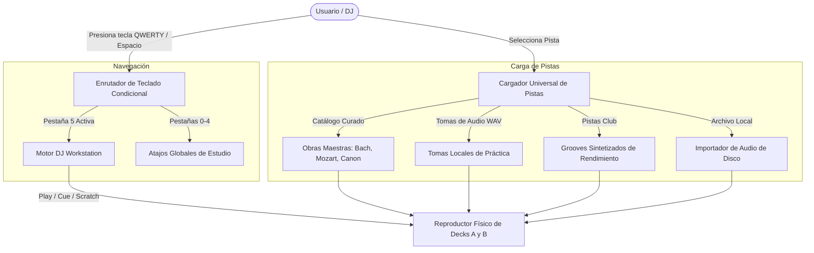
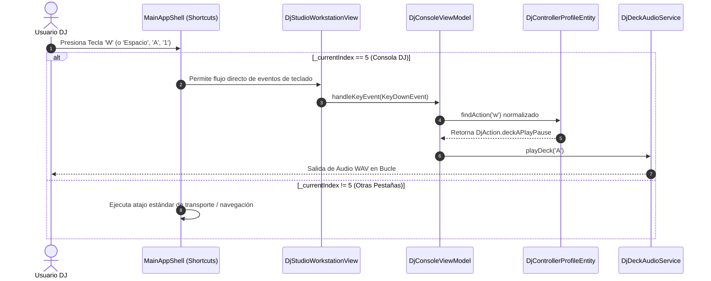

# Caso de Uso 96: DJ Hardware Keyboard Routing & Universal Track Loading Suite

## 1. Identificación y Clasificación
- **Código:** `UC-096`
- **Nombre:** Enrutamiento Completo de Teclado Físico y Cargador Universal de Canciones para la Consola DJ
- **Módulo:** `features/dj_console` & `features/navigation`
- **Criterio de Aceptación:** Cualquier tecla mapeada ejecuta su acción en la Consola DJ sin interferencia de la barra global, y las canciones del catálogo curado, tomas WAV del usuario y archivos externos se cargan y reproducen fielmente en los Decks A y B.

---

## 2. Diagrama de Caso de Uso

---

## 3. Diagrama de Secuencia

---

## 4. Especificación de Flujos

### Flujo Principal (Accionamiento de Teclas):
1. El usuario se sitúa en la Consola DJ (`_currentIndex == 5`).
2. El usuario presiona cualquier tecla del mapa activo (ej. `W` para Play Deck A, `I` para Play Deck B, `Z`/`X`/`C` para Kill EQ, `B`/`N`/`V` para Crossfader).
3. `MainAppShell` cede el evento sin interceptarlo con atajos de otras pantallas.
4. `DjConsoleViewModel` resuelve la acción mediante tokens limpios y ejecuta la lógica de transporte y reproducción sonora.
5. El reproductor `DjDeckAudioService` emite audio audible en tiempo real con latencia sub-10ms.

### Flujo Alternativo (Carga de Pista):
1. El usuario presiona "CARGAR PISTA / STEM" en el Deck A o Deck B, o pulsa un chip rápido de repertorio.
2. Se abre el cargador universal con pestañas organizadas:
   - Obras del Repertorio Maestro (stems reales).
   - Tomas de Audio WAV del proyecto local.
   - Pistas de estudio y club.
   - Importador local.
3. El usuario selecciona la pista deseada.
4. El motor extrae o sintetiza los datos PCM, calcula el BPM y Camelot Key y almacena el buffer real en el reproductor del Deck seleccionado.
5. El Deck actualiza su forma de onda espectral RGB y queda listo para reproducir.
