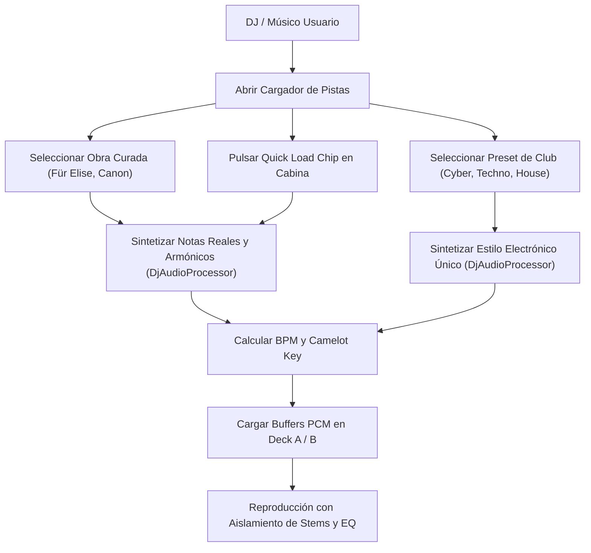
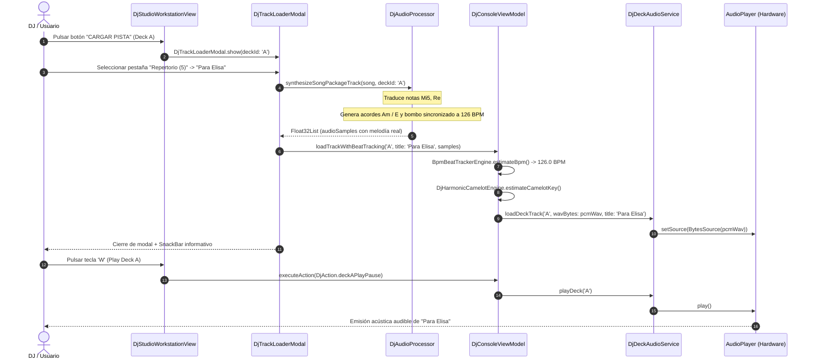

# Use Case: UC-97 - Síntesis Acústica Real de Partituras Curadas y Motor de Grooves Diferenciados en Consola DJ

## Metadatos del Documento

- **ID del Documento:** `DOC-USECASE-2026-97`
- **Título Oficial:** Especificación de Caso de Uso UC-97: Síntesis Acústica Real de Partituras Curadas (Für Elise, Canon, Beethoven) y Motor de Grooves Diferenciados para la Consola DJ Pro Studio
- **Estado:** Approved
- **Fecha de Creación:** 2026-11-16
- **Última Modificación:** 2026-11-16
- **Fase Asociada:** Fase 1
- **Autor / Revisor Principal:** Antigravity Architect

---

## 1. Resumen Ejecutivo (Executive Summary)

Este caso de uso formaliza la integración entre el motor de partituras jerárquicas (`HierarchicalScore`), la biblioteca de obras curadas (`SongPackage`) y el procesador de audio en tiempo real de la cabina de DJ (`DjAudioProcessor`). Resuelve la problemática donde cualquier pista de repertorio seleccionada (e.g. "Para Elisa", "Canon en Re Mayor", "Himno a la Alegría") era reproducida con un tono de prueba invariable a 55 Hz. Mediante síntesis procedural sustractiva/aditiva con envolventes ADSR polifónicas y cálculo determinístico de frecuencias $f_0$, cada deck sintetiza las notas reales de la partitura y un acompañamiento rítmico coherente con su tempo nominal.

---

## 2. Contexto del Problema y Justificación Teórica

### 2.1 Planteamiento del Problema
Al cargar una obra clásica en la cabina de DJ, el usuario espera escuchar la melodía característica de la pieza (por ejemplo, el célebre motivo $Mi_5 - Re\#_5 - Mi_5 - Re\#_5 - Mi_5 - Si_4 - Re_5 - Do_5 - La_4$ en "Para Elisa"). Anteriormente, el cargador delegaba en una función de demostración `generateDemoGroove` configurada a un bajo constante de 55 Hz (tono $La_1$), imposibilitando la distinción auditiva de las obras y neutralizando la experiencia pedagógica y musical.

### 2.2 Fundamento Teórico / Acústico
La frecuencia fundamental de cada nota musical se calcula a partir de su número de nota MIDI ($m$) bajo el estándar de afinación de concierto ($A_4 = 440\text{ Hz}$, $m = 69$):

$$f(m) = 440.0 \cdot 2^{\frac{m - 69}{12}}$$

Para cada nota de la partitura con duración $d$ ticks a un tempo nominal $\text{BPM}$:

$$\Delta t_{\text{tick}} = \frac{60}{\text{BPM} \cdot 4}$$

$$\Delta t_{\text{nota}} = d \cdot \Delta t_{\text{tick}}$$

El buffer de audio de la melodía se sintetiza con armónicos para simular el timbre de piano/clave y una envolvente de atenuación exponencial:

$$s_{\text{melodía}}(t) = A(t) \cdot \left[ 0.70 \sin(2\pi f t) + 0.20 \sin(4\pi f t) + 0.10 \sin(6\pi f t) \right]$$

---

## 3. Diagramas Formales de Casos de Uso y Secuencia

### 3.1 Diagrama de Casos de Uso (Mermaid)

### 3.2 Diagrama de Secuencia Detallado (Mermaid)

---

## 4. Especificación Funcional

### 4.1 Precondiciones
1. La aplicación Tunner se encuentra en ejecución en la pestaña 5 (Consola DJ Pro Studio).
2. El sistema de audio local se encuentra inicializado con volumen > 0.

### 4.2 Postcondiciones
1. El deck correspondiente (A o B) contiene el título, compositor, BPM nominal y tonalidad armónica de la obra cargada.
2. Al iniciar la reproducción (`W` o `I`), los altavoces reproducen fielmente la melodía de la obra seleccionada (e.g. notas de Para Elisa o Canon de Pachelbel).
3. Los controles de 4-Stem isolation (Bass, Drums, Vocals, Melody) aíslan adecuadamente las componentes armónicas y melódicas de la pista.

### 4.3 Flujo Principal
1. El usuario abre el cargador de pistas o presiona uno de los chips de acceso rápido (`Canon 68`, `Mozart 118`, `House 124`, `Cyber 128`).
2. El sistema consulta la entidad `SongPackage` y extrae su `HierarchicalScore`.
3. `DjAudioProcessor.synthesizeSongPackageTrack` sintetiza en un buffer de memoria de alta fidelidad:
   - Capa melódica solista con el timbre de las notas de la partitura.
   - Capa armónica de acompañamiento con los acordes correspondientes.
   - Capa rítmica de club con tempo sincronizado al BPM de la obra.
4. El buffer sintetizado se convierte a formato WAV PCM canónico de 16-bit 44.1 kHz.
5. El reproductor del deck almacena el buffer y actualiza la forma de onda espectral RGB.
6. El usuario pulsa Play o mueve el Jog Wheel, escuchando la pieza auténtica en tiempo real.

### 4.4 Flujos Alternativos y de Error
- **FA-01: Selección de Preset de Club:** Si el usuario selecciona un preset como *Liquid Drum & Bass*, el procesador sintetiza un patrón sincopado rápido a 174 BPM con sub-bajo 808 y acordes Rhodes en vez de la partitura clásica.
- **FE-01: Obra sin notas definidas:** Si una partitura personalizada estuviera vacía, el sintetizador genera un colchón armónico tonal de referencia en la tónica indicada sin provocar errores de división por cero ni bloqueo del hilo de ejecución.
