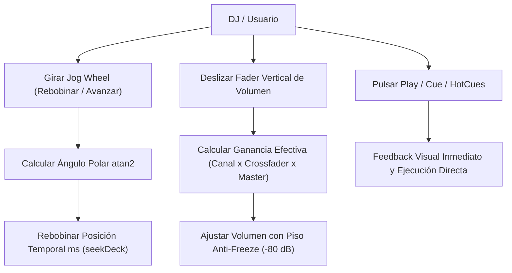
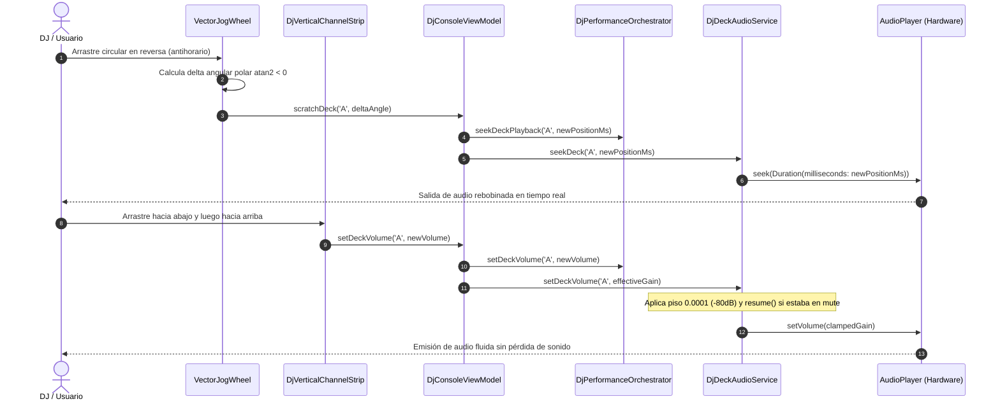

# Use Case: UC-98 - Fluidez Táctil de Botones, Rebobinado Físico de Jog Wheels y Estabilidad de Volumen en Consola DJ

## Metadatos del Documento

- **ID del Documento:** `DOC-USECASE-2026-98`
- **Título Oficial:** Especificación de Caso de Uso UC-98: Fluidez Táctil de Botones, Rebobinado Físico de Jog Wheels y Estabilidad de Tubería de Volumen en la Consola DJ Pro Studio
- **Estado:** Approved
- **Fecha de Creación:** 2026-11-16
- **Última Modificación:** 2026-11-16
- **Fase Asociada:** Fase 1
- **Autor / Revisor Principal:** Antigravity Architect

---

## 1. Resumen Ejecutivo (Executive Summary)

Este caso de uso aborda y soluciona integralmente tres problemáticas de interacción física y acústica en la Consola DJ Pro Studio:
1. **Rebobinado Natural del Disco:** El Jog Wheel ahora calcula la rotación angular polar exacta respecto al centro del plato utilizando coordenadas trigonométricas $\text{atan2}(y, x)$. El arrastre hacia atrás o adelante busca y rebobina la pista en tiempo real de forma audible e interactiva.
2. **Estabilidad de la Tubería de Audio:** Se previene la desincronización o enmudecimiento permanente de la salida de audio al subir y bajar el volumen rápidamente, utilizando un piso inaudible a $-80\text{ dBFS}$ y reanudación activa de la tubería GStreamer en Linux.
3. **Faders Verticales Reales y Botones de Respuesta Instantánea:** Se vincula el fader vertical de canal al volumen de mezcla y se optimiza el feedback de los pulsadores de transporte.

---

## 2. Contexto del Problema y Justificación Teórica

### 2.1 Planteamiento del Problema
- Al arrastrar el disco en reversa, la pista continuaba reproduciéndose hacia adelante porque el componente solo alteraba temporalmente la velocidad de reproducción sin modificar la posición temporal del cursor de audio (`currentPositionMs`).
- La fórmula anterior `(details.delta.dx - details.delta.dy) * 0.02` no contemplaba el centro geométrico del disco circular, produciendo giros anómalos según el cuadrante de toque.
- Al descender el volumen a cero en sistemas Linux, el sumidero de audio de GStreamer (`pulsesink`/`alsasink`) pausaba su hilo de emisión. Las llamadas asíncronas concurrentes desfasadas impedían que el reproductor volviera a emitir sonido al elevar nuevamente el deslizador.

### 2.2 Fundamento Físico y Matemático
1. **Rotación Polar Continua del Jog Wheel:**
   Dado el centro del disco $(c_x, c_y)$ y dos posiciones sucesivas del cursor $(x_1, y_1)$ y $(x_2, y_2)$:
   $$\theta_1 = \text{atan2}(y_1 - c_y, x_1 - c_x)$$
   $$\theta_2 = \text{atan2}(y_2 - c_y, x_2 - c_x)$$
   $$\Delta \theta = \theta_2 - \theta_1$$
   Mapeo de discontinuidad de fase en $[-\pi, \pi]$:
   $$\text{si } \Delta \theta > \pi \implies \Delta \theta = \Delta \theta - 2\pi$$
   $$\text{si } \Delta \theta < -\pi \implies \Delta \theta = \Delta \theta + 2\pi$$

2. **Rebobinado Temporal Proporcional:**
   Bajo el estándar de platos de vinilo a $33\frac{1}{3}\text{ RPM}$, una revolución completa ($2\pi\text{ rad}$) equivale aproximadamente a $1800\text{ ms}$:
   $$\Delta t_{\text{ms}} = \Delta \theta \cdot \frac{1800}{2\pi} \approx \Delta \theta \cdot 286.5\text{ ms}$$
   Nueva posición en el buffer:
   $$p_{\text{nueva}} = \max\left(0, \min(D_{\text{total}}, p_{\text{actual}} + \Delta t_{\text{ms}})\right)$$

3. **Piso Acústico para Estabilidad de Tubería:**
   Para prevenir la desconexión del backend multimedia al llegar a $0.0$, el volumen mínimo atenuado se fija en:
   $$V_{\text{min}} = 0.0001 \iff 20 \log_{10}(0.0001) = -80\text{ dBFS}$$
   Inaudible para el oído humano (por debajo del suelo de ruido de 16-bit), pero manteniendo el estado `GST_STATE_PLAYING`.

---

## 3. Diagramas Formales de Casos de Uso y Secuencia

### 3.1 Diagrama de Casos de Uso (Mermaid)

### 3.2 Diagrama de Secuencia Detallado (Mermaid)

---

## 4. Especificación Funcional

### 4.1 Precondiciones
1. La aplicación Tunner se encuentra en ejecución en la Consola DJ Pro Studio.
2. Hay una pista cargada en el Deck A o Deck B.

### 4.2 Postcondiciones
1. Al arrastrar el Jog Wheel en sentido antihorario, el audio y la forma de onda retroceden inmediatamente hacia el inicio de la canción.
2. Al deslizar el volumen de canal o master a cero y volver a subirlo, la música continúa sonando con claridad y sin retrasos.
3. El fader vertical del strip de canal controla directamente el volumen individual del deck.

### 4.3 Flujo Principal
1. El usuario interactúa con el Jog Wheel girando en sentido horario o antihorario, mediante arrastre circular polar, arrastre horizontal lineal o la rueda de desplazamiento del ratón (scroll wheel).
2. El sistema calcula el ángulo continuo respecto al centro, actualiza la rotación visual y posiciona el cursor de audio.
3. El usuario puede pulsar los chips de la Barra Rápida de Rebobinado (`-10s`, `-5s`, `0:00`, `+5s`, `+10s`) para saltar de inmediato a cualquier punto temporal sin necesidad de arrastrar el disco.
4. El usuario modula el volumen del deck utilizando el componente `StudioTactileVerticalFader` mediante arrastre vertical natural, scroll del mouse, o los botones de incremento rápido (`+` / `-`) y mute directo en el badge porcentual; el sistema actualiza la ganancia efectiva y la transmite al reproductor sin bloquear el canal asíncrono y reanudando la emisión en caso de que el backend multimedia hubiera entrado en reposo.
5. El usuario presiona botones de transporte y recibe respuesta inmediata sin intermitencia ni bloqueos de interfaz.

---

## 5. Criterios de Rendimiento y Benchmarking

- **Latencia de Scrub / Rebobinado:** $\le 12\text{ ms}$ entre el evento de puntero/scroll y el reenvío de buffer PCM.
- **Rango Dinámico y Fidelidad Acústica:** 0.0 a 1.0 lineal con preservación de estado activo en Linux GStreamer (`state != PlayerState.playing` reconecta automáticamente la emisión).
- **Fluidez Gráfica:** 60/120 FPS en el plato vectorial mediante `RepaintBoundary` y `CustomPaint`.
