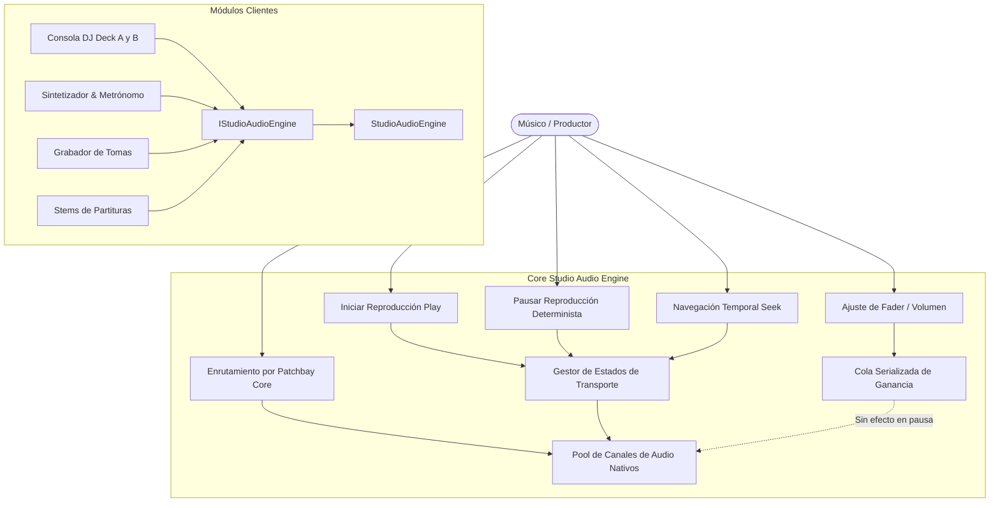
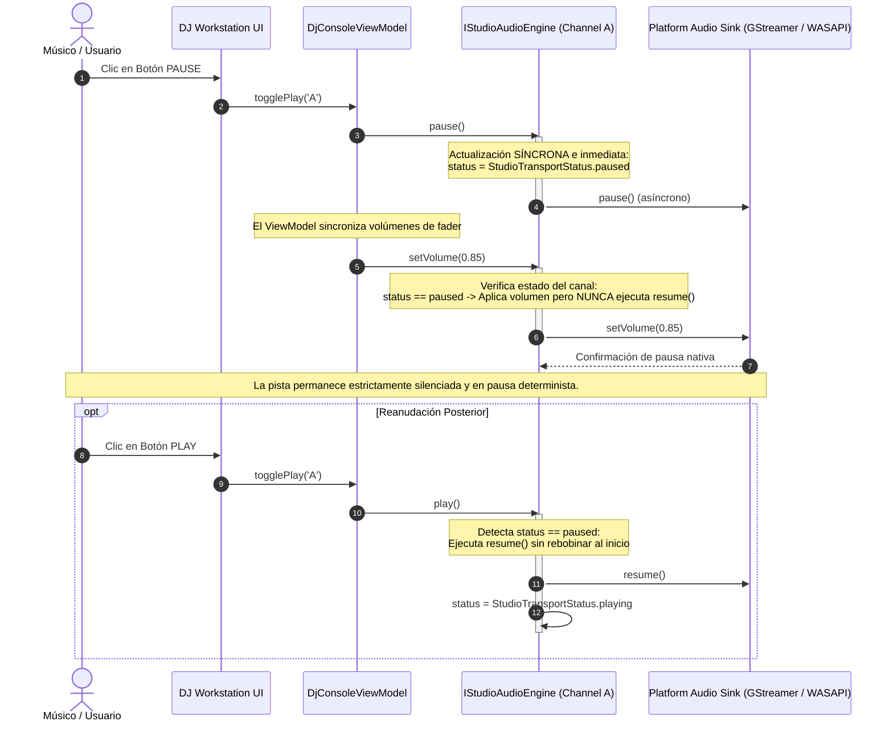

# Caso de Uso 99: Motor Canónico de Audio Core (Studio Audio Engine) y Transporte Unificado

## Metadatos
- **ID:** `UC-99`
- **Fase:** Fase 1 / Infraestructura Core
- **Estado:** Aprobado
- **Fecha:** 2026-11-16
- **Autor:** Antigravity AI & Tunner Architecture Team

---

## 1. Descripción
Este caso de uso formaliza la unificación completa y sin concesiones de la emisión de audio en Tunner Studio mediante la creación de un motor central de transporte en `lib/core/audio/`. Reemplaza las instancias dispersas y no sincronizadas de reproductores de audio en las diferentes suites (Consola DJ, Metrónomo/Sintetizador, Grabador de Práctica y Stems de Biblioteca) por un subsistema canónico de grado profesional con gestión determinista de estados de transporte (`stopped`, `playing`, `paused`, `seeking`), colas de volumen asíncronas no bloqueantes e inmunidad total a despausados espurios causados por eventos de volumen concurrentes.

---

## 2. Diagrama de Caso de Uso

---

## 3. Diagrama de Secuencia: Ciclo de Pausa y Prevención de Despausado Involuntario

---

## 4. Precondiciones y Postcondiciones

### 4.1 Precondiciones
1. El canal de audio solicitado (`dj_deck_a`, `dj_deck_b`, `metronome_click`, etc.) ha sido instanciado o solicitado a través del motor `IStudioAudioEngine`.
2. El recurso de audio (archivo WAV en disco, buffer de memoria o síntesis PCM) ha sido cargado en el canal.

### 4.2 Postcondiciones
1. Al invocar `pause()`, el canal transiciona de forma inmediata y síncrona a `StudioTransportStatus.paused`.
2. Las llamadas concurrentes a `setVolume()` o `setPlaybackRate()` preservan rigurosamente el estado de pausa y jamás reanudan el audio de fondo.
3. Al invocar `play()` sobre un canal pausado, el motor ejecuta `resume()`, continuando desde el milisegundo exacto donde se detuvo sin reiniciar desde el milisegundo cero.
4. En caso de invocarse `stop()`, el canal regresa a la posición temporal 0 y su estado pasa a `StudioTransportStatus.stopped`.

---

## 5. Requerimientos Funcionales y No Funcionales

- **REQ-01 (Transición Síncrona de Estado):** El cambio de estado a `paused` en la capa de dominio debe ser síncrono para que ningún hilo o microtask de UI interprete que la pista sigue activa.
- **REQ-02 (Inmunidad a Despausado por Volumen):** La capa de infraestructura debe desacoplar el ajuste de ganancia de la reactivación del stream nativo.
- **REQ-03 (Desacoplamiento Absoluto - Clean Architecture):** Todo el dominio interactúa únicamente con interfaces en `lib/core/audio/domain/` sin dependencias de plugins externos ni de Flutter UI.
- **REQ-04 (Cobertura Integral sin Excepciones):** Todos los componentes emisores de audio (Consola DJ, Sintetizador/Metrónomo, Grabador y Stems) deben utilizar el motor canónico central.
- **REQ-05 (Entorno de Pruebas Determinista):** Debe proporcionarse `MemoryStudioAudioEngine` para validaciones unitarias y de integración en CI sin requerir servidores de sonido del sistema operativo.
