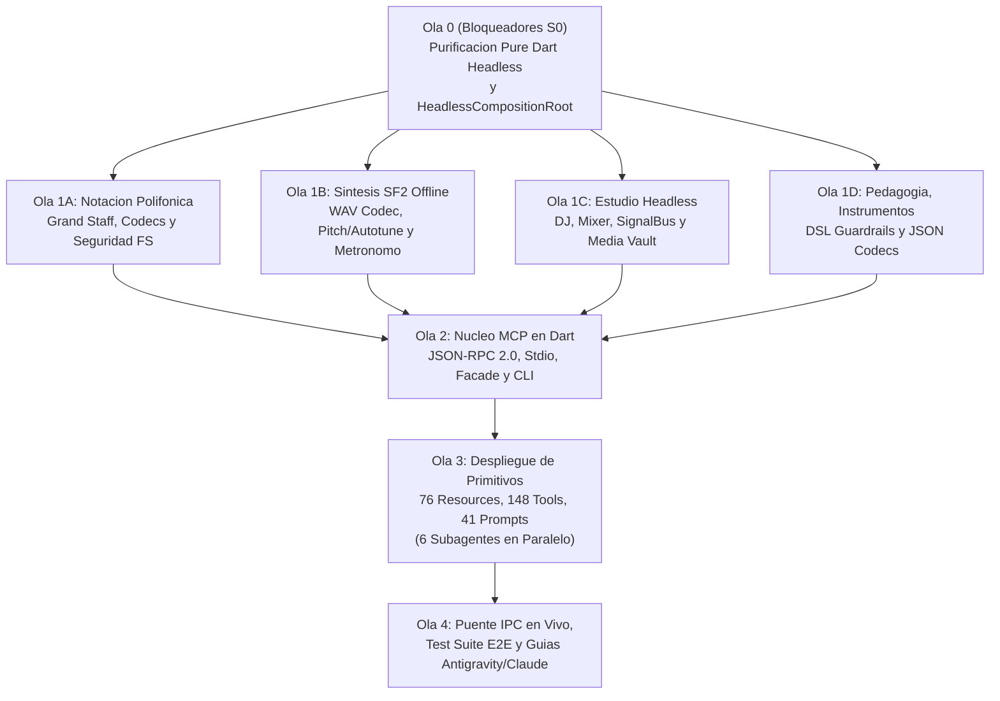

# Implementation Plan: Tunner Model Context Protocol (MCP) Server & Pre-MCP Headless Hardening

Este documento define la hoja de ruta técnica forense, estricta y ejecutable para corregir las brechas detectadas en todo el ecosistema **Tunner** (40 módulos, 449 archivos `.dart` auditados) y desplegar el servidor nativo **Tunner MCP Server** (`bin/tunner_mcp_server.dart`) en Dart puro, permitiendo que cualquier agente de Inteligencia Artificial (Antigravity, Claude Desktop, Cursor) orqueste profesionalmente el 100% de las herramientas musicales de la plataforma.

---

## Metadatos del Plan

- **ID del Plan:** `PLAN-FASE5-MCP-2026-001`
- **Título de la Implementación:** Remediación Headless Pure Dart y Servidor Nativo MCP de Orquestación Musical Total
- **Fase del Proyecto:** Fase 5 (Épica 13 — Integración IA Local y Ecosistema MCP)
- **Estado:** Completado (Olas 0 a 4 Implementadas y Certificadas en AOT)
- **ADR Relacionado:** [ADR-0178](../04_adrs/0178_dart_native_mcp_server_and_headless_engine.md)
- **Documento Arquitectónico Base:** [DOC-ARCH-2026-186](../01_architecture/186_tunner_mcp_server_architecture.md)
- **Caso de Uso Base:** [UC-186](../02_use_cases/186_uc_tunner_mcp_server_orchestration.md)
- **Base Forense:** 17 reportes individuales por módulo en [`docs/05_audits/mcp_feature_reports/`](../05_audits/mcp_feature_reports/)

---

## 1. Alcance, Base Forense y Objetivos de la Implementación

### 1.1 Resumen Cuantitativo de la Auditoría Previa
Seis subagentes auditores especializados inspeccionaron archivo por archivo la totalidad del código fuente de Tunner y sus casos de uso (`UC-01` a `UC-186`):

| Dominio Auditado | Reportes Generados | Archivos `.dart` | Resources (`tunner://`) | Tools (`tunner_*`) | Prompts Guiados |
| :--- | :--- | :---: | :---: | :---: | :---: |
| Core Audio, Channels, DSL, Terminal & Infra | `01`, `02`, `03` | 140 | 15 | 32 | 7 |
| Sheet Music, Score Editor, Importers & Project | `04`, `05`, `06` | 40 | 13 | 31 | 7 |
| Synth, Drone, Tuner, Acoustic Lab, Autotune & Metronome | `07`, `08`, `09` | 67 | 11 | 18 | 6 |
| DJ Console, Mixer, Modular Rack, Media Vault & Recorder | `10`, `11`, `12` | 93 | 11 | 30 | 7 |
| Chord Analyzer, Harmonic Tutor & Pedagogy Suite | `13`, `14`, `15` | 55 | 15 | 22 | 8 |
| Instruments, Persistence, Workspaces & App Shell | `16`, `17` | 54 | 11 | 15 | 6 |
| **TOTAL CONSOLIDADO** | **17 Reportes** | **449** | **76** | **148** | **41** |

### 1.2 Objetivo Primario
1. Eliminar el 100% de los bloqueadores S0 que impiden compilar y ejecutar los motores de dominio/infraestructura de Tunner en un proceso CLI Pure Dart (`dart run` / `dart compile exe`) sin dependencia del motor gráfico de Flutter ni plugins de plataforma.
2. Completar las brechas funcionales S1/S2 detectadas en notación polifónica (Grand Staff / múltiples voces para piano en 3/4), renderizado offline SF2/WAV, análisis acústico offline, seguridad del intérprete DSL y serialización JSON canónica.
3. Implementar el servidor nativo **Tunner MCP Server** sobre `stdio` (JSON-RPC 2.0) exponiendo los **76 Resources**, **148 Tools** y **41 Prompts** junto con el puente IPC opcional hacia la interfaz OLED Desktop.

### 1.3 Límites del Alcance (Scope Boundaries)
- **Incluido (In-Scope):**
  - Purificación Pure Dart Headless de la infraestructura compartida y extracción de `HeadlessCompositionRoot`.
  - Remediación de los defectos funcionales y de serialización identificados en los 17 reportes.
  - Implementación completa de `lib/mcp/` y `bin/tunner_mcp_server.dart`.
  - Puente IPC local (`TunnerIpcBridge`) con 7+ eventos de sincronización en vivo con Tunner Desktop.
  - Pruebas unitarias, de contrato JSON-RPC y pruebas acústicas End-to-End.
  - Manifiestos y guías de conexión para Antigravity IDE y Claude Desktop.
- **Excluido (Out-of-Scope):**
  - Microservicios remotos, servidores HTTP en la nube o wrappers en Python (prohibidos por `AGENTS.md`).
  - Rediseño visual de la interfaz OLED existente (solo recibirá eventos de refresco vía IPC opcional).

---

## 2. Análisis de Dependencias, Seguridad y Riesgos Tecnológicos

- **SDK Objetivo:** Pure Dart `^3.11.x` para `bin/tunner_mcp_server.dart` (compilable AOT con `dart compile exe`). Flutter SDK estable únicamente para la app gráfica y su cliente IPC.
- **Protocolo y Transporte:** JSON-RPC 2.0 sobre `stdin`/`stdout` asíncrono (`dart:io`, `dart:convert`). Cero busy-waiting.
- **Aislamiento Estricto de `stdout`:** Todo log interno debe migrar del singleton `StudioDebugLogger` (`debugPrint` de Flutter) a `IStudioLogger` con implementación `StudioStderrLogger` (`stderr.writeln`). Un solo `print()` en `stdout` rompe el cliente MCP.
- **Seguridad para Agentes IA:**
  - Validación obligatoria de fronteras de workspace contra Path Traversal en `LocalProjectStorageRepository` y `FsWorkspaceCommandHandler`.
  - Presupuesto de ejecución (`maxStatements` y `maxLoopDepth`) en `TunnerDslInterpreter` para prevenir DoS por bucles anidados generados por IA.
  - Offloading en `Isolate.run` para convolución IR ($O(N \cdot M)$), codificación ZLib `.tunner` y renderizado WAV multipista.

---

## 3. Plan Maestro de Ejecución por Olas (Multi-Agent Roadmap)

---

### Ola 0: Purificación Pure Dart Headless y `HeadlessCompositionRoot` (Bloqueadores S0)

**Objetivo:** Lograr que el 100% del dominio y los servicios de negocio compilen y pasen pruebas con `dart test` sin importar `package:flutter/` ni `dart:ui` ni `path_provider`.

1. **Logging Seguro para `stdio` (Reportes 01, 03, 05):**
   - [ ] Inyectar `IStudioLogger` (fallback `NoOpStudioLogger`) en `UniversalScoreImporterService` y en todos los servicios de `lib/core/audio/` y `lib/core/file_system/` que hoy llaman directamente a `StudioDebugLogger`.
   - [ ] Implementar `StudioStderrLogger` (`stderr.writeln`) en `lib/core/logging/infrastructure/studio_stderr_logger.dart`.
2. **Descontaminación de `package:flutter/` en Dominio e Infraestructura Core (Reportes 01, 02, 03, 04, 12, 17):**
   - [ ] `lib/features/persistence/domain/app_user_settings_entity.dart`: Reemplazar import de `tunner_theme.dart` (`flutter/material.dart`) por un enum/value object puro `ThemePaletteId` o `StudioThemeMode`.
   - [ ] `lib/core/audio/infrastructure/native_dsp_ffi_bridge_native.dart`: Eliminar import innecesario de `kIsWeb` (`flutter/foundation.dart`) en target `dart.library.ffi`.
   - [ ] Migrar `StudioAudioDeviceMatrixService`, `StudioMasterClockService`, `StudioWorkspaceFileSystemService` y `StudioThemeCatalogService` de `ChangeNotifier` a `StudioPureNotifierMixin` (`lib/core/domain/i_studio_listenable.dart`).
   - [ ] Reemplazar imports de `flutter/foundation.dart` por `dart:typed_data` o `void Function()` en `studio_master_capture_service.dart`, `ScoreEditorController` y `PracticeRecorderController`.
   - [ ] Corregir DIP en `StudioOsAudioKernelBridge`, `TunnerOsKernel`, `AudioDspCommandHandler` y `FsWorkspaceCommandHandler` para tipar contra `IStudioAudioDeviceMatrixService` e `IStudioMasterClockService`.
   - [ ] Desactivar timers visuales (`Timer.periodic(33ms)` en `StudioAudioDeviceMatrixService` y `Timer(200ms)` en `StudioPatchbayRoutingService`) cuando operen en modo `headless: true`.
3. **Desacoplamiento de `path_provider` y Plugins Hardware (Reportes 03, 10, 17):**
   - [ ] Extraer `AtomicJsonFilePersistenceService` Pure Dart (`dart:io` + ruta raíz inyectada) desde `JsonLocalPersistenceService`.
   - [ ] Inyectar proveedor de directorio raíz por DI en `LocalDiskStudioFileSystemRepository`, `StudioAudioHardwarePersistenceService`, `DjConsoleBlueprintStorageService` y `DjKeymapPersistenceService`.
   - [ ] Aislar `TunerProjectTerminalAdapter` de los 3 adaptadores Pure Dart en `terminal_feature_adapters.dart`.
   - [ ] Crear `lib/app/headless_composition_root.dart` (`HeadlessCompositionRoot`) con `PosixFileGateway` y gateways in-memory/`NoOp` (`MemoryDjDeckAudioPlayer`, `NoOpAudioPlaybackService`, `NoOpPracticeRecorderService`), y componerlo desde `StudioCompositionRoot`.

---

### Ola 1: Remediación Funcional, Acústica y Serialización (Brechas S1/S2)

Ejecutable por **4 subagentes en paralelo** sobre las ramas limpias de la Ola 0:

#### Ola 1A: Notación Polifónica, Codecs y Seguridad de Proyecto (Reportes 04, 05, 06)
- [ ] **Polifonía Real y Grand Staff:** Añadir campos `voice` (`int`, default `1`) y `staff` (`int`, default `1`, ej. mano derecha = 1, mano izquierda = 2) a `HierarchicalNote` y soporte multi-pentagrama en `HierarchicalScore`. Ajustar `_splitOverlappingNotes()` en `ScoreEditorOperations` para que solo recorte solapamientos dentro de la misma combinación `(staff, voice)`, habilitando composición real de piano en 3/4 (melodía + acompañamiento simultáneo).
- [ ] **Corrección de Exportadores y Parsers:**
  - `CanonicalPdfExporter`: Posicionar notas por `startTick` (apilando acordes verticalmente), renderizar armaduras (`keySignatureFifths`) y puntillos.
  - `CanonicalMusicXmlExporter` y `CanonicalAbcExporter`: Preservar `keySignatureFifths`, `isTied`, `voice` y `staff`.
  - `CanonicalMidiExporter`: Soportar SMF Format 1 multipista y Program Change dinámico según instrumento (eliminar programa fijo 73).
  - `MusicXmlScoreParser`: Leer todas las partes (`parts`), no solo `parts.first`.
  - `VectorOmrEngine`: Soportar claves múltiples (Sol/Fa) y agrupación de acordes simultáneos.
- [ ] **Contenedor `.tunner` y Seguridad:** Añadir campo tipado `List<SongPackage>` en `TunnerProjectPackage`; validar fronteras de workspace contra Path Traversal y añadir listado de proyectos en `LocalProjectStorageRepository`; preservar `stemScores` y armonía modal real en `SongDecomposerService`.

#### Ola 1B: Síntesis SF2 Offline, Análisis Acústico y Metrónomo (Reportes 07, 08, 09)
- [ ] **Decodificador WAV Canónico Compartido:** Unificar `OfflineWavDecoder` (PCM 16/24-bit y IEEE 32-bit float, mono/estéreo, preservando `sampleRate` y `channels`) eliminando las limitaciones dispares de `PcmWavDecoder`, `WavPcmCodec` y `VocalAutoTuneProcessor`.
- [ ] **Renderizado Offline SF2 Multipista:** Conectar `PolyphonicVoicePool` y `StemAudioSynthesizer` a `SoundFontSynthesizerService` para renderizar `HierarchicalScore` completo (multi-nota, multi-voz, respetando `includeMelodyTrack`, `includeAccompanimentTrack` y `a4Ref` configurable).
- [ ] **Corrección de Dron:** Aplicar `config.volume` en `HarmonicDroneSynthesizer.generateDroneWavBuffer`.
- [ ] **Análisis de Pitch y AutoTune Autónomo:**
  - Extraer `OfflinePitchContourAnalyzer` desde el pipeline de ventana deslizante de `pitch_detector_service.dart` para analizar archivos WAV sin micrófono.
  - Permitir auto-detección de `fundamentalHz` desde WAV en `HarmonicSeriesAnalyzer`.
  - Hacer autónomo `VocalAutoTuneProcessor.processWavBytes` (extracción automática de `TimedPitchSample` + crossfade entre segmentos TD-PSOLA).
- [ ] **Metrónomo Offline:** Implementar `OfflineMetronomeTrackGenerator` para renderizar pistas WAV de click-track con compases simples/compuestos y `countInBars`.

#### Ola 1C: Estudio Headless — DJ, Mixer, Rack Modular y Media Vault (Reportes 10, 11, 12)
- [ ] **Extracción de Controladores Pure Dart:** Extraer `DjConsoleHeadlessController`, `ModularRackHeadlessController` (incluyendo `StandardRackNode`) y `MediaVaultHeadlessController` desde sus respectivos ViewModels (`ChangeNotifier`), dejando los ViewModels como adaptadores finos de presentación.
- [ ] **Mixer y Automix Offline:** Implementar `MixerAudioRenderer` y `copyWithTrackPan` en `mixer`; implementar renderizado offline de transiciones Automix WAV y análisis multi-ventana (evitando sesgo de primer segundo) en `DjHarmonicCamelotEngine`.
- [ ] **SignalBus y Grabadora Offline:** Añadir detección de ciclos DAG multi-salto, `updateConnection()` (ganancia/mute por cable) y serialización JSON en `SignalBus`; unificar `RackModuleType` con DJ/Mixer; crear `OfflinePracticeTakeAnalyzer` para construir `PracticeTakeEntity` desde archivos WAV en disco.

#### Ola 1D: Pedagogía Headless, Instrumentos, Seguridad DSL y JSON Codecs (Reportes 02, 13, 14, 15, 16)
- [ ] **Orquestación Pedagógica Headless:** Extraer `BlindEarHeadlessSessionController` (con filtro de estabilidad de 3 muestras y prioridad a ítems `isDue` de Ebbinghaus) y `PedagogicalSessionAggregator` desde `TunerViewModel`/`BlindEarTrainerModal`. Desacoplar lógica de métricas de `HarmonicTutorViewModel`.
- [ ] **Rendimiento y Cobertura de `chord_analyzer`:** Eliminar doble cómputo DFT entre `PolyphonicMultiToneDetector` y `PolyphonicChordRecognizer`, ampliar rango por defecto a `A0..C8` (`27.5 Hz - 4186 Hz`) y añadir modo `stateless` para invocaciones MCP atómicas. Resolver colisión nominal de `PerformanceGrade` y actualizar `totalAccumulatedAccuracy` en `GuidedLessonEvaluator`.
- [ ] **Instrumentos y Transposición:** Corregir bug de octava en `InstrumentTranspositionService._noteNameToMidi` (`Cb4`, `E#`, `B#` y salida anglosajona); crear mapper bidireccional unificado entre `UniversalInstrumentDefinition` (40) e `InstrumentProfileEntity` (42); parametrizar `sampleRate` y `resonanceFactor` en `ProceduralInstrumentSynthesizer`.
- [ ] **Guardrails DSL y Concurrencia:** Añadir límites globales `maxStatements` y `maxLoopDepth` en `TunnerDslInterpreter`; envolver `IrConvolutionProcessor.convolve()` y `TunnerPackageCodecService` en `Isolate.run`.
- [ ] **Serialización JSON Canónica:** Implementar `toJson()`/`fromJson()` en todas las entidades de dominio faltantes (Audio/Channels, DSL Diagnostics, Docking/FS, Drone/Tuner/Metronome, Instrumentos, Pedagogía y `SpectralComparisonResult`, más `structuredData` en `TunnerOsCommandResult` y preservación de `evaluations` en `PracticeReportEntity.toMap()`).

---

### Ola 2: Núcleo del Servidor MCP Nativo en Dart (`lib/mcp/` y `bin/`)

- **Archivos a Crear:**
  - `lib/mcp/protocol/mcp_json_rpc_message.dart` (Request, Response, Error, Notification inmutables).
  - `lib/mcp/protocol/mcp_error_codes.dart` (Códigos JSON-RPC estándar + códigos de dominio acústico `-32000` a `-32099`).
  - `lib/mcp/protocol/mcp_stdio_transport.dart` (Stream reactivo sobre `stdin`/`stdout`, cero busy-waiting).
  - `lib/mcp/protocol/mcp_dispatcher.dart` (Negociación `initialize`, `resources/list`, `resources/read`, `tools/list`, `tools/call`, `prompts/list`, `prompts/get`).
  - `lib/mcp/facade/tunner_headless_facade.dart` (Fachada unificada inyectada desde `HeadlessCompositionRoot`).
  - `bin/tunner_mcp_server.dart` (CLI ejecutable con flags `--workspace`, `--ipc-port`, `--headless-only`).

---

### Ola 3: Implementación Paralela de los 76 Resources, 148 Tools y 41 Prompts

Cada subagente implementa exactamente los primitivos especificados en sus reportes forenses:

| Subagente Implementador | Módulos MCP (`lib/mcp/modules/`) | Primitivos Exactos | Reportes Fuente |
| :--- | :--- | :--- | :--- |
| **Dev MCP-1 (Core & DSL)** | `core_audio_mcp_module.dart`, `dsl_terminal_mcp_module.dart`, `workspace_fs_mcp_module.dart` | 15 Resources, 32 Tools, 7 Prompts | `01`, `02`, `03` |
| **Dev MCP-2 (Notation & IO)** | `notation_editor_mcp_module.dart`, `importers_omr_mcp_module.dart`, `project_library_mcp_module.dart` | 13 Resources, 31 Tools, 7 Prompts | `04`, `05`, `06` |
| **Dev MCP-3 (Synth & DSP)** | `synth_drone_mcp_module.dart`, `tuner_acoustic_mcp_module.dart`, `autotune_metronome_mcp_module.dart` | 11 Resources, 18 Tools, 6 Prompts | `07`, `08`, `09` |
| **Dev MCP-4 (Studio & DJ)** | `dj_mixer_mcp_module.dart`, `modular_rack_mcp_module.dart`, `vault_recorder_mcp_module.dart` | 11 Resources, 30 Tools, 7 Prompts | `10`, `11`, `12` |
| **Dev MCP-5 (Pedagogy)** | `harmony_chords_mcp_module.dart`, `ear_training_mcp_module.dart`, `pedagogy_eval_mcp_module.dart` | 15 Resources, 22 Tools, 8 Prompts | `13`, `14`, `15` |
| **Dev MCP-6 (Platform)** | `instruments_mcp_module.dart`, `persistence_shell_mcp_module.dart` | 11 Resources, 15 Tools, 6 Prompts | `16`, `17` |

---

### Ola 4: Puente IPC en Vivo, Suite de Pruebas E2E y Guías de Conexión IA

1. **Puente IPC Local (`lib/mcp/ipc/tunner_ipc_bridge.dart`):**
   - [ ] Transporte sobre Unix Domain Socket / TCP `127.0.0.1` loopback con los 7 eventos UI definidos en el Reporte 03 (`ui.theme.changed`, `ui.theme.imported`, `ui.docking.layout_changed`, `ui.navigation.tab_changed`, `ui.command_prompt.notify`, `workspace.fs.changed`, `workspace.file.open_requested`) + eventos musicales (`ui.score.updated`, `ui.mixer.updated`, `ui.dj.updated`).
   - [ ] Degradación silenciosa a modo headless autónomo cuando la GUI no esté abierta.
2. **Suite de Pruebas Integrales (`test/mcp/`):**
   - [ ] Pruebas de protocolo JSON-RPC 2.0 (mensajes válidos, malformados, concurrentes, errores `-32600` a `-32099`).
   - [ ] Prueba de pureza CLI: verificación automática de que `bin/tunner_mcp_server.dart` compila con `dart compile exe` sin Flutter SDK.
   - [ ] Pruebas E2E musicales completas (ej. flujo de composición de piano en 3/4 con melodía en `staff=1, voice=1` y acompañamiento en `staff=2, voice=2`, exportación a MusicXML + MIDI Format 1 + PDF + renderizado SF2 a WAV verificando FFT del audio resultante).
3. **Documentación y Manifiestos de Usuario (`docs/06_guides/mcp_antigravity_and_claude_setup.md`):**
   - [ ] Snippets listos para copiar y pegar en la configuración MCP de **Antigravity** y **Claude Desktop** apuntando al binario compilado AOT (`tunner_mcp_server`).

---

## 4. Estrategia de Rollback (Plan de Contingencia)

- **Punto de Restauración Git:** Rama `qa` sincronizada con `origin/qa` (`4679447`, PR #207 consolidado).
- **Ejecución por Olas Independientes:** Cada Ola se entregará en Pull Requests atómicos hacia `qa` con auditoría QA previa al merge.
- **Aislamiento del Servidor MCP:** Todo el código nuevo del protocolo vive en `lib/mcp/` y `bin/tunner_mcp_server.dart`. Si se requiere desactivar la integración IA, basta con desvincular el binario en el cliente MCP sin impacto en la aplicación Flutter Desktop/Mobile.

---

## 5. Criterios de Aceptación (Definition of Done)

1. [ ] `dart compile exe bin/tunner_mcp_server.dart` compila limpiamente en Pure Dart sin dependencias de `package:flutter/` ni `dart:ui`.
2. [ ] Cero líneas de log o `print` en `stdout`; el 100% de la telemetría se emite por `stderr`.
3. [ ] Los 76 Resources, 148 Tools y 41 Prompts responden conforme al estándar MCP con validación estricta de esquemas JSON.
4. [ ] Todas las brechas S0 y S1 de los 17 reportes forenses cerradas y verificadas con pruebas unitarias.
5. [ ] `flutter analyze` y `dart analyze` con cero advertencias y cobertura $\ge 90\%$ en `test/mcp/`.
6. [ ] Tiempo de arranque en frío $\le 120\text{ ms}$, memoria en reposo $\le 65\text{ MB}$ y cero bucles busy-waiting.
7. [ ] Aprobación explícita del creador del proyecto antes de mergear a `main`.

---

## 6. Índice de los 17 Reportes Forenses Individuales

1. [01_core_audio_and_channels.md](../05_audits/mcp_feature_reports/01_core_audio_and_channels.md)
2. [02_core_dsl_and_terminal_kernel.md](../05_audits/mcp_feature_reports/02_core_dsl_and_terminal_kernel.md)
3. [03_core_packaging_fs_and_infrastructure.md](../05_audits/mcp_feature_reports/03_core_packaging_fs_and_infrastructure.md)
4. [04_sheet_music_and_score_editor.md](../05_audits/mcp_feature_reports/04_sheet_music_and_score_editor.md)
5. [05_universal_importer_and_transcription.md](../05_audits/mcp_feature_reports/05_universal_importer_and_transcription.md)
6. [06_project_format_and_song_library.md](../05_audits/mcp_feature_reports/06_project_format_and_song_library.md)
7. [07_audio_synthesizer_and_drone.md](../05_audits/mcp_feature_reports/07_audio_synthesizer_and_drone.md)
8. [08_tuner_and_acoustic_lab.md](../05_audits/mcp_feature_reports/08_tuner_and_acoustic_lab.md)
9. [09_vocal_autotune_and_metronome.md](../05_audits/mcp_feature_reports/09_vocal_autotune_and_metronome.md)
10. [10_dj_console_and_mixer.md](../05_audits/mcp_feature_reports/10_dj_console_and_mixer.md)
11. [11_modular_rack_and_signal_bus.md](../05_audits/mcp_feature_reports/11_modular_rack_and_signal_bus.md)
12. [12_media_vault_and_practice_recorder.md](../05_audits/mcp_feature_reports/12_media_vault_and_practice_recorder.md)
13. [13_chord_analyzer_and_harmonic_tutor.md](../05_audits/mcp_feature_reports/13_chord_analyzer_and_harmonic_tutor.md)
14. [14_ear_training_exercises_and_guided_lessons.md](../05_audits/mcp_feature_reports/14_ear_training_exercises_and_guided_lessons.md)
15. [15_pedagogy_profiles_reports_and_evaluator.md](../05_audits/mcp_feature_reports/15_pedagogy_profiles_reports_and_evaluator.md)
16. [16_instrument_catalog_and_physics.md](../05_audits/mcp_feature_reports/16_instrument_catalog_and_physics.md)
17. [17_persistence_workspaces_and_app_shell.md](../05_audits/mcp_feature_reports/17_persistence_workspaces_and_app_shell.md)
