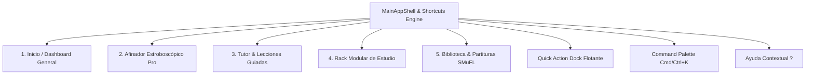

# Manual de Usuario Oficial: Tunner Suite 1.0 (Conservatory Edition)

---

## 1. Filosofía y Arquitectura Acústica

**Tunner** es una suite acústica y pedagógica integral diseñada para músicos de conservatorio, productores y estudiantes. Su arquitectura se fundamenta en principios no negociables:

- **100% Offline-First:** Toda la computación DSP, análisis armónico, síntesis de audio y renderizado de partituras se ejecuta localmente en el dispositivo sin enviar datos a la nube ni requerir conexión a internet.
- **Latencia Sub-10ms:** Los motores de procesamiento de señal procesan buffers PCM nativos con tiempos de respuesta imperceptibles, garantizando sincronía audiovisual total.
- **Reloj Determinista en Isolate:** El metrónomo y secuenciador rítmico corren en hilos aislados del sistema operativo, eliminando fluctuaciones (jitter < 1 ms).
- **Tríada de Hyper-Sinergia:** Todas las herramientas se comunican de forma atómica a través del `SignalBus` maestro, compartiendo señales de audio, reloj y afinación en tiempo real.

---

## 2. Entorno de Trabajo y Navegación

La interfaz de Tunner se organiza en cinco espacios de trabajo principales accesibles desde la barra inferior o mediante las teclas numéricas `1` a `5`:

### 2.1 Pestaña 1: Inicio y Dashboard General (`1`)
Panel de bienvenida que centraliza el estado general de la sesión, la afinación de concierto actual (A4 = 440 Hz por defecto), selector rápido de instrumentos y acceso a proyectos recientes.

### 2.2 Pestaña 2: Afinador Estroboscópico Pro (`2` o `A`)
Afinador visual de grado estroboscópico basado en el algoritmo **McLeod Pitch Method (MPM)** con resolución de $\pm 0.1\text{ cents}$. Permite calibrar el tono de referencia entre 415 Hz (Barroco) y 466 Hz, y seleccionar temperamentos históricos (Pitagórico, Justo, Mesotónico, Werkmeister III).

### 2.3 Pestaña 3: Tutor y Lecciones Guiadas (`3` o `L`)
Módulo pedagógico con ejercicios interactivos y evaluación milimétrica de ritmo, detectando si el músico toca adelantado (*rushing*) o retrasado (*dragging*) respecto al pulso.

### 2.4 Pestaña 4: Rack Modular de Estudio (`4`)
Consola multitarea con chasis tipo rack donde se pueden montar, ordenar y conectar en caliente múltiples procesadores: Afinador, Metrónomo, Dron Armónico, Espectrograma FFT, Autotune Vocal, Grabador y Analizador Polifónico.

### 2.5 Pestaña 5: Canciones y Partituras SMuFL (`5` o `S`)
Lienzo vectorial estándar con soporte de tipografía musical SMuFL, importador universal MusicXML/MIDI, transcriptor en vivo micrófono-a-partitura y reproductor interactivo con playhead dinámico.

---

## 3. Guía de Módulos de Hyper-Sinergia

### 3.1 Visualizador Polifónico y Armónicos H1-H8 (`Shift + C`)
Diseñado para instrumentos armónicos (piano, guitarra, arreglos vocales):
- **Detección Concurrente:** Descompone acordes complejos identificando fundamental, tercera, quinta, séptima y extensiones (9ª, 11ª, 13ª).
- **Espectro de Armónicos:** Grafica en vivo la energía de los sobretonos teóricos $H_1 \dots H_8$ según la relación:
  $$H_n = n \cdot f_0$$
- **Evaluación en Cents:** Indica la desviación individual de cada voz respecto a la escala temperada para facilitar afinaciones precisas cuerda por cuerda.

### 3.2 Entrenador Auditivo a Ciegas (`Shift + E`)
Módulo de entrenamiento de oído relativo y absoluto de grado conservatorio:
- **Modo Pantalla Oculta (Blind Mode):** Oculta las pistas visuales para forzar la discriminación auditiva pura.
- **Atajos Ergonómicos 1-4:** Las opciones de intervalo se responden al instante pulsando las teclas `1`, `2`, `3` o `4`.
- **Re-escucha Rápida:** La barra espaciadora (`Espacio`) repite el intervalo base y objetivo inmediatamente.
- **Rachas y Calificación:** Evalúa la maestría de Grado S (conservatorio), Grado A, B y C según el desvío en cents y el tiempo de respuesta en milisegundos.

### 3.3 Quick Action Dock y Command Palette
- **Quick Action Dock:** Barra flotante en la zona inferior con controles rápidos de transporte (Play/Stop, Record, Tap Tempo, Calibrador de Hz y estado de afinación en vivo). Se puede colapsar o expandir según necesidad.
- **Command Palette (`Cmd/Ctrl + K` o `Cmd/Ctrl + F`):** Buscador Spotlight interactivo para acceder a cualquier función, herramienta o instrumento en milisegundos sin tocar el ratón.

---

## 4. Matriz Universal de Atajos de Teclado (Memoria Muscular DAW)

Tunner adopta las convenciones cinemáticas de los estándares de la industria (Ableton Live, Logic Pro, Avid Pro Tools y Adobe Photoshop):

| Tecla / Combinación | Acción Operativa | Estándar de Industria |
|---|---|---|
| `Espacio` | Play / Stop Transporte y Metrónomo | Convención Universal DAW |
| `Enter` / `Return` | Rebobinar playhead al inicio (Compás 1) | Pro Tools / Logic Pro |
| `C` | Conmutar Modo Bucle / Ciclo de Práctica | Logic Pro / Ableton Live |
| `,` (Coma) | Retroceder 1 compás / pulso (*Nudge Back*) | Pro Tools / Logic |
| `.` (Punto) | Avanzar 1 compás / pulso (*Nudge Forward*) | Pro Tools / Logic |
| `R` | Iniciar / Detener Grabación de Toma | Convención Universal |
| `B` o `T` | Tap Tempo interactivo | Ableton Live |
| `]` / `[` | Ajuste fino de tempo ($\pm 1$ BPM) | DAW Transport |
| `Shift + ]` / `Shift + [` | Ajuste grueso de tempo ($\pm 5$ BPM) | DAW Transport |
| `A` | Enfocar Afinador Estroboscópico | Photoshop-Style Single Key |
| `M` | Alternar Metrónomo en Isolate | Photoshop-Style Single Key |
| `S` | Pentagrama Interactivo & Partituras | Photoshop-Style Single Key |
| `L` | Tutor de Lecciones & Rushing/Dragging | Photoshop-Style Single Key |
| `Shift + E` | Entrenador Auditivo a Ciegas | Herramienta de Oído |
| `Shift + C` | Visualizador Polifónico & Armónicos | Herramienta Armónica |
| `Alt + ↑` / `Alt + ↓` | Calibrar Tono de Concierto A4 ($\pm 1$ Hz) | Calibración Acústica |
| `0` (Cero) | Silencio Total / Panic Mute | Estudio de Grabación |
| `Cmd/Ctrl + K` (o `F`) | Abrir Command Palette Spotlight | Navegación Global |
| `Cmd/Ctrl + I` | Selector Universal de Instrumentos (60+) | Catálogo Timbrico |
| `?` (o `Shift + /`) | Abrir Matriz de Atajos de Teclado | Ayuda Global HUD |
| `1` a `5` | Salto directo a Pestañas 1 a 5 | Navegación Rápida |

---

## 5. Ayuda Contextual Inmediata (`?`)

Cada módulo, tarjeta y control de Tunner cuenta con un botón de ayuda contextual circular `?`. Al pulsarlo o enfocar la herramienta, se despliega una ficha técnica con:
1. Descripción funcional del módulo.
2. Fundamento físico y acústico (con fórmulas en notación KaTeX).
3. Consejo pedagógico de conservatorio para la práctica.
4. Lista de atajos de teclado asociados a esa herramienta específica.
