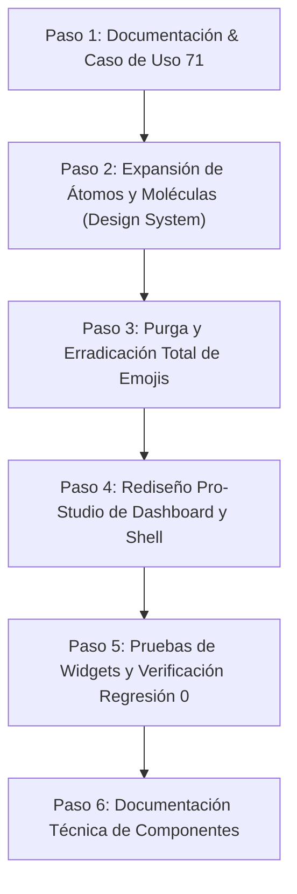

# Plan de Implementación: Refactorización Atómica Radical y Transformación de Interfaz Gráfica Pro-Studio (Estilo Adobe Creative Cloud)

- **ID del Plan:** `PLAN-UI-ADOBE-STUDIO-OVERHAUL-2026-071`
- **Título de la Implementación:** `Refactorización Atómica Integral, Erradicación de Emojis y Arquitectura Visual de Estudio Pro-Workstation`
- **Fase del Proyecto:** `Fase Global - Capa de Presentación, Sistema de Diseño y Workspaces`
- **Estado:** `En Progreso`
- **ADR Relacionado:** [ADR 0065](../04_adrs/0065_atomized_studio_design_system_adobe_spectrum.md)
- **Documento Funcional Base:** [DOC-UI-2026-071](../01_product_vision/doc_adobe_spectrum_atomized_design_system.md) y [Caso de Uso 71](../02_use_cases/71_uc_atomized_studio_design_system_and_professional_workspace_overhaul.md)

---

## 1. Alcance y Objetivos de la Implementación

### 1.1 Objetivo Primario
Transformar radicalmente la interfaz gráfica de **Tunner**, elevándola al estándar de diseño industrial y software profesional de audio/multimedia de **Adobe Creative Cloud (Audition, Premiere Pro, Photoshop)** y DAWs profesionales (Ableton Live, Logic Pro). 
Erradicar por completo los emojis infantiles, elementos amontonados y estilos desordenados, reemplazándolos por una **arquitectura de diseño atómico 100% desacoplada e independiente de la lógica de negocio**, garantizando que ninguna funcionalidad existente se rompa o degrade en latencia.

### 1.2 Límites del Alcance (Scope Boundaries)
- **Incluido (In-Scope):**
  1. **Expansión del Sistema de Diseño Atómico (`lib/core/design_system/`):**
     - Átomos: `StudioIcon` (glifos vectoriales nítidos de estudio), `StudioMetricDisplay` (números tabulares monoespaciados para Hz, cents, BPM, dB), `StudioStatusLed` (indicadores discretos de 4px), `StudioHairline` (bordes técnicos de 1px), `StudioKnob` (perillas rotativas de alta precisión).
     - Moléculas: `StudioPanelHeader` (barra de título pro con icono de herramienta y acciones), `StudioSegmentedControl` (selector de pestañas estilo Adobe), `StudioVuMeter` (medidor acústico de pico y RMS).
     - Organismos: `StudioRackModule` (tarjeta de módulo acoplable de precisión), `StudioWorkbenchShell` (contenedor de estación de trabajo con distribución limpia de paneles).
  2. **Erradicación Quirúrgica de Emojis en todo el Repositorio:**
     - Sustitución sistemática de caracteres emoji en entidades de dominio, presentación y modales por glifos vectoriales profesionales (`StudioIcon`).
  3. **Modernización de Workspaces y Pantallas Principales:**
     - Rediseño sobrio de `HomeDashboardScreen`, `MainAppShell`, y tarjetas de módulos de `ModularStudioRackView`.
  4. **Documentación Técnica Exhaustiva y Pruebas:**
     - Creación de documentación de cada componente atómico según `docs/templates/plantilla_documentacion.md`.
     - Pruebas unitarias y de widgets que garanticen regresión cero.
- **Excluido (Out-of-Scope):**
  - No se modifica la lógica matemática de pitch detection (YIN, McLeod MPM, Autocorrelación) ni los algoritmos DSP en `lib/domain/`.
  - No se alteran los contratos de persistencia ni los ViewModels funcionales.

---

## 2. Análisis de Dependencias y Tecnologías

- **Framework:** Flutter SDK (Material 3 base con tokens de diseño personalizados, evitando componentes Material inflados o inconsistentes).
- **Tipografía y Gráficos:** Iconografía vectorial nativa (`Icons.*`) y micro-renderizado con `CustomPainter` sin assets pesados ni fuentes externas que comprometan el modo offline.
- **Riesgo Tecnológico:** Cero impacto en el bucle principal de audio. Los nuevos átomos son widgets inmutables ligeros con costo mínimo de renderizado (`const` constructors, repintado localizado).

---

## 3. Plan Paso a Paso de Ejecución (Step-by-Step Roadmap)

### Paso 1: Documentación Formal y Caso de Uso 71
- [x] Redacción del Plan de Implementación formal (`docs/05_implementation_plans/plan_atomized_studio_design_system_overhaul.md`).
- [ ] Redacción del Caso de Uso 71 con diagramas Mermaid de Casos de Uso y Secuencia (`docs/02_use_cases/71_uc_atomized_studio_design_system_and_professional_workspace_overhaul.md`).

### Paso 2: Catálogo Atómico y Molecular (`lib/core/design_system/`)
- [ ] Implementar `StudioIcon`: Glifos vectoriales de 16-18px mapeados semánticamente a instrumentos y herramientas de audio.
- [ ] Implementar `StudioMetricDisplay`: Tipografía monoespaciada con cifras tabulares para evitar fluctuaciones visuales a 60 FPS.
- [ ] Implementar `StudioStatusLed`: Micro-indicador de 4-6px para estados de afinación, grabación y clipping.
- [ ] Implementar `StudioHairline`: Separador de 1px ultra-fino para acoplamiento de paneles.
- [ ] Implementar `StudioSegmentedControl`: Selector de pestañas técnico compacto.
- [ ] Implementar `StudioVuMeter`: Medidor de nivel y volumen acústico en decibelios.

### Paso 3: Erradicación Sistemática de Emojis
- [ ] Refactorizar `lib/features/instrument/domain/visual_interface_profile.dart`.
- [ ] Refactorizar `lib/features/modular_rack/domain/rack_module_entity.dart`.
- [ ] Refactorizar `lib/features/instrument/presentation/drum_pads_tactile_widget.dart`.
- [ ] Refactorizar `lib/features/song_library/presentation/song_decomposer_modal.dart`.
- [ ] Refactorizar `lib/features/customization/presentation/theme_editor_dialog.dart`.
- [ ] Refactorizar `lib/features/ear_training/presentation/blind_ear_trainer_modal.dart`.
- [ ] Refactorizar `lib/features/instrument/domain/instrument_profile_entity.dart`.
- [ ] Refactorizar `lib/features/modular_rack/presentation/rack_unit_card.dart`.
- [ ] Refactorizar `lib/features/modular_rack/presentation/multitask_master_console_widget.dart`.
- [ ] Refactorizar `lib/features/navigation/presentation/home_dashboard_screen.dart`.

### Paso 4: Rediseño Pro-Studio de Dashboard y Shell
- [ ] Aplicar jerarquía de 4 superficies mate en `HomeDashboardScreen`.
- [ ] Reemplazar tarjetas infladas por paneles técnicos con bordes hairline de 1px.
- [ ] Unificar headers y barras de herramientas con `StudioToolbar` y `StudioPanelHeader`.

### Paso 5: Suite de Pruebas y Control de Calidad
- [ ] Crear pruebas de widgets unitarias en `test/core/design_system/studio_atoms_test.dart`.
- [ ] Verificar que ninguna prueba existente se rompa.
- [ ] Validación de compilación y ausencia de advertencias.

### Paso 6: Documentación Técnica de Componentes
- [ ] Redactar especificación técnica de la biblioteca de átomos en `docs/01_product_vision/doc_atomic_components_reference.md`.

---

## 4. Estrategia de Rollback (Plan de Contingencia)

- Si algún componente atómico presenta incompatibilidades visuales con pantallas existentes, el sistema de diseño cuenta con `StudioThemeScope` y presets de fallback que preservan los tokens canónicos sin impactar la lógica de negocio.
- Los commits se realizan de forma atómica y modular para permitir reversiones selectivas en caso de requerirse.

---

## 5. Criterios de Aceptación (Definition of Done)

- [ ] Cero emojis en la interfaz gráfica principal, selectores y modales de herramientas.
- [ ] Jerarquía visual coherente con paleta Adobe Spectrum Dark / Darkest.
- [ ] Componentes UI 100% atomizados en `lib/core/design_system/`.
- [ ] Lecturas acústicas numéricas con tipografía tabular y monoespaciada.
- [ ] Suite de pruebas pasando sin regresiones.
- [ ] Documentación técnica completa en `docs/`.
