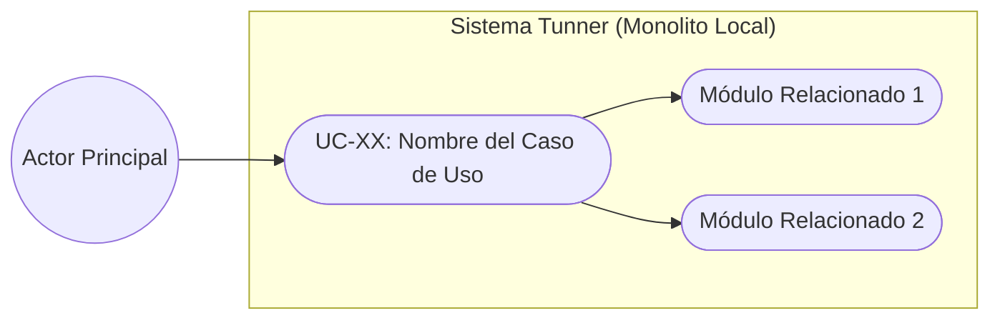
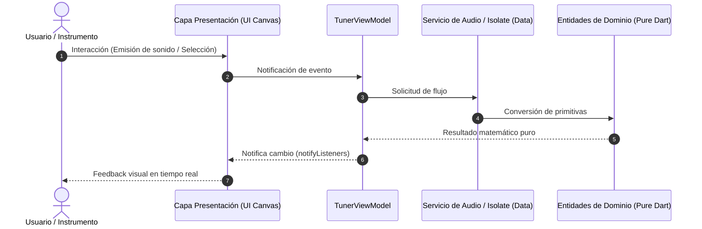

# Template: Use Case Specification (Plantilla Caso de Uso)

Este documento define la estructura obligatoria para cada caso de uso del sistema en **Tunner**, clasificado secuencialmente en `docs/02_use_cases/`.

---

## Metadatos del Caso de Uso

- **ID del Caso de Uso:** `UC-[NUMERO_DOS_DIGITOS]-[IDENTIFICADOR_CORTO]` (Ejemplo: `UC-01-ACOUSTIC-PITCH-DETECTION`)
- **Nombre Canónico:** `[Nombre del caso de uso en infinitivo]`
- **Fase Asociada:** `[Fase 1 | Fase 2 | Fase 3 | Fase 4]`
- **Actor Principal:** `[Estudiante / Músico / Motor de Audio / Sistema]`
- **Actores Secundarios:** `[Hardware Micrófono / Sistema Operativo / Canvas UI]`
- **Estado:** `[Draft | Review | Approved]`

---

## 1. Descripción Breve y Propósito

*Explicación atómica del valor que este caso de uso entrega al usuario y cómo contribuye a su proceso de aprendizaje o precisión acústica.*

---

## 2. Diagrama de Caso de Uso (Mermaid)

---

## 3. Precondiciones y Postcondiciones

### 3.1 Precondiciones
*Qué debe ser verdadero en el sistema antes de que se inicie este caso de uso.*
1. El usuario ha otorgado permisos de micrófono (si aplica).
2. El motor de audio se encuentra en estado inicializado.

### 3.2 Postcondiciones
*Qué estado exacto queda garantizado al finalizar con éxito.*
1. La UI refleja el estado actualizado a 60/120 FPS.
2. Cero memoria residual ni fugas en buffers.

---

## 4. Diagrama de Flujo y Secuencia (Mermaid)

---

## 5. Flujo Principal de Eventos (Happy Path)

1. **Paso 1:** El actor ejecuta la acción inicial.
2. **Paso 2:** El sistema valida las restricciones en la capa de dominio.
3. **Paso 3:** La capa de infraestructura procesa el evento sin bloquear el hilo de interfaz.
4. **Paso 4:** La capa de presentación actualiza el lienzo visual en menos de 10 ms.

---

## 6. Flujos Alternativos y Excepciones

### Flujo Alternativo A1: [Condición de desvío]
- Si ocurre [evento X], el sistema realiza [acción Y].

### Flujo de Excepción E1: [Condición de fallo]
- Si [falla hardware/señal], el sistema captura el error y retorna a un estado seguro sin crashear.

---

## 7. Criterios de Calidad y No Negociables Asociados

- **Latencia:** $\le 10\text{ ms}$.
- **Consumo de CPU:** No bloqueante.
- **Tolerancia:** $\pm 1\text{ cent}$ en afinación.
